# Що отримає меблева фабрика

Показ на справжньому Odoo 19 і модулях пакета «меблі» (`td_mebli_*`) для вигаданої фабрики «Меблева фабрика «Демо»». На екранах — п’ять ролей
(менеджер салону, технолог-конструктор, начальник виробництва, комірник, фінансист) і 24 замовлення на різних етапах: 7 пропозицій, 5 очікують
запуску, 6 у виробництві, 6 виготовлено; 17 виробничих замовлень. Відео (до 4 хв, з підписами-вигодами): `video/scenario.webm`.
Біль у дужках — ідентифікатор із концепції (`concept/features.md`).

## 1. Ціна й маржа відомі ще в пропозиції — менеджер салону (PAIN-02, PAIN-11)
**Біль:** опції шафи чи кухні рахують на калькуляторі, а маржу з’ясовують, коли виріб уже виготовлено.
**Як закрито:** покупець обирає декор, кромку, фурнітуру й називає розміри; менеджер одразу бачить ціну, планову собівартість і маржу (у прикладі — 39%),
а пропозиція з логотипом і реквізитами фабрики готова з тих самих даних.

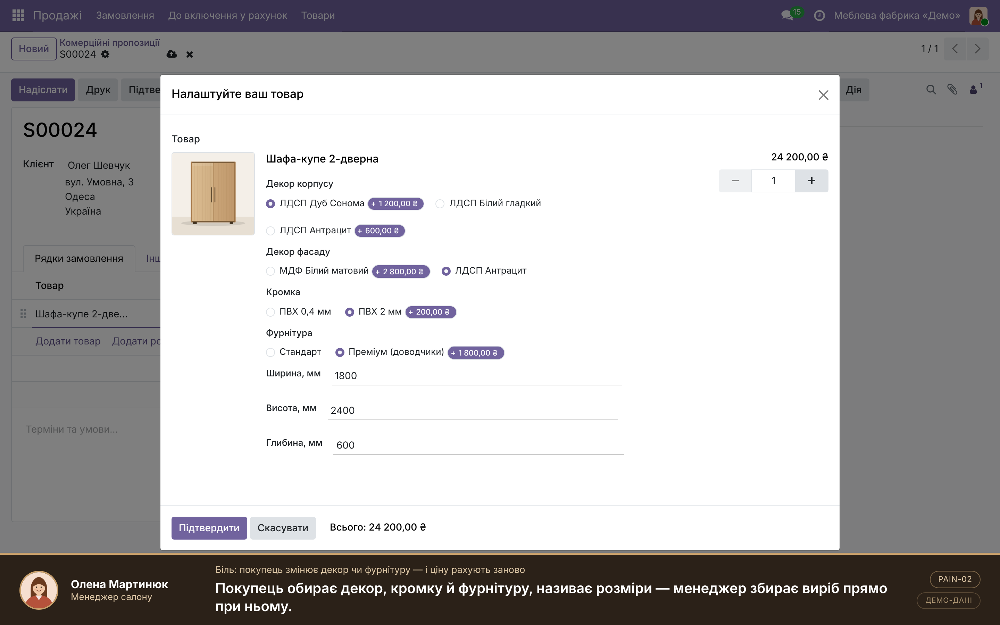
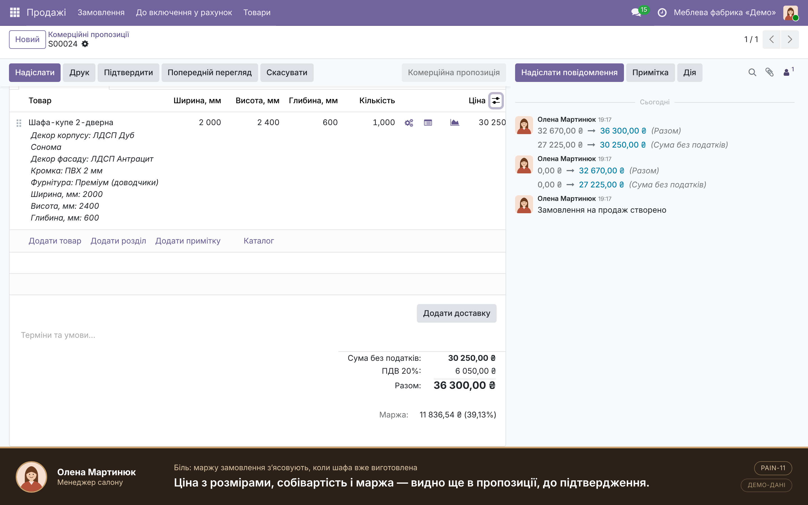
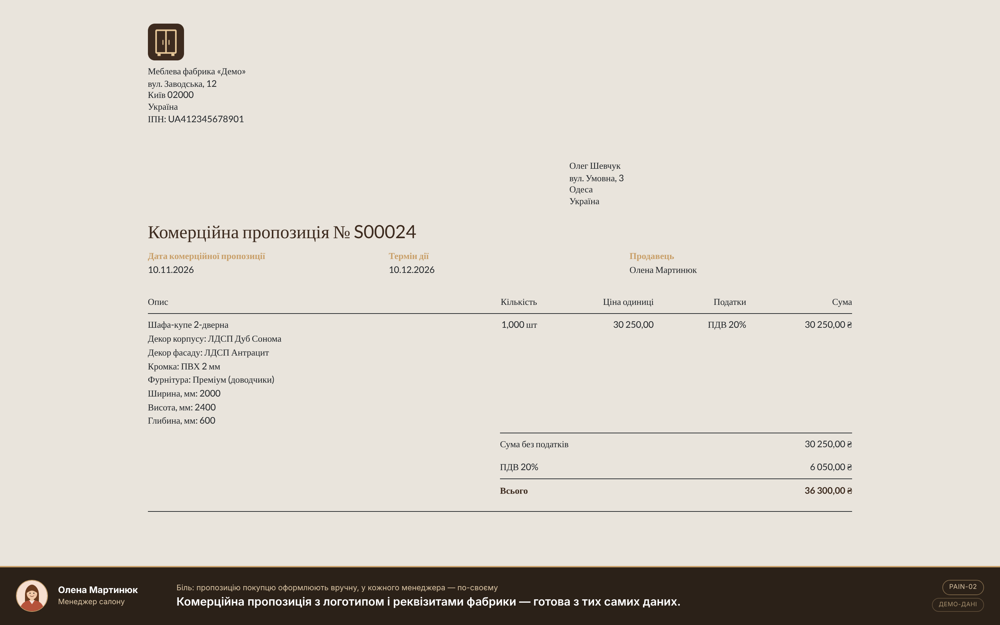

## 2. Специфікація складається сама — менеджер салону, технолог (PAIN-03)
**Біль:** специфікацію вручну переносять між програмами проєктування, розкрою й обліку.
**Як закрито:** з опцій і розмірів автоматично виходить специфікація: плити в м², кромка в метрах, деталі з розмірами. Змінили ширину — перерахувалось усе.

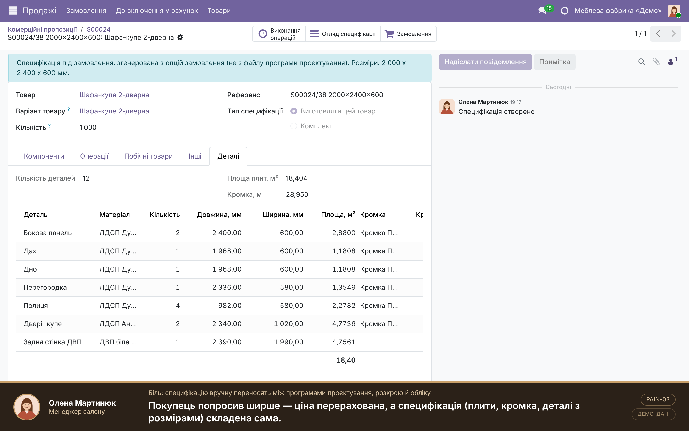

## 3. Виробництво знає про замовлення одразу — начальник виробництва (PAIN-05)
**Біль:** статус замовлення живе в чатах і таблицях, цілісної картини немає.
**Як закрито:** після підтвердження виробниче замовлення створюється само. Дошка показує всі замовлення за етапами з маржею й часом очікування запуску;
список виробництва — клієнт, термін, що в роботі, чого не вистачає; червоним — замовлення, які за планом не встигають у термін.

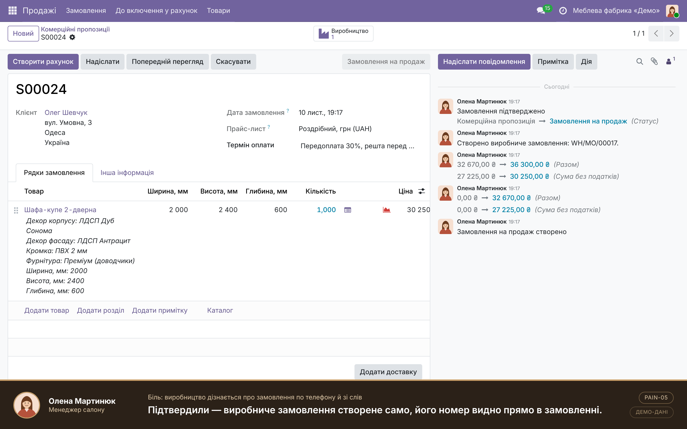
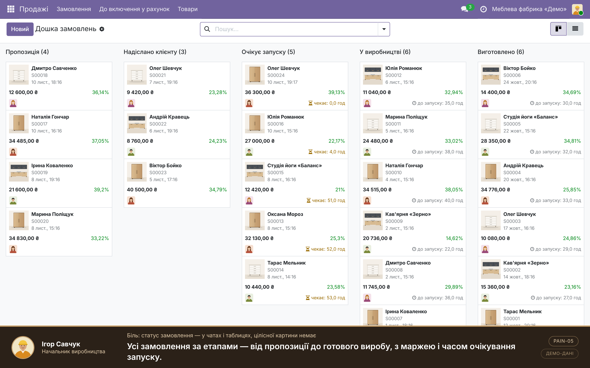
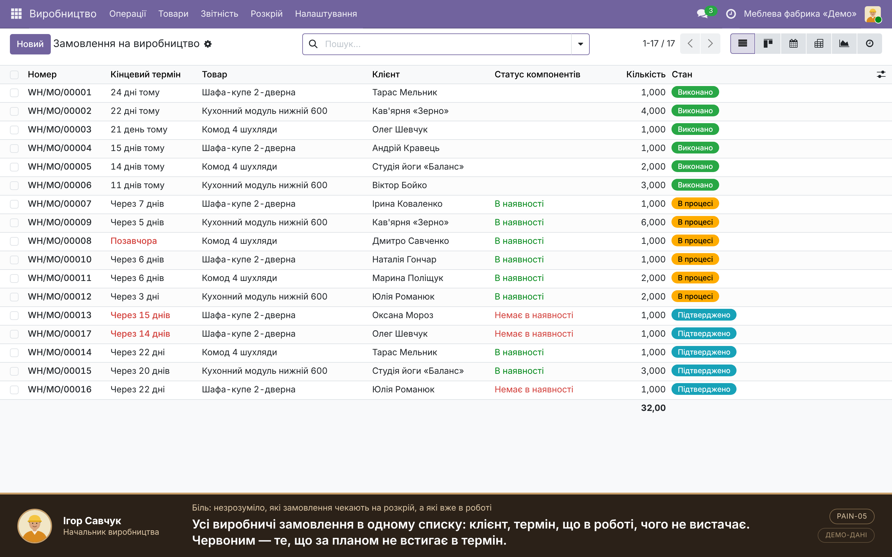

## 4. Нестача фурнітури видна до запуску — начальник виробництва (PAIN-07)
**Біль:** про нестачу розсувної системи дізнаються на складанні.
**Як закрито:** у виробничому замовленні нестача компонента видна одразу (стандартний облік наявності Odoo за специфікацією замовлення), закупівля встигає замовити.

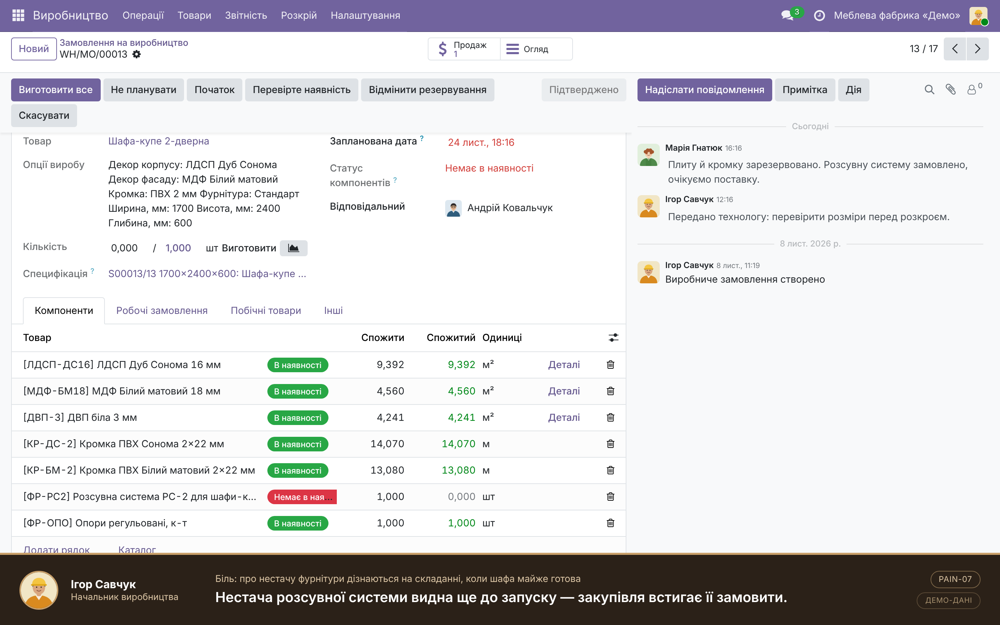

## 5. Вузьке місце видно до зриву термінів — начальник виробництва (PAIN-06)
**Біль:** не вистачає людей чи світла — план летить, а де саме, не видно.
**Як закрито:** завантаження кожної дільниці у % від тижневої потужності; у прикладі складання — 128% (червоним), решта — 85–92%.

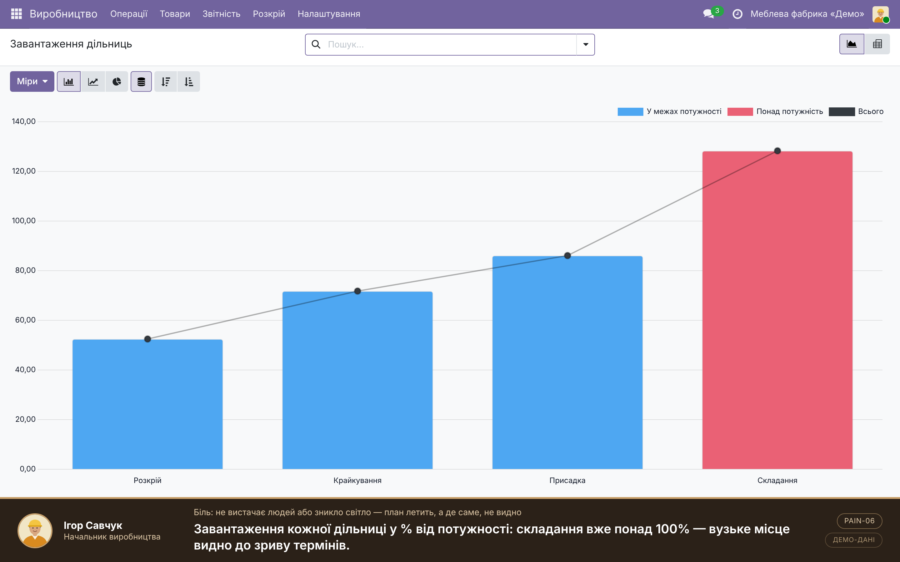

## 6. Розкрій із відходами, картою й обліком обрізків — технолог, комірник (PAIN-04, PAIN-08)
**Біль:** розкрій під кожне замовлення — окрема ручна задача; відходи з’ясовуються після розкрою, обрізки губляться.
**Як закрито:** деталі кількох замовлень збираються в одне завдання; карта показує цілий лист і лист, узятий з обрізка, з легендою; відсоток відходів і економія
від обрізків у гривнях (у прикладі 4,84 м² і 2 240,88 ₴ на одному завданні, відходи 10,0%). Ділові обрізки стоять на обліку з розмірами й площею, наступний розкрій бере їх першими.

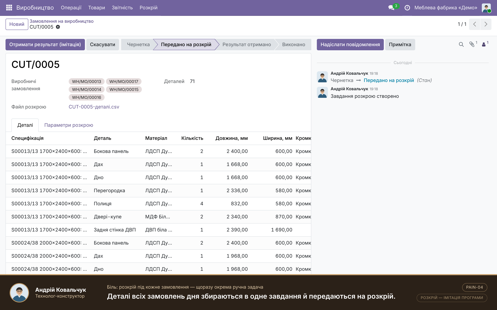
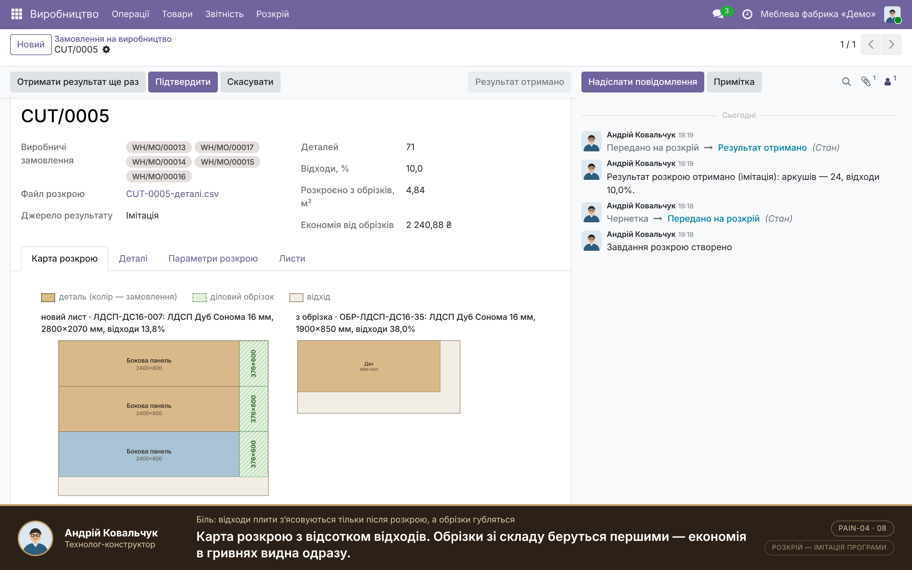
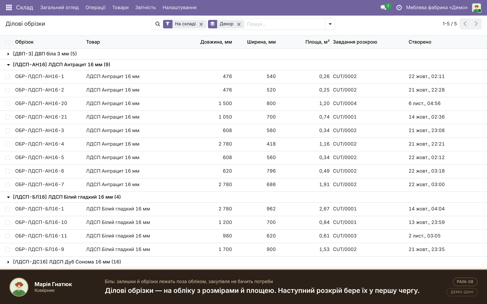

## 7. План і факт, час до запуску, маржа замовлень — начальник виробництва, фінансист (PAIN-05, PAIN-10, PAIN-11)
**Біль:** фактична собівартість відома заднім числом; ніхто не знає, скільки замовлення чекає запуску.
**Як закрито:** вартість за специфікацією поруч із реальною по матеріалах і годинах (у прикладі 19 339 ₴ проти 20 239 ₴; перевитрата плити й кромки видна по рядках);
середній час від замовлення до початку роботи — 32 год, по кожному замовленню окремо; звіт собівартості — маржа 12–39%, у середньому 27%, низька маржа червоним.

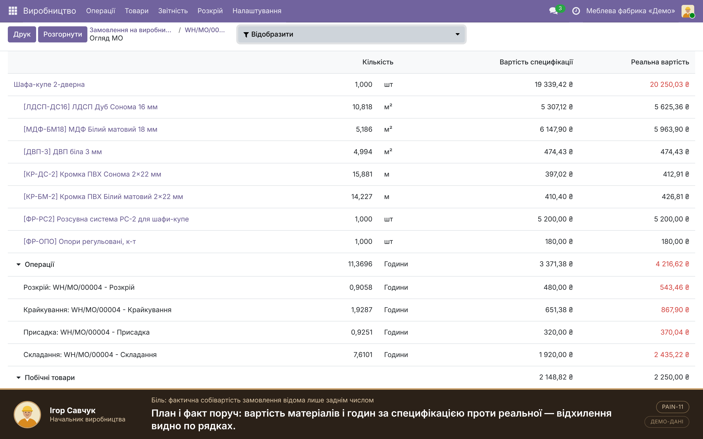
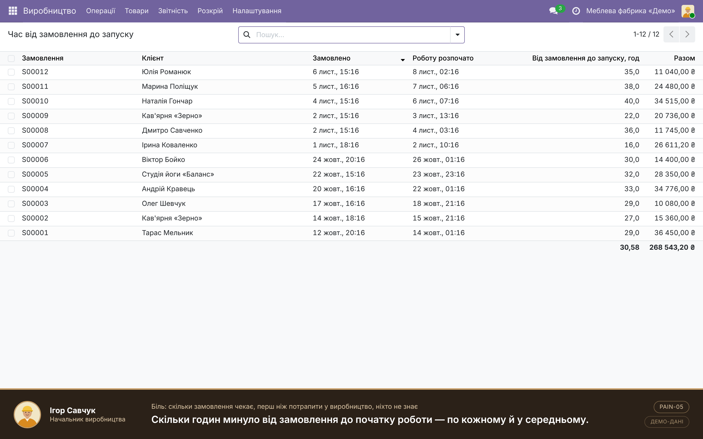
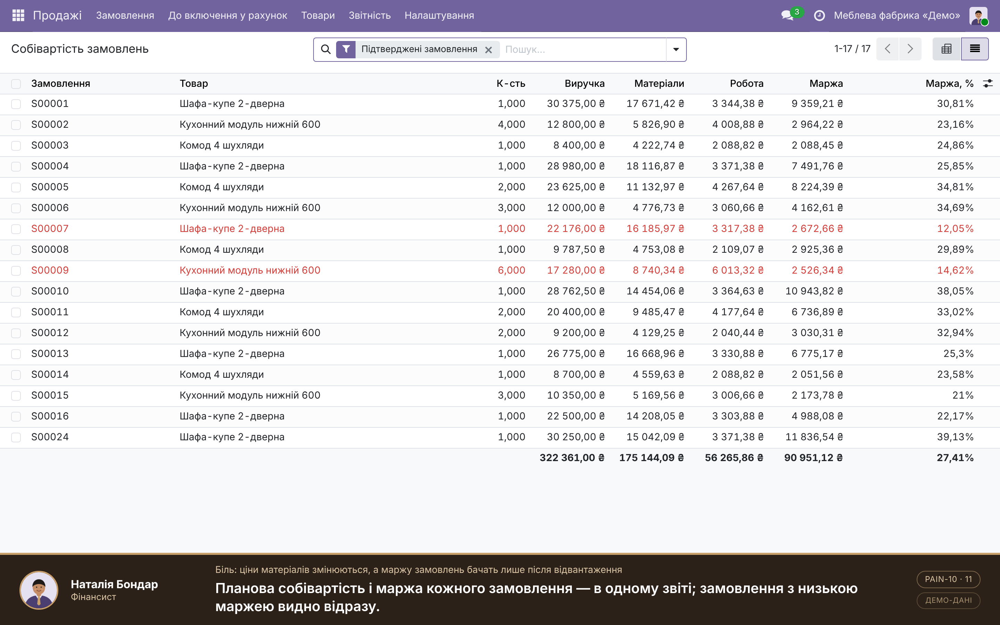

## Що в цьому показі імітація і що з’явиться в пакеті
**Імітація (позначена на екранах компактною позначкою):** розрахунок розкрою — проста евристика замість програми розкрою; усі дані — фабрика, люди, покупці, ціни,
залишки, історія повідомлень, дати й тривалості операцій — вигадані; потужність дільниць задана для показу; ілюстрації виробів намальовані для показу.
**Є в коді пакета (35 автотестів проходять):** конфігуратор із розмірами й ціною, специфікація й виробниче замовлення з опцій, планова собівартість і маржа,
завдання розкрою з прийомом результату (інтерфейс для файлу реальної програми) та картою, ділові обрізки як складський залишок, дошка замовлень, завантаження дільниць,
час від замовлення до запуску. План/факт, нестача компонентів, рахунки й оплати — стандартні можливості Odoo, на які спирається пакет.
**Не показано й не обіцяється:** імпорт із програми проєктування, підключення реальної програми розкрою, курс євро в маржі, доставка й монтаж, рекламації.
