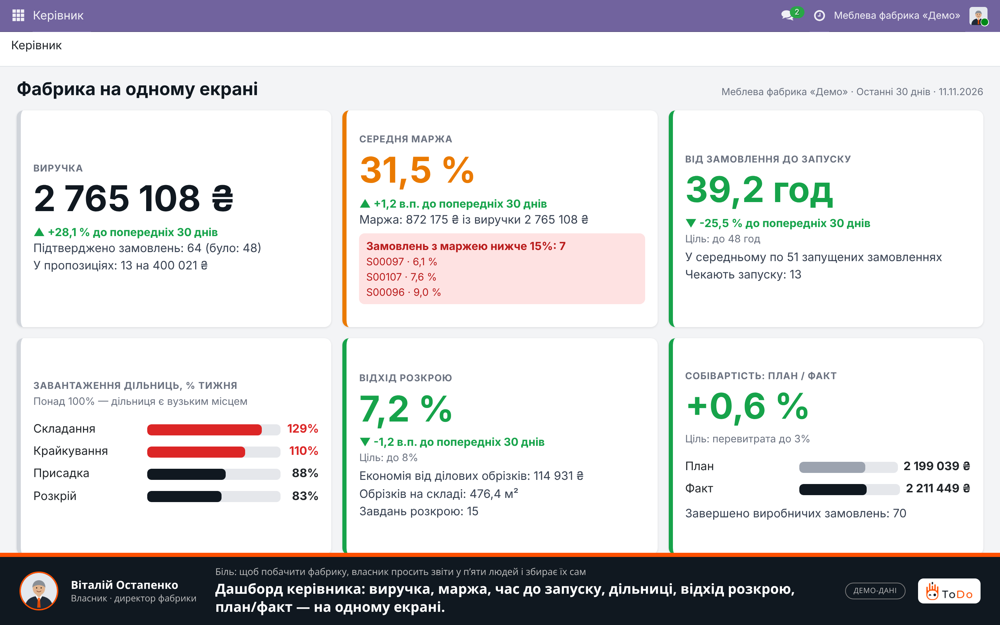
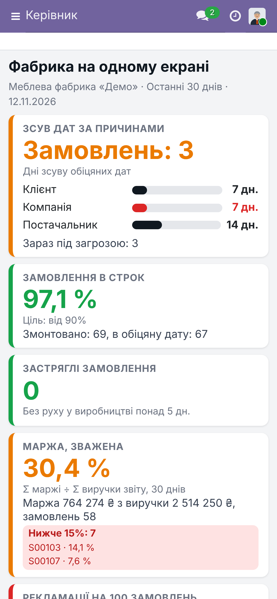
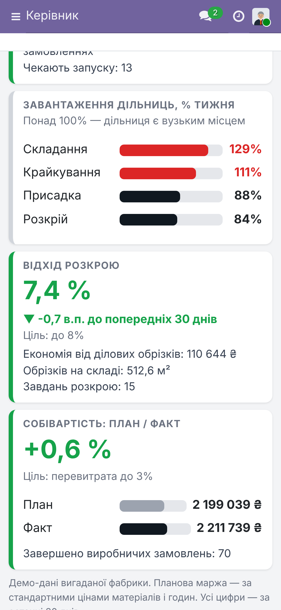
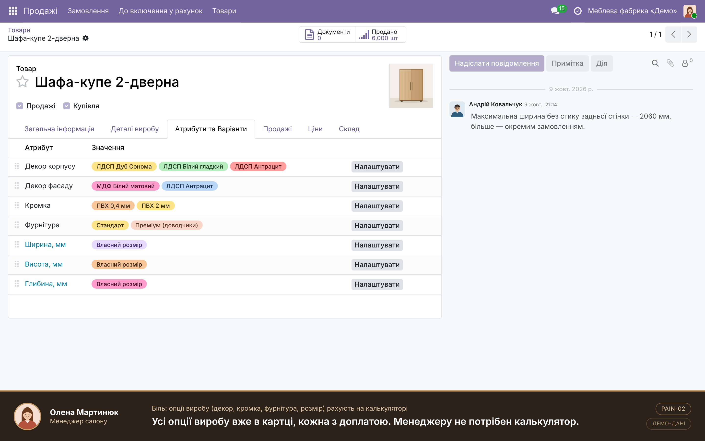
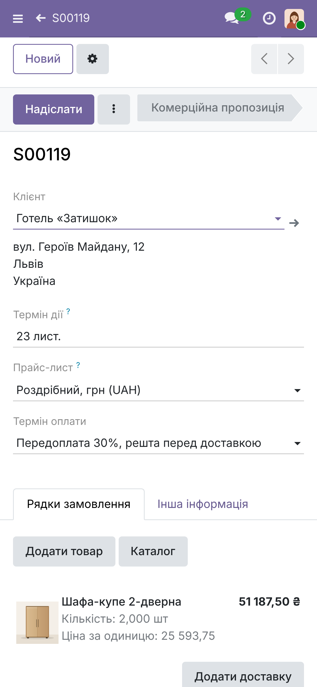
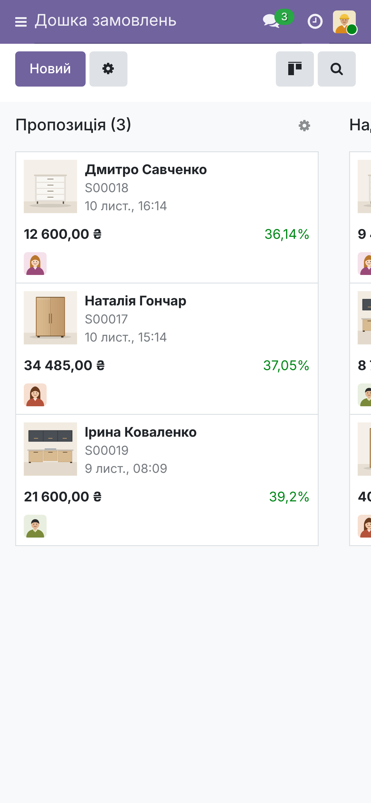
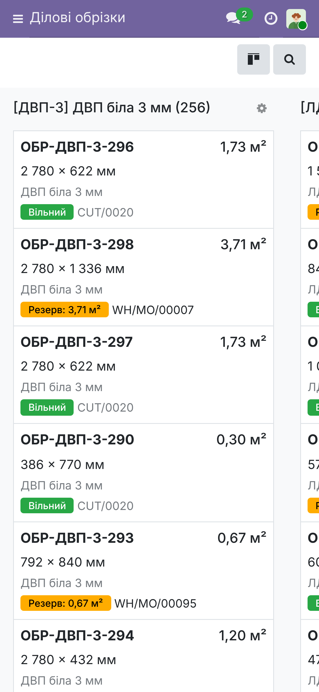
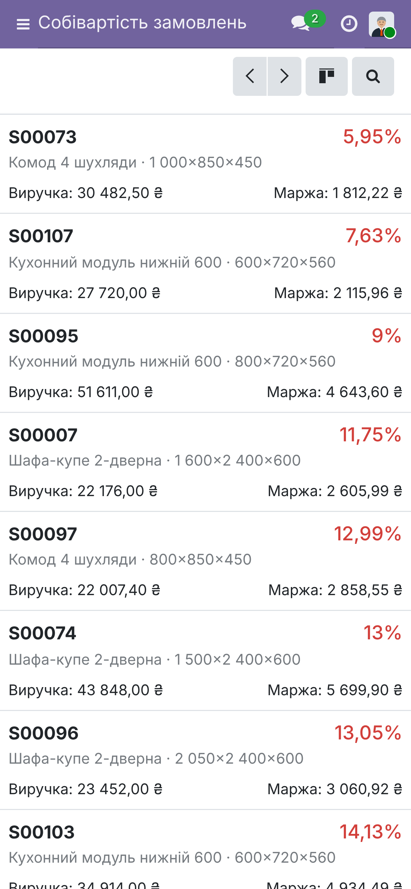

# Власник меблевої фабрики бачить усю фабрику на одному екрані — і замовлення від салону до цеху
Скільки ми заробили на цьому замовленні? Коли воно піде в цех? Де застряг розкрій? Зазвичай відповіді збирають із п’яти таблиць і десяти дзвінків. Нижче — те, що бачить кожна роль у справжньому Odoo 19 Community, на комп’ютері й на телефоні. Фабрика «Демо» і всі дані вигадані.

## Керівник: вся фабрика на одному екрані
**Біль:** щоб побачити фабрику, власник просить звіти у п’яти людей і збирає їх сам, а маржу замовлення бачить, коли виріб уже відвантажено.
**Вигода:** один екран за 10 секунд. Виручка за 30 днів — {{d_revenue}} ({{d_revenue_delta}}), підтверджено {{d_orders}} замовлень. Середня маржа — {{d_margin}}, і {{d_low_text}} — вони виділені червоним. Від замовлення до запуску — {{d_launch}} (ціль до 48 год). Вузьке місце — {{d_top}}. Відхід розкрою {{d_waste}} (ціль до 8%), обрізки зекономили {{d_saving}}. Собівартість: план {{d_plan}}, факт {{d_fact}} ({{d_overrun}}). Кожна картка відкриває деталі.

## Ціна й маржа відомі ще в пропозиції
**Біль:** опції виробу (декор, кромка, фурнітура, розмір) рахують на калькуляторі, а маржу з’ясовують, коли шафа вже виготовлена.
**Вигода:** покупець обирає декор, кромку й фурнітуру та називає розміри — менеджер збирає виріб при ньому, а ціна й маржа видно до підтвердження.

## Специфікація складається сама
**Біль:** специфікацію вручну переносять між програмами проєктування, розкрою й обліку.
**Вигода:** покупець попросив ширше — ціна перерахована, а плити, кромка й деталі з розмірами складені самі. Підтвердили замовлення — виробниче замовлення вже створене.

## Виробництво знає про замовлення одразу
**Біль:** статус замовлення живе в чатах і таблицях, цілісної картини немає.
**Вигода:** усі замовлення за етапами — від пропозиції до готового виробу, з маржею й часом очікування запуску; нестачу фурнітури видно до запуску, а не на складанні.

## Вузьке місце видно до зриву термінів
**Біль:** не вистачає людей або зник графік — план летить, а де саме, не видно.
**Вигода:** завантаження кожної дільниці у % від тижневої потужності; зараз {{load_text}}.

## Розкрій із відходами, картою й обліком обрізків
**Біль:** розкрій під кожне замовлення — окрема ручна задача, відходи з’ясовуються після розкрою, а обрізки губляться.
**Вигода:** деталі кількох замовлень збираються в одне завдання; карта розкрою показує відсоток відходів. Обрізки зі складу беруться першими: на прикладі завдання — {{cut_m2}} м² з обрізків і {{cut_saving}} грн економії, відходи {{cut_waste}}%. Ділові обрізки — на обліку з розмірами й площею.

## План і факт собівартості, час до запуску, маржа кожного замовлення
**Біль:** фактична собівартість відома лише заднім числом, а скільки замовлення чекає на запуск, ніхто не знає.
**Вигода:** вартість матеріалів і годин за специфікацією — поруч із реальною ({{plan_cost}} проти {{real_cost}} на прикладі замовлення). Середній час до запуску — {{avg_launch}} год. Маржа кожного замовлення в одному звіті; низьку видно відразу.

## З телефона — той самий Odoo, без окремого застосунку
**Біль:** менеджер у салоні, начальник у цеху й комірник на складі не завжди біля комп’ютера.
**Вигода:** справжній мобільний Odoo 19: менеджер оформлює замовлення з конфігуратором і бачить маржу; начальник дивиться дошку й завантаження; комірник — обрізки з розмірами й резервом; власник — маржу замовлень і дашборд.

## Заклик
Покажемо на ваших даних
ToDo — впровадження Odoo для виробництв. Розкрій у показі — імітація: інтерфейс прийому файлу від програми розкрою є, підключення конкретної — окремий етап.
