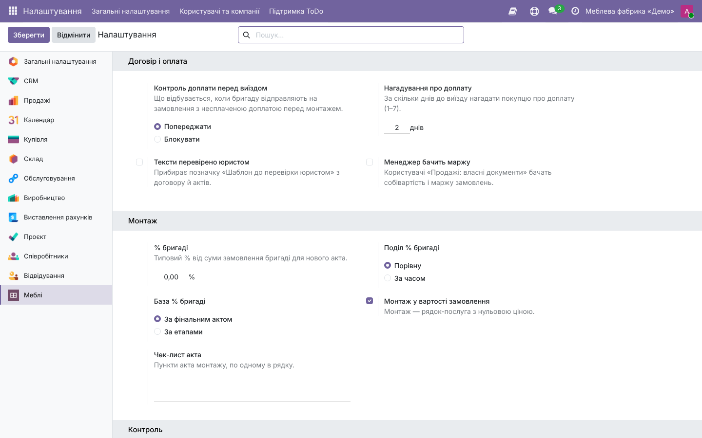
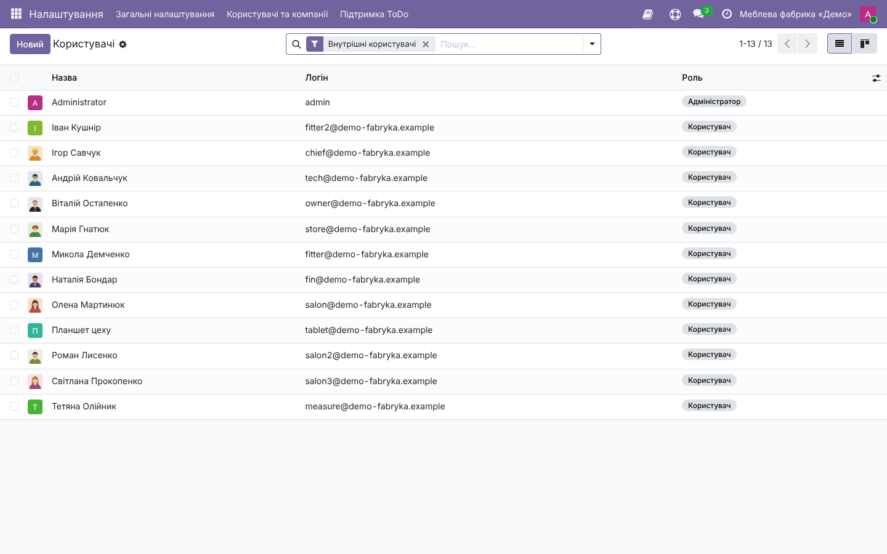
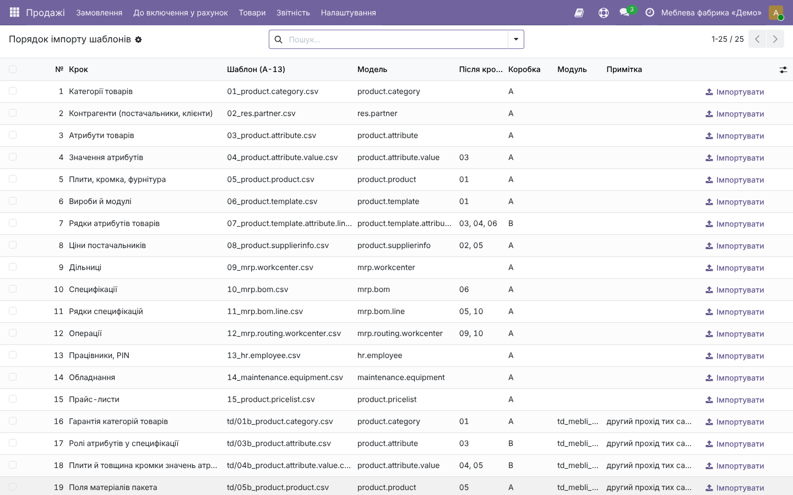
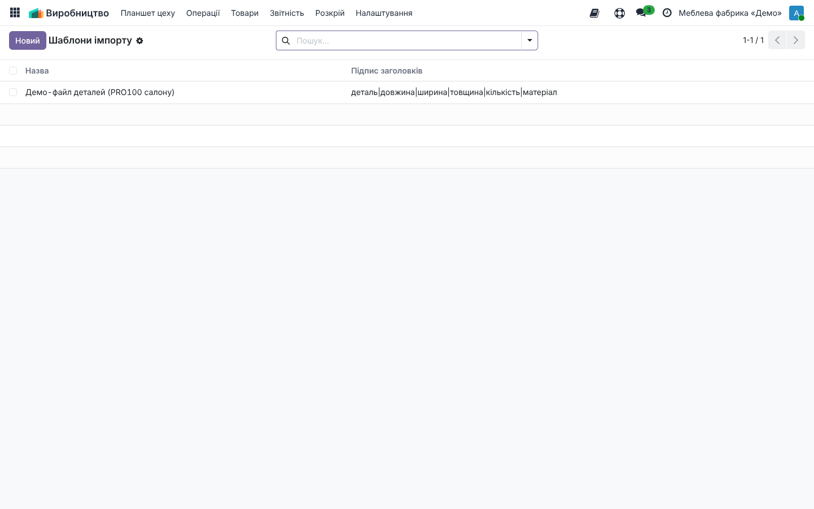
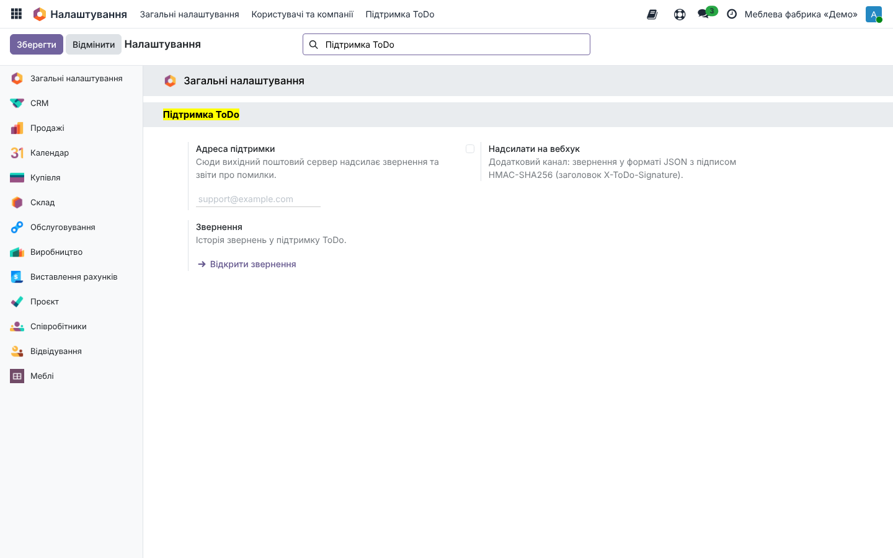
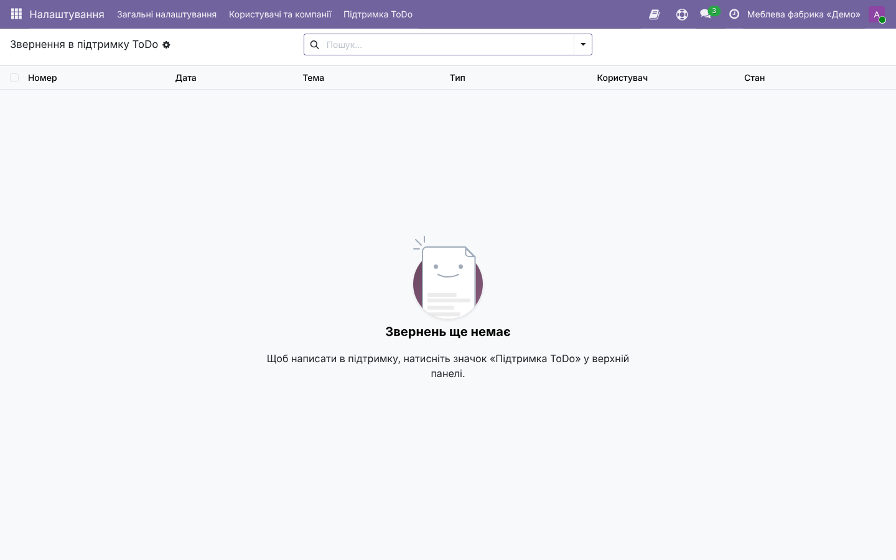
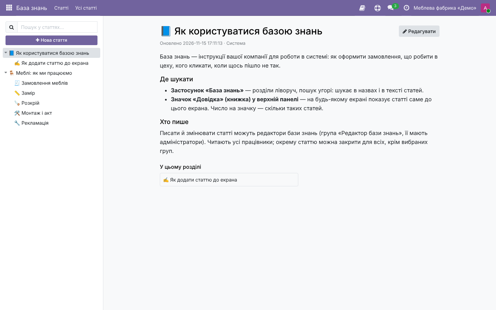
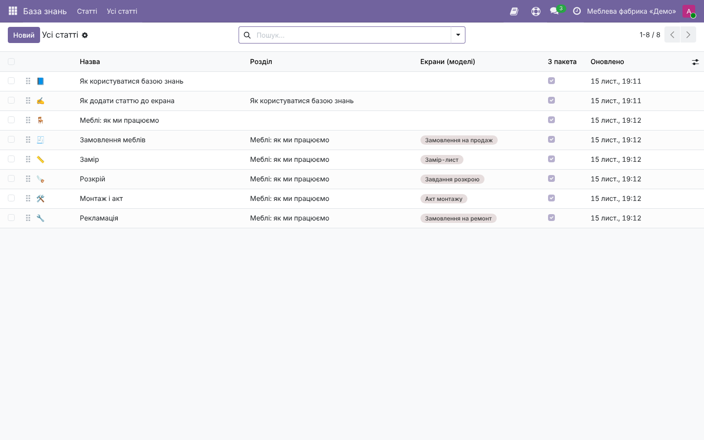
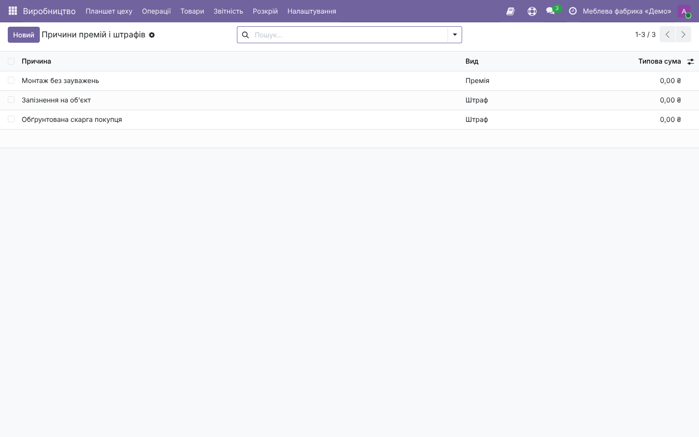
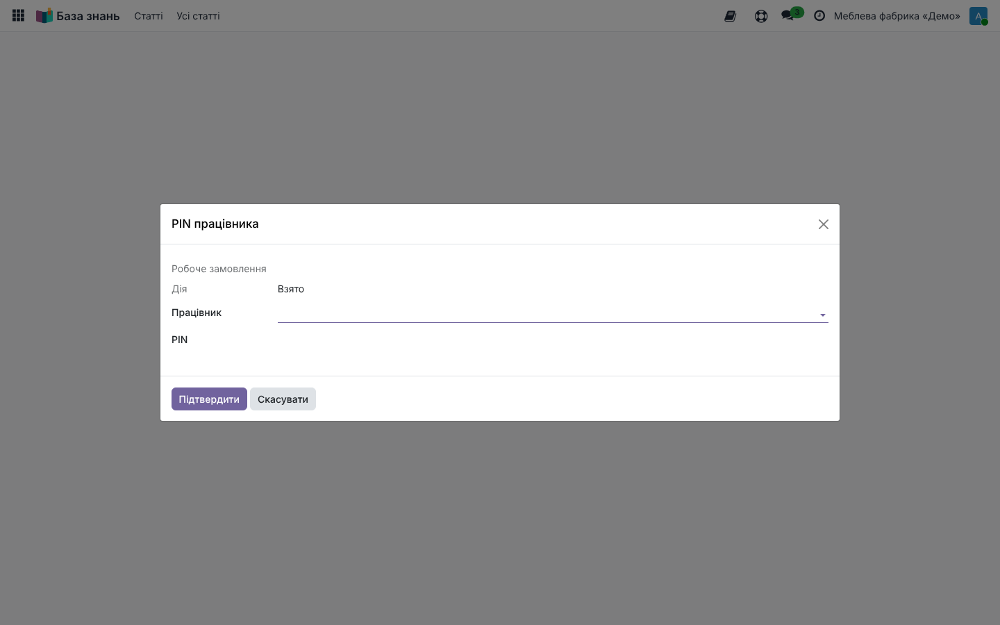

# Посібник адміністратора

Для кого: адміністратор пакета «меблі» у ToDo і в клієнта (установка, налаштування, користувачі, обмін, пошта, оновлення, резервні копії, підтримка). Стенд/SHA: див. INDEX.md. Вхід: користувач-адміністратор бази (на демо-стенді — `admin`; пароль не наводиться).

## Перший запуск
Модулі до установки, їх порядок і джерело — `package/config/CONFIG.md`, розділ «Модулі до установки» (47 модулів профілю B-демо + `td_mebli_demo` на стенді; профілі коробок — нижче). Установка демо-стенда — командою з `package/demo/README.md`: `package/demo/up.sh <instance> ce [--profile <файл answers>]`; база — лише `demo-mebli-pkg-<суфікс>`; веб-доступ — `tools/odoo/serve.sh <instance> <порт>`. Пароль демо-ролей не наводиться: задайте змінну `DEMO_USERS_PASSWORD` перед `up.sh` (без неї — локальний тестовий дефолт лише для стенда на `localhost`). Для друку PDF задайте `DEMO_REPORT_URL=http://127.0.0.1:<порт>` (адреса для стилів і шрифтів звітів; інакше «Технічні» → «Системні параметри» → `report.url`).
### Встановлення бази клієнта (крок B-04)
1. Сервер: Linux, Odoo 19.0 (CE; для коробки C — EE з ліцензією клієнта), PostgreSQL 16 з повними даними часових поясів (`Europe/Kyiv`), `wkhtmltopdf` для PDF, доступ сервера до `bank.gov.ua` (лише коробка B з курсом НБУ). Конфіг Odoo — за зразком `tools/odoo/odoo.conf.example`: `addons_path` = стандартні addons Odoo + тека з модулями пакета (`package/addons` тегу релізу), `data_dir`, `list_db = False` (розділ «Безпека»).
2. Анкета клієнта `answers.yaml` (схема `package/templates/answers.yaml`) — профіль коробки, VP-xx, `edition`, `contract_mode`. Перелік модулів профілю: `python3 tools/odoo/apply.py plan --config package/config --answers <answers.yaml>` (preflight обмежень і модулі через кому; порядок — «Модулі до установки» `CONFIG.md`).
3. Порожня база й модулі однією командою: `odoo-bin -c <конфіг> -d <база> -i <модулі з кроку 2 через кому> --load-language=uk_UA --stop-after-init` (демо-дані Odoo 19 за замовчуванням не ставляться); мова користувачів — «Українська».
4. Конфіг-пакет: дані `package/config/data/*.yaml` (облік і податки, продаж і проєкт монтажів, виробництво й склад, календар і пошта, параметри компанії `res.company.td_*` за VP-xx, групи-функції коробки B за VP-02, налаштування) застосовуються в порядку номерів файлів зі значеннями з `answers.yaml`; потім повторне застосування в режимі звірки (нічого не змінюється — ідемпотентність) і читання назад (значення в базі = анкеті). На тестових базах це робить `python3 tools/odoo/apply.py config --db <база> --config package/config --answers <answers.yaml> --mode apply`, далі `--mode compare` і `--mode readback`; скрипт приймає лише бази `test-…`/`demo-…`/`emu-…` (захист від проду), тому на базі клієнта ці самі файли застосовує виконавець ранбука B-04 з тим самим порядком і read-back.
5. Ручні кроки (CONFIG.md «Ручні кроки»): вихідна пошта (SMTP), адреса підтримки `td_support.email`, тексти шаблонів листів клієнта.
6. Майстер-дані — розділ «Майстер-дані й імпорт»; користувачі — «Користувачі й ролі».
7. Перехід A → B (або B → C): змініть `VP-01` (і `VP-02`, `VP-03`) в `answers.yaml`, повторіть кроки 2–4 на тій самій базі: додаткові модулі ставляться `-i`, групи-функції вмикаються, дані не втрачаються; для C — сервер з EE (мости ставляться самі, `auto_install`).

Після установки перевірте:
1. Мова інтерфейсу й друкованих форм — українська (`uk_UA`), англійських підписів пакета немає (AC-N.01).
2. Після входу відкривається головний екран із плитками застосунків (`td_home_menu`, лише CE).
3. У верхній панелі є значки «Довідка» (книжка) і «Підтримка ToDo» (рятувальний круг).
4. «Налаштування» → «Меблі» показує блоки «Договір і оплата», «Монтаж», «Контроль», «Функції коробки B» 
5. Швидкодія на еталонному стенді (200 відкритих замовлень): ціна з розмірів і дошка — до 3 с, імпорт 300 деталей — до 30 с, етикетки — до 60 с (AC-N.02; вимірювання на стенді не проводилось — ризик, перевірити на пілоті).

## Головний екран (td_home_menu)
Плитки кореневих меню з іконками, пошук застосунку за назвою (Enter — відкрити, Esc — очистити), стрілки клавіатури. Відкривається після входу (коли в адресі немає дії) і кнопкою з плитками в навбарі; гаряча клавіша — `h`. На телефоні — сітка в 3 колонки. Лише Community: якщо встановлено Enterprise (`web_enterprise`), модуль нічого не змінює. Налаштувань немає; знімок — menedzher.md крок 1.

## Параметри
Параметри клієнта задаються у файлі анкети `answers.yaml` (схема — `package/templates/answers.yaml`, приклад — `answers.example.yaml`), конфіг-пакет A-12 переносить їх у базу. Після установки більшість значень видно й можна змінити в «Налаштування» → «Меблі» (поле компанії `res.company.td_*`).

| Параметр | Ключ answers.yaml / VP-xx | Що змінює | Допустимі значення | За замовчуванням | Де в UI |
|---|---|---|---|---|---|
| Профіль коробки | `VP-01` | набір модулів і функцій: light / A / B (інформаційне поле компанії) | `light`, `A`, `B` | `A` | «Меблі» → «Контроль» → «Профіль коробки» |
| Функції коробки B | `VP-02` | вмикає групи-функції: `configurator`, `offcut`, `cutting_batch`, `kiosk`, `quality`, `label_scan`, `change_sign`, `nbu`, `ai_mapping`, `analog`, `shop_board` | будь-який набір зі списку; лише при VP-01 = `B` | усі, крім `ai_mapping` | «Меблі» → «Функції коробки B» (галочки «Конфігуратор виробів», «Обрізки», «Пакети розкрою», «Кіоск цеху», «Контроль якості», «Сканування етикеток», «Підпис зміни замовлення», «Курс НБУ», «AI-підказка колонок», «Аналоги», «Табло цеху») |
| Юрособи компанії | `VP-03` | одна юрособа / кілька / кілька з монтажем від ФОП (модуль `td_mebli_multico`) | `single`, `multi`, `multi_install_fop`; лише при VP-01 = `B` | `single` | стандартні компанії Odoo; модуль — при установці |
| Обмін з BAS/BAF | `VP-04` | ставить модуль обміну `td_mebli_bas` | `true`, `false` (у light — `false`) | `true` | при установці |
| Оплата замовлення етапами | `VP-05` | умова оплати з етапами «Передоплата / Перед монтажем / Після акта» активна й за замовчуванням | `true`, `false` | `true` | «Виставлення рахунків» → «Налаштування» → «Умови оплати» (умова «Меблі на замовлення») |
| Контроль доплати перед виїздом | `VP-06` | попереджати або блокувати «Почати монтаж», якщо доплату не отримано | `warn`, `block`; лише при VP-05 = `true` | `warn` | «Договір і оплата» → «Контроль доплати перед виїздом» |
| Нагадування про доплату, днів до виїзду | `VP-07` | за скільки днів до виїзду покупцю йде нагадування | ціле 1–7 | `2` | «Договір і оплата» → «Нагадування про доплату» |
| Менеджер бачить маржу | `VP-08` | показ маржі й собівартості менеджеру (група «Меблі: Бачить маржу») | `true`, `false` | `false` | «Договір і оплата» → «Менеджер бачить маржу» |
| Розкрій плит | `VP-09` | `both` — свій розкрій і порізка в дистриб'ютора; `distributor` — меню власного розкрою приховано | `both`, `distributor` (у light — `distributor`) | `both` | «Контроль» → «Розкрій плит» |
| Застряглі замовлення, днів без руху | `VP-10` | поріг «застряглого» замовлення на дошці, дашборді й у брифінгу | ціле 1–30 | `5` | «Контроль» → «Застряглі замовлення» |
| Поріг ціни закупівлі вище історії, % | `VP-11` | позначка «вище історії» в закупівлях і «Ціни проти історії» | ціле 1–50 | `5` | «Контроль» → «Ціна вище історії» |
| Мінімальний діловий обрізок, мм | `VP-12` | найменший залишок плити, що обліковується як обрізок | ціле 100–1000; лише при VP-01 = `B` | `300` | «Контроль» → «Мінімальний обрізок» |
| Строк закриття рекламації, днів | `VP-13` | коли рекламація вважається простроченою (дашборд, брифінг) | ціле 1–60 | `14` | «Контроль» → «Прострочка рекламації» |
| Поділ % бригаді між виконавцями | `VP-14` | порівну або за часом | `equal`, `time`; у light не застосовується | `equal` | «Монтаж» → «Поділ % бригаді» |
| База нарахування % бригаді | `VP-15` | з фінального акта або з кожного етапу | `final`, `stage`; у light не застосовується | `final` | «Монтаж» → «База % бригаді» |
| Монтаж у вартості замовлення | `VP-16` | рядок «Монтаж» з нульовою ціною в замовленні | `true`, `false` | `true` (поле модуля) | «Монтаж» → «Монтаж у вартості замовлення» |
| Перевитрата матеріалу у виробництві | `VP-17` | поведінка при перевитраті: дозволити / попередити / заборонити (споживання нових специфікацій) | `flexible`, `warning`, `strict` | `warning` | специфікація → «Споживання» (стандарт) |
| Платник ПДВ | `VP-18` | ПДВ 20 % за замовчуванням продажу й закупівлі або без податку; план рахунків `l10n_ua` (AC-N.03) | `true`, `false` | `true` | налаштування бухобліку: податки за замовчуванням |
| Редакція Odoo | `edition` | набір модулів: на Enterprise мости ставляться самі | `ce`, `ee` (`ee` лише з VP-01 = `B`) | `ce` | при установці |
| Режим договору | `contract_mode` | текст і реквізити друкованого договору, акт приймання-передачі; `unset` — друк договору блокується | `contract`, `sale`, `unset` | `unset` | «Налаштування» → «Продажі» → блок «Документи меблевого виробництва» → «Друкований договір» |
| Навчання в системі | `elearning.mode` | вмикає або вимикає навчальні курси пакета (рядок `"on"`/`"off"` в лапках; блок додає крок A-17b) | `"on"`, `"off"` | "on" | — (з'явиться після A-17b) |
| Поріг проходження тестів | `elearning.pass_score` | відсоток правильних відповідей для зарахування уроку | ціле 0–100 | 80 | — (з'явиться після A-17b) |

Обмеження між параметрами (перевіряють конфіг-пакет і fit-gap): `edition: ee` ⇒ VP-01 = `B`; VP-01 = `light` ⇒ `edition: ce`, VP-04 = `false`, VP-05 = `false`, VP-09 = `distributor`; VP-06, VP-07 — лише при VP-05 = `true`; VP-14, VP-15 — не для light.
Не параметри анкети (дані клієнта, задаються в налаштуваннях): «% бригаді», «Чек-лист акта», «Тексти перевірено юристом» (ставиться після висновку юриста), гарантійні строки категорій, норма відходу плити.

## Профілі
| Профіль | Для кого | Що відрізняється | Файл профілю стенда |
|---|---|---|---|
| light (легкий тариф «ФОП-цех») | мікроцех на CE | без обміну з BAS (`td_mebli_bas` не ставиться), без графіка оплат, лише порізка в дистриб'ютора, нарахування бригадам приховано | `package/demo/profiles/answers.alt-1.yaml` |
| A (CE-старт, вхід) | компанія 10–249 працівників, одна юрособа | тверде ядро; функції коробки B вимкнено групами | `answers.alt-5.yaml` (`--no-demo`) |
| B (CE-повний) | компанія на CE з повною функціональністю | A + функції VP-02, кілька юросіб (VP-03) | `package/demo/answers.yaml` (стенд), `answers.alt-2.yaml`, `answers.alt-3.yaml` |
| C (EE, апгрейд) | клієнт з ліцензією Enterprise | B + мости EE (див. «Редакції») | `answers.alt-4.yaml` (EE не перевірено) |
Профіль задається ключем `VP-01` (AC-N.07): при «A» функції коробки B не видно жодній ролі, навіть адміністратору меню. Апгрейд A → B → C — у ту саму базу з того самого пакета (зміна `answers.yaml` і повторне застосування конфіг-пакета); міграція бази CE → EE не перевірена.

## Редакції
CE (Community) — основа всіх сценаріїв цього посібника; стенд піднято й перевірено на CE.
EE (Enterprise) — **не перевірено** (EE недоступна в середовищі тесту; `up.sh <i> ee` повертає код 70). На EE ставляться мости `td_mebli_*` з `auto_install` (AC-130: без EE вони не ставляться):
| Міст | Стандартний застосунок EE | Що додає (за кодом модуля, не перевірено) | AC |
|---|---|---|---|
| `td_mebli_shopfloor` | Shop Floor (`mrp_workorder`) | вкладка «Деталі» у робочому замовленні цеху, меню «Планшет цеху» веде в Shop Floor | AC-126 |
| `td_mebli_quality` | Quality (`quality_control`) | меню «Перевірки якості» веде в стандартні перевірки якості | AC-127 |
| `td_mebli_fsm`, `td_mebli_planning` | Field Service, Planning | меню «Календар монтажів» — у Field Service; кнопка «Запланувати бригаду» на задачі | AC-128 |
| `td_mebli_helpdesk` | Helpdesk | меню «Рекламації» — тікети Helpdesk з кнопками «Рекламація», «Повторне виготовлення» | AC-113 |
| `td_mebli_sign` | Sign | кнопка «Підписати договір (Sign)» на замовленні | AC-129 |
Група «старі екрани» (`group_td_old_screens`) мостів повертає екрани CE для тих, хто ще не перейшов. Підписи мостів перекладено в `i18n/uk.po` модулів («Деталі», «Запланувати бригаду», «Рекламація», «Повторне виготовлення», «Підписати договір (Sign)»); у UI на EE не перевірено (EE недоступна). `td_home_menu` на EE не ставиться (свій головний екран EE).

## Користувачі й ролі
Користувачі: «Налаштування» → «Користувачі та компанії» → «Користувачі» . Новий користувач: «Новий» → ім'я, логін (e-mail), групи на вкладці прав доступу, «Компанії» й «Компанія за замовчуванням» (видно при кількох юрособах), у налаштуваннях користувача — мова «Українська» і «Часовий пояс» `Europe/Kyiv` (не `Europe/Kiev` — див. «Типові помилки»). Запрошення — кнопка на формі користувача (лист зі встановленням пароля; потрібна вихідна пошта і правильний `web.base.url`); без пошти — «Дія» → «Змінити пароль» і передайте пароль людині особисто. Скидання пароля — кнопка «Скинути пароль» на формі користувача (лист) або посилання «Скинути пароль» на сторінці входу. Для ролі призначте групи на вкладці прав доступу користувача:
| Роль | Групи Odoo (стандарт + пакет) |
|---|---|
| Менеджер продажу | Продажі: «Користувач: лише власні документи» (старший — «усі документи») |
| Замірник | «Замірник» (`td_mebli_measure.group_td_mebli_measurer`) — лише свої заміри, без цін (AC-006) |
| Конструктор-технолог | Виробництво: користувач; Склад: користувач |
| Начальник виробництва | Виробництво: адміністратор; планшет цеху — окремий користувач з правами користувача виробництва |
| Комірник і закупівля | Склад, Купівля: користувач (комірнику — адміністратор складу) |
| Фінансист | Виставлення рахунків / Бухоблік; «Фінансист» (`td_mebli_base.group_finance`) — собівартість (AC-115) |
| Керівник | «Керівник фабрики (дашборд)» (`td_mebli_dashboard.group_td_mebli_director`) + менеджерські групи застосунків (AC-122) |
| Бригадир, монтажник | Проєкт: користувач — лише свої виїзди й акти (AC-099) |
| Сервіс | «Сервіс» (`td_mebli_claim.group_service`) — рекламації |
| Редактор статей | «Редактор бази знань» (`td_knowledge.group_td_knowledge_editor`) |
| Адміністратор підтримки | «Адміністратор підтримки» (`td_support.group_td_support_admin`; є в адміністратора системи) |
Окремі групи пакета: «Меблі: Бачить маржу» (`td_mebli_base.group_margin_view`, вмикає VP-08); групи-функції «Функція меблів: конфігуратор», «Функція меблів: обрізки», «Функція меблів: пакети розкрою», «Функція меблів: кіоск цеху», «Функція меблів: контроль якості», «Функція меблів: сканування етикеток», «Функція меблів: підпис зміни замовлення», «Функція меблів: курс НБУ», «Функція меблів: AI-підказка колонок», «Функція меблів: аналоги», «Функція меблів: табло цеху» вмикає VP-02 галочками «Функції коробки B» — вручну їх не призначати.
Працівники цеху — картки працівників («Співробітники») з PIN, без користувача Odoo; кіоск відвідувань — стандарт `hr_attendance`.
Правила доступу записів пакета (56 правил: `td_mebli_install` 19, `td_mebli_measure` 12, `td_mebli_sale` 7, `td_mebli_cutting` 4, `td_mebli_bas` 3, `td_mebli_shop` 3, `td_knowledge` 2, `td_mebli_migration` 2, `td_mebli_mrp` 2, `td_support` 2) обмежують записи компанією (юрособою, AC-036), а замірника й бригадира — своїми записами. Перегляд — «Технічні» → «Правила запису» (режим розробника); не змінювати без рішення архітектора.
Відома розбіжність: групи ТР `group_measurer/technologist/shop_master/installer/director` у `td_mebli_base` не створено — ролі збираються зі стандартних груп і груп модулів вище (`package/demo/plan.md`).

## Компанії й мультикомпанія
Коробка A — одна юрособа (VP-03 = `single`). Кілька юросіб (коробка B, VP-03 = `multi` або `multi_install_fop`):
1. Друга юрособа: «Налаштування» → «Користувачі та компанії» → «Компанії» → «Новий» — назва, реквізити, валюта гривня; потім для неї «Виставлення рахунків» → «Налаштування»: план рахунків `l10n_ua` і податки за замовчуванням (ПДВ 20 % або без податку — VP-18 для кожної компанії окремо).
2. Користувачам — «Компанії» й «Компанія за замовчуванням» на формі користувача; перемикач компаній — у верхній панелі. Правила записів пакета показують кожному лише записи дозволених компаній (AC-036).
3. «Налаштування» → «Меблі»: усі поля позначені як параметри компанії — перемкніть компанію у верхній панелі й задайте значення для кожної (контроль доплати, % бригаді, пороги тощо).
4. Обмін з BAS: окремий канал на кожну компанію (одна активна на компанію; окрема база BAS на юрособу) — «Обмін з обліковою системою».
5. Монтаж від ФОП (VP-03 = `multi_install_fop`, модуль `td_mebli_multico`): ФОП — окрема компанія (крок 1); на замовленні у вкладці «Інша інформація» поле «Монтаж виконує» = компанія ФОП; при підтвердженні рядок послуги монтажу переходить в окреме замовлення-послугу компанії ФОП, пов'язане з основним (смарт-кнопки «Монтаж (ФОП)» і «Основне замовлення»); ФОП не може бути продавцем того самого замовлення; користувач без доступу до компанії ФОП отримає відмову (AC-035). Скасування основного замовлення ставить дію на рішення щодо замовлення монтажу.

## Безпека
- Паролі: адміністратор бази — окремий сильний пароль (не `admin`), паролі демо-ролей у базі клієнта не використовуються; двофакторна автентифікація — стандарт Odoo (налаштування користувача → «Безпека облікового запису»), рекомендовано для адміністраторів і фінансистів. Скидання — «Користувачі й ролі».
- Менеджер баз даних: у конфігу Odoo `list_db = False` (як у `tools/odoo/odoo.conf.example`) закриває сторінку `/web/database/manager` і вибір бази; майстер-пароль (`admin_passwd`) — довгий випадковий, зберігається в сховищі секретів хостингу, не в git.
- Доступ адміністратора: група «Налаштування» (адміністратор системи) — лише відповідальним клієнта й ToDo; вона ж дає «Адміністратор підтримки» і «Редактор бази знань».
- Секрети пакета: «Ключ API» каналу BAS (поле бачить лише адміністратор системи), «Секрет вебхука» підтримки (системний параметр, лише адміністратор), пароль SMTP — вводяться в UI на базі клієнта, не в git і не в `answers.yaml`; у зверненнях у підтримку паролі й токени замінюються на `***`.
- Резервні копії містять персональні дані покупців — зберігати шифровано на іншому сервері (розділ «Резервні копії»).

## Локалізація UA
- Мова: `uk_UA` ставиться при установці (`--load-language=uk_UA`), мова користувачів — «Українська» (AC-N.01).
- План рахунків і податки: `l10n_ua` (VP-18), на кожну компанію.
- Курси НБУ (`td_mebli_ua`, функція `nbu` коробки B, AC-037/038): розклад «Курси НБУ» постачається вимкненим, і онлайн-завантаження вимкнено системним параметром. Щоб увімкнути: «Налаштування» → «Технічні» → «Системні параметри» → «Новий»: ключ `td_mebli_ua.nbu_online`, значення `1`; «Технічні» → «Заплановані дії» → «Курси НБУ» → «Активно». Сервер має бачити `https://bank.gov.ua` (запит курсів на сьогодні). Без параметра розклад нічого не завантажує (лише запис у журналі сервера), а виклик оновлення курсів поза розкладом відмовляє «Онлайн-завантаження курсів НБУ вимкнено (системний параметр td_mebli_ua.nbu_online)». Збій НБУ — курси не змінюються, фінансист отримує дію «Курс НБУ не оновлено». На демо-стенді мережі немає: курси — імітація (джерело курсу «НБУ (імітація, без мережі)»). Перерахунок цін — «Оновити ціни за курсом» (`finansyst.md` крок 8).

## Майстер-дані й імпорт
Шаблони — `package/master-data/*.csv` (28 файлів, README там). Порядок імпорту показує «Продажі» → «Налаштування» → «Міграція» → «Порядок імпорту шаблонів» 
Порядок: категорії товарів → контрагенти (постачальники плит, фурнітури, порізки) → атрибути й значення (декор, кромка) → товари й шаблони виробів → ціни постачальників → дільниці → специфікації й операції → працівники → обладнання → прайс-листи; поля пакета — файли `td/*.csv` після основних. Імпорт — стандартний («Дія» → «Імпорт записів» у списку). Шаблони колонок для деталей програм проєктування — «Виробництво» → «Налаштування» → «Шаблони імпорту» ; формули деталей — «Правила деталей».
Імпорт за кроками: «Продажі» → «Налаштування» → «Міграція» → «Порядок імпорту шаблонів» — 28 кроків (від «Категорії товарів» до «Коди BAS працівників»): номер, назва, файл шаблону, модель, від чого залежить, коробка, модуль, примітка. Кнопка «Імпортувати» в рядку відкриває стандартний імпорт Odoo для моделі цього кроку (завантажте CSV, перевірте відповідність колонок, «Тест», потім «Імпорт»); рядки модулів, не встановлених у цій базі (напр. коди BAS у профілі light), сірі й без кнопки.
Повна міграція з BAS/BAF і БАЗИС (F-46, AC-089, коробка B, крок впровадження B-06): (1) клієнт вивантажує довідники, відкриті й закриті замовлення, залишки з BAS/BAF і бібліотеку матеріалів БАЗИС; (2) конвертори модуля `td_mebli_migration/scripts/convert_bas.py` і `convert_bazis.py` перетворюють вивантаження в CSV-шаблони пакета (`--source <тека вивантаження> --templates package/master-data --out <тека> [--mapping map.json]`); формати вивантажень BAS/BAF і БАЗИС не погоджено (ВП-1, ВП-3) — мапінг колонок у скриптах чернетковий і замінюється файлом `--mapping`, складеним на зразках клієнта; результат — лише в тестову базу; (3) CSV імпортуються за «Порядок імпорту шаблонів»; (4) фінансист звіряє: «Міграція» → «Звірка» — сума передоплат відкритих замовлень, кількість відкритих замовлень, залишки плит і фурнітури Odoo проти джерела, «Порівняти з Odoo», розбіжності — «Підписати пояснення» (`finansyst.md` крок 7, AC-090). Коробка A — лише перенесення довідників за шаблонами (без історії закритих замовлень).
Типові помилки імпорту: невідомий зовнішній ідентифікатор батьківського запису (порушено порядок) -> імпортуйте попередній файл; дата не в форматі -> формат РРРР-ММ-ДД; кодування не UTF-8 -> збережіть CSV в UTF-8.

## Обмін з обліковою системою
Облік і податкові накладні ведуться в BAS/BAF клієнта, пакет обмінюється документами (VP-04, модуль `td_mebli_bas`): продажі й рахунки, платежі, табель, нарахування. У профілі light обміну немає. Формат файла — чернетковий JSON до узгодження контракту з франчайзі BAS (ВП-1).
1. Канал: «Виставлення рахунків» → «Обмін з BAS» → «Канали» → «Новий»: назва, «Компанія» (одна активна на компанію), «Відповідальний» (отримує дії про помилки й неспівставлені платежі), «Дата початку обміну» (документи до цієї дати не передаються — вони вже в BAS; порожньо — усі проведені), транспорт «Файл у теці / вкладення». Транспорт «HTTP-сервіс BAS» із полями «Адреса сервісу» і «Ключ API» у формі є, але до контракту з франчайзі відмовляє: «HTTP-транспорт — після контракту обміну з франчайзі.» (`td_mebli_bas/models/bas_channel.py:63`, пакет у стані помилки) — не вибирати.
2. Передача Odoo → BAS: розклад «Меблі: обмін з BAS» (раз на добу) або «Передати в BAS» на каналі/замовленні/табелі/нарахуваннях створює пакет обміну (напрям «Odoo → BAS») з файлом у полі «Файл». Транспорт «файл»: бухгалтер BAS завантажує файл пакета (вкладення) і імпортує його в BAS обробкою франчайзі; результат — у «Журнал».
3. Відповідь BAS → Odoo (платежі): «Пакети» → «Новий»: канал, напрям «BAS → Odoo», вид «Платежі», «Завантажити файл» (файл від BAS) → «Імпортувати»; платіж з номером рахунку закриває рахунок і етап графіка, без рахунку — «Не зіставлено» в журналі й дія відповідальному; помилка — «Повторити».
4. Коди BAS: поле «Код BAS» на контрагенті, товарі й працівнику (без коду документ не передається: «Контрагент … не має коду BAS.»). Масово — шаблонами `package/master-data/td/19b`…`21b` (коди контрагентів, матеріалів, працівників) через «Порядок імпорту шаблонів» (кроки «Коди BAS …»).
5. Кілька юросіб — окремий канал і окрема база BAS на кожну. Оплати з BAS на стенді не відтворено (формат — ВП-1).

## Пошта
Вихідна пошта: «Налаштування» → «Загальні налаштування» → «Обговорення» → власні поштові сервери (SMTP; пароль — секрет, задає адміністратор клієнта на кроці B-04, не в git). Перевірка — тестове з'єднання сервера й тестовий лист. На демо-стенді SMTP немає: листи лишаються в черзі.
- Адреса бази `web.base.url` («Технічні» → «Системні параметри»): з неї будуються посилання в листах і портал підпису пропозиції (AC-117); має бути публічною адресою сервера клієнта (https). Odoo оновлює її при вході адміністратора — щоб закріпити, додайте параметр `web.base.url.freeze` = `True` (стандарт Odoo).
- Відправник: листи йдуть від імені компанії/користувача з домену псевдонімів пошти (налаштування «Обговорення»); домен має бути дозволений SPF/DKIM поштового сервера клієнта, інакше листи потрапляють у спам.
- Відповіді покупців на листи документів (пропозиція, замовлення) потрапляють у чат документа, лише якщо налаштовано вхідну пошту (вхідний сервер або псевдоніми домену); без неї — на поштову скриньку відправника. Пакет вхідної пошти не потребує.
- Ранковий брифінг отримують активні внутрішні користувачі групи «Керівник фабрики (дашборд)» (крім адміністратора `admin`, якщо є інші), кожен окремо — у «Обговорення» або на e-mail залежно від налаштування сповіщень користувача; для листа в користувача має бути e-mail (`td_mebli_notify/models/briefing.py:83`).
Шаблони листів пакета (`td_mebli_notify`, `td_mebli_sale`): «Меблі: запис на замір», «Меблі: нова дата замовлення», «Меблі: доплата перед монтажем», «Меблі: дата монтажу», «Меблі: монтаж завтра», «Меблі: ранковий брифінг власника», «Меблі: зміна замовлення на підпис». Тексти змінюються в «Технічні» → «Шаблони листів»; набір фіксований (AC-004, AC-030). Запис на замір створює зустріч типу зустрічі «Замір» з нагадуванням календаря «Лист — за 1 день» (покупцю, AC-004).

## Розклади й автоматичні дії
«Технічні» → «Заплановані дії» (режим розробника):
| Розклад | Частота | Що робить |
|---|---|---|
| «Меблі: прогнозні дати замовлень» | раз на добу | перераховує прогнозні дати замовлень |
| «Меблі: дії на зсув прогнозної дати» | щогодини | дія менеджеру, коли прогноз пізніший за обіцяну дату |
| «Меблі: нагадування покупцям» | раз на добу | нагадування про замір, доплату, монтаж |
| «Меблі: ранковий брифінг власника» | раз на добу, 07:30 | брифінг керівнику за даними дашборда |
| «Меблі: обмін з BAS» | раз на добу | передача документів у BAS |
| «Курси НБУ» | раз на добу; розклад постачається вимкненим | курси НБУ (функція `nbu`, коробка B); конфіг-пакет його НЕ вмикає: вмикає адміністратор разом із системним параметром `td_mebli_ua.nbu_online` (розділ «Локалізація UA») |
Тип дії «Зсув прогнозної дати» (`td_mebli_notify.mail_activity_type_td_forecast_shift`) — дія менеджеру замовлення від розкладу «Меблі: дії на зсув прогнозної дати» (підсумок «Прогноз пізніший за обіцяну дату»); налаштовується в «Обговорення» → «Типи дій» (режим розробника).
Автоматичні дії меню: «Оновити ціни за курсом» (finansyst.md), «Мій день» (bryhadyr.md), «Створити завдання розкрою» (tekhnolog.md).
Нумерація документів пакета («Технічні» → «Нумерація»; технічні назви англійською): `BAS exchange batch` (`BAS/РРРР/`), `Cutting Job` (`CUT/`), `Installation Act` (`АКТ-`), `Measurement Sheet` (`ЗМ/РРРР/`), `ToDo support request` (`TDS/`).

## Інтеграції й формати
Зведення BOX §10 — що є в пакеті і як цим користуватися:
| Інтеграція / формат | У пакеті | Як користуватися | Де в посібнику |
|---|---|---|---|
| Імпорт специфікації з CSV / Excel за шаблоном колонок | так (коробка A) | «Імпорт деталей» на специфікації; шаблони колонок — «Шаблони імпорту» | `tekhnolog.md` крок 2 |
| БАЗИС (CSV / XML), PRO100 (текст із табуляцією) | після зразка файлів клієнта | ті самі «Шаблони імпорту»: шаблон мапінгу складається на зразку файлу клієнта; до зразка не обіцяти | `tekhnolog.md` крок 2 |
| ViyarPro, KRONAS MASTER 3D, API порізки Viyar / Kronas | ні (пізніше) | не обіцяти | — |
| Список деталей на розкрій / порізку (CSV) | так | «Передати на розкрій» додає «Файл розкрою» CSV; «Передати дистриб'ютору» — закупівля послуги порізки з тим самим файлом; результат розкрою — «Імпортувати результат» | `tekhnolog.md` кроки 4–5 |
| Обмін з BAS / BAF | так (VP-04) | розділ «Обмін з обліковою системою» | `finansyst.md` кроки 1–3 |
| Етикетки деталей | так: PDF із QR | «Етикетки деталей (QR)»; друк на будь-якому принтері етикеток через PDF; формат принтерів і етикеток верстатів не підтверджено | `tekhnolog.md` крок 7 |
| Підпис клієнта (пропозиція, зміна, акт) | так: стандартний підпис порталу Odoo + підпис акта на планшеті | `menedzher.md` крок 5, `bryhadyr.md` крок 5; юридична сила простого підпису — питання юриста | — |
| Банківські виписки, ПРРО, онлайн-оплата, Нова Пошта, ЕДО | ні (опція / пізніше, сторонні модулі) | поза пакетом, окреме рішення під клієнта | — |

## Друковані форми
«Договір», «Акт приймання-передачі», «Комплектувальний лист», «Етикетки деталей (QR)», «Наряд на замовлення», «Акт монтажу», «Денний план бригади», «Відомість нарахувань», «Звірка міграції» — кирилиця шрифтом пакета (AC-N.06); тексти договору й акта — «до перевірки юристом», доки не відмічено «Тексти перевірено юристом». PDF потребує `report.url` (див. «Перший запуск»).
Документи BOX §11.2, яких у пакеті немає (рішення власника — `tests/open-questions.md`, AI-20):
| Документ BOX §11.2 | Стан | Чим замінено зараз |
|---|---|---|
| «Додаткова угода на зміну» | не розроблено | версії зміни на замовленні (вкладка «Зміни») і лист «Меблі: зміна замовлення на підпис» з підписом порталом (коробка B); друкованої угоди немає |
| «Гарантійний документ» | не розроблено (умовно, NR-01; залежить від юриста) | гарантійний строк категорії товару («Гарантія, міс.») і поля гарантії на рекламації; друкованого документа немає |
| «Акт рекламації» | не розроблено | рекламація (`repair.order`) з фото, причиною й деталлю; стандартний друк замовлення на ремонт — не акт, без підписів |
| PDF «Замовлення порізки / список деталей» | PDF не розроблено | CSV «Файл розкрою» на завданні розкрою + стандартний друк замовлення на купівлю послуги порізки |

## Оновлення версії
Оновлення пакета (нова версія `td_*`, тег релізу A-18) у клієнта (крок B-11):
1. Повідомте користувачів; зупиніть сервіс Odoo (`systemctl stop <сервіс odoo>` або зупинка контейнера).
2. Резервна копія бази й filestore (розділ «Резервні копії») — і перевірка, що вона відновлюється.
3. Код: модулі пакета з нового тегу (`git checkout <тег пакета>` у теці з `package/addons`, що в `addons_path`).
4. Оновлення: `odoo-bin -c <конфіг> -d <база> -u <усі модулі td_* бази через кому> --stop-after-init` (з `--i18n-overwrite`, щоб оновити переклади). Скрипти `migrations/` модулів заповнюють нові обов'язкові поля без втрати даних (AC-N.04). Нові модулі профілю — `-i`.
5. Запустіть сервіс; перевірте вхід кожної ролі, дошку замовлень, друк договору, обмін з BAS, журнал сервера без помилок.
6. Відкат: зупинити сервіс, відновити копію кроку 2 і код попереднього тегу.
Мінорні оновлення Odoo 19 (виправлення ядра): той самий порядок з `-u base` (оновлює всі модулі) після оновлення коду Odoo; перед цим — копія. Перехід на нову мажорну версію Odoo — окремий крок D-03. Нотатки релізу `upgrade-<версія>.md` (A-18) — лише доповнення до цих кроків (особливості версії). Демо-стенд оновлюється перепідйомом `up.sh` або скиданням зі знімка `package/demo/reset.sh <instance> ce`.

## Резервні копії
Що копіювати: базу PostgreSQL і файлове сховище бази (`<data_dir>/filestore/<база>`, `data_dir` — з конфігу Odoo). Бекапів баз у git немає.
- Копія бази: `pg_dump -Fc -d <база> -f /backup/<база>-$(date +%F).dump`; файли: `tar czf /backup/<база>-filestore-$(date +%F).tgz -C <data_dir>/filestore <база>`; обидва файли — на інший сервер (шифровано: у копії персональні дані покупців).
- Перевірка копії: `pg_restore -l <файл>.dump > /dev/null` (архів читається) і щоквартальне пробне відновлення в окрему базу з записом результату (AC-N.05).
- Відновлення: `createdb <база-відновлена>` → `pg_restore -d <база-відновлена> <файл>.dump` → розпакувати filestore у `<data_dir>/filestore/<база-відновлена>` → запустити Odoo з цією базою, перевірити вхід, останні замовлення й вкладення (фото актів).
- Розклад: щодня вночі (повна копія), зберігати 14 щоденних і 12 щомісячних, копія — поза сервером Odoo (рішення AI-23 з ризиком; власник/Тімлід — вето, хостинг ще не обрано).
Демо-стенд має знімок `<instance>-snap` (скидання за секунди — `reset.sh`); це не резервна копія клієнта.

## Звернення в підтримку (td_support)
Користувач натискає значок «Підтримка ToDo» у верхній панелі або «Надіслати в підтримку ToDo» на діалозі помилки (menedzher.md «Довідка й підтримка»). Звернення отримує номер `TDS/NNNNN`; лист іде на адресу підтримки через вихідну пошту Odoo. Технічні дані (логін, сторінка, версія, ідентифікатор бази, модулі `td_*`) рахує сервер; паролі й токени в тексті замінюються на `***`.
Налаштування: «Налаштування» → блок «Підтримка ToDo»: «Адреса підтримки» (`td_support.email`; доки не задано — звернення зберігається зі станом «Не надіслано», назовні нічого не йде), «Надсилати на вебхук», «Адреса вебхука», «Секрет вебхука» (вимкнено), кнопка «Відкрити звернення» 
Усі звернення — «Налаштування» → «Підтримка ToDo» (дія «Звернення в підтримку ToDo», група «Адміністратор підтримки») . Обмеження: до 5 звернень користувача на годину, до 5 вкладень і 10 МБ. Адресу й канал підтримки визначає власник пакета (відкрите питання; значення не вигадується).

## База знань (td_knowledge)
Застосунок «База знань»: дерево розділів, пошук з урахуванням форм слова, стаття праворуч . Статті пакета (`td_mebli_knowledge`): розділ «Меблі: як ми працюємо» і статті до екранів замовлення, заміру, розкрою, монтажу, рекламації; загальні — «Як користуватися базою знань», «Як додати статтю до екрана». Редагують — «Редактор бази знань»: «База знань» → «Статті» (читалка) і «Усі статті» (список, створення) . Редактор бачить у вікні значка «Довідка» кнопку «Додати статтю до цього екрана»: відкривається нова стаття, уже прив'язана до моделі поточного екрана — напишіть назву й текст, оберіть розділ і збережіть; стаття одразу з'явиться в «Довідка» на цьому екрані. У статті «Де показувати» прив'язує її до екрана — тоді значок «Довідка» покаже її там; «Читачі» обмежують групами. Оновлення пакета не затирає правок клієнта.

## Довідник налаштувань модулів
Поля «Налаштування» пакета (`res.config.settings`):
| Поле (як у UI) | Технічна назва | Модуль | Параметр |
|---|---|---|---|
| «Профіль коробки» | `td_box_profile` | `td_mebli_base` | VP-01 |
| «Конфігуратор виробів», «Обрізки», «Пакети розкрою», «Кіоск цеху», «Контроль якості», «Сканування етикеток», «Підпис зміни замовлення», «Курс НБУ», «AI-підказка колонок», «Аналоги», «Табло цеху» | `group_td_feature_*` | `td_mebli_base` | VP-02 |
| «Контроль доплати перед виїздом» | `td_payment_control` | `td_mebli_base` | VP-06 |
| «Нагадування про доплату, днів до виїзду» | `td_pay_reminder_days` | `td_mebli_base` | VP-07 |
| «Менеджер бачить маржу» | `td_margin_to_salesman` | `td_mebli_base` | VP-08 |
| «Розкрій плит» | `td_cutting_mode` | `td_mebli_base` | VP-09 |
| «Застряглі, днів» | `td_stuck_days` | `td_mebli_base` | VP-10 |
| «Поріг ціни вище історії, %» | `td_price_threshold_pct` | `td_mebli_base` | VP-11 |
| «Мінімальний обрізок, мм» | `td_min_offcut_mm` | `td_mebli_base` | VP-12 |
| «Прострочка рекламації, днів» | `td_claim_overdue_days` | `td_mebli_base` | VP-13 |
| «Поділ % бригаді» | `td_crew_split` | `td_mebli_base` | VP-14 |
| «База % бригаді» | `td_crew_base` | `td_mebli_base` | VP-15 |
| «Монтаж у вартості замовлення» | `td_install_in_price` | `td_mebli_base` | VP-16 |
| «Друкований договір» (налаштування продажів) | `td_contract_mode` | `td_mebli_base` (поле), `td_mebli_sale` (налаштування) | `contract_mode` |
| «% бригаді» | `td_crew_pct` | `td_mebli_base` | дані клієнта |
| «Чек-лист акта» | `td_act_checklist` | `td_mebli_base` | дані клієнта (пункти акта, по рядку) |
| «Тексти перевірено юристом» | `td_legal_checked` | `td_mebli_base` | після висновку юриста |
| «Постачальник моделі AI-мапінгу» (під «AI-підказка колонок») | `td_ai_mapping_url` | `td_mebli_mrp` | порожньо, доки постачальника не обрано (AI-підказка вимкнена) |
| «Собівартість: відрядна замість годин» («Меблі» → «Контроль») | `td_cost_piecework` | `td_mebli_cost` | факт праці в собівартості — з нарахувань відрядної замість годин |
| «Адреса підтримки», «Надсилати на вебхук», «Адреса вебхука», «Секрет вебхука» | `td_support_email`, `td_support_webhook_*` | `td_support` | див. «Звернення в підтримку» |
Службові товари пакета «Повторна деталь» (`td_mebli_claim`, `td_mebli_shop`) — товар виробничого замовлення на повторну деталь з рекламації або браку на планшеті; не видаляти й не архівувати. Довідники пакета: «Причини премій і штрафів» («Виробництво» → «Налаштування») ; «Правила деталей», «Шаблони імпорту» (tekhnolog.md). PIN працівника для кіоску — у картці працівника; вікно «PIN працівника» 
Модуль `td_mebli_multico` (монтаж від ФОП, коробка B, VP-03 = `multi_install_fop`) на стенді не встановлено (профіль `single`): на замовленні поле «Монтаж виконує» (вкладка «Інша інформація», лише при кількох компаніях) і смарт-кнопки «Монтаж (ФОП)» / «Основне замовлення» (переклад у `td_mebli_multico/i18n/uk.po`; у UI не перевірено) — див. «Компанії й мультикомпанія» (AC-035).

## Поля пакета на стандартних формах
Модулі `td_*` розширюють форми стандартного Odoo і власні форми іншими модулями пакета. Поля нижче видно на формі (частина — лише в коробці B або за групою доступу).

| Форма | Модулі | Поля й кнопки пакета | Де в посібнику |
|---|---|---|---|
| «Акт монтажу» (`td.mebli.install.act`) | td_mebli_install | кнопки й блоки (див. посібник ролі) | bryhadyr.md SC-08 |
| «Атрибут товару» (`product.attribute`) | td_mebli_mrp | Розмір виробу; Роль компонента | — (описано в цьому рядку) |
| «Варіант товару» (`product.product`) | td_mebli_bas | Код BAS | — (описано в цьому рядку) |
| «Вивантаження табеля в BAS (імітація)» (`td.mebli.timesheet.export`) | td_mebli_bas | кнопки й блоки (див. посібник ролі) | finansyst.md SC-05 |
| «Використання робочого центру» (`mrp.routing.workcenter`) | td_mebli_mrp, td_mebli_shop | База часу; Валюта; Крок якості; Розцінка за одиницю бази; Хвилин на одиницю бази | — (описано в цьому рядку) |
| «Завдання» (`project.task`) | td_mebli_claim, td_mebli_install | Акти; Бракує до монтажу; Валюта замовлення; Вид виїзду; Доплату до монтажу отримано; Контроль оплати; Рекламація | bryhadyr.md SC-08 |
| «Завдання розкрою» (`td.mebli.cutting.job`) | td_mebli_cutting | Проєкт проти заміру | tekhnolog.md SC-02 |
| «Замовлення на виробництво» (`mrp.production`) | td_mebli_cutting, td_mebli_measure, td_mebli_mrp, td_mebli_sale | Деталі; Кромка, м; Кількість деталей; Кількість завдань розкрою; Площа плит, м²; Проєкт проти заміру | tekhnolog.md SC-02 |
| «Замовлення на купівлю» (`purchase.order`) | td_mebli_purchase | колонка «Історія» в рядках: ціна проти середньої ціни закупівель за історію, червоне — вище порогу «Ціна вище історії» (VP-11), сіре — історії немає | komirnyk.md SC-04 |
| «Замовлення на продаж» (`sale.order`) | td_mebli_bas, td_mebli_claim, td_mebli_cost, td_mebli_cutting, td_mebli_install, td_mebli_measure, td_mebli_notify, td_mebli_sale, td_mebli_shop | % бригаді; Бракує до монтажу; Виробництво; Виробництво розпочато; Відрядна; Відхилення собівартості, %; Візуалізація проєкту; Готовність цеху; Графік оплат; До запуску, год; До сплати до монтажу; Доплату до монтажу отримано; Етап замовлення; Закуплено під замовлення; Закупівля, що зсуває дату; Заміри; Зміни; Зсув, дн.; Комплектувальний лист; Матеріали (факт); Не вміщається; Не запаковано; Обмін з BAS; Оплата етапами; Отримано; Планова маржа, %; Планова собівартість; Позиція, що зсуває дату; Порізка; Причина зсуву; Прогнозна дата; Рекламації; Роботи (факт); Ручні позначки оплати; Собівартість рядків; Фактична маржа; Фактична маржа, %; Фактична собівартість | menedzher.md SC-01 |
| «Замовлення на ремонт» (`repair.order`) | td_mebli_claim | Гарантійний строк не задано; Гарантія; Гарантія до; Деталь; Днів відкрито; Замовлення, на яке скарга; Повторне виготовлення; Після гарантії; Сервісний виїзд; Фото | bryhadyr.md SC-08 |
| «Запис у журналі» (`account.move`) | td_mebli_bas | Обмін з BAS; Пакет BAS | finansyst.md SC-05 |
| «Запит на технічне обслуговування» (`maintenance.request`) | td_mebli_maint | Дільниця стоїть; Простій; Простій, год; Робочий центр | nachalnyk-vyrobnytstva.md SC-03 |
| «Категорія товару» (`product.category`) | td_mebli_base | Гарантія, міс. | — (описано в цьому рядку) |
| «Контакт» (`res.partner`) | td_mebli_bas, td_mebli_sale | Код BAS; Приймань у статистиці; Середнє запізнення, дн. | — (описано в цьому рядку) |
| «Лід» (`crm.lead`) | td_mebli_measure | Заміри | menedzher.md SC-01 |
| «Партія/Серійний номер» (`stock.lot`) | td_mebli_cutting | Довжина, мм; Діловий обрізок; Завдання розкрою; Площа, м²; Ширина, мм | komirnyk.md SC-04 |
| «Переміщення» (`stock.picking`) | td_mebli_shop | кнопка «Комплектувальний лист» (комплект замовлення на відвантаження); «Підтвердити» доставки з неповним комплектом відмовляє з переліком незапакованих деталей | komirnyk.md SC-04 |
| «Робочий центр» (`mrp.workcenter`) | td_mebli_maint, td_mebli_mrp | Відкриті заявки; Доступно годин на тиждень | — (описано в цьому рядку) |
| «Специфікація» (`mrp.bom`) | td_mebli_mrp, td_mebli_sale | Версія розкрою; Висота, мм; Глибина, мм; Деталі; Замовлення на продаж; Кромка, м; Кількість деталей; Площа плит, м²; Специфікація під замовлення; Ширина, мм | tekhnolog.md SC-02 |
| «Співробітник» (`hr.employee`) | td_mebli_bas | Код BAS | — (описано в цьому рядку) |
| «Термін оплати» (`account.payment.term`) | td_mebli_sale | колонка «Етап оплати» в рядках умови: «Передоплата», «Перед монтажем», «Після акта»; рядки «Передоплата» й «Перед монтажем» мають бути сплачені до виїзду бригади, «Після акта» — після підписаного акта; умова без етапів — уся сума до монтажу (умова пакета «Меблі на замовлення») | — (описано в цьому рядку) |
| «Технічне обслуговування» (`maintenance.equipment`) | td_mebli_maint | Робочий центр | — (описано в цьому рядку) |
| «Товар» (`product.template`) | td_mebli_mrp | Аналоги; Вид матеріалу; Довжина листа, мм; Макс. висота, мм; Макс. глибина, мм; Макс. ширина, мм; Мін. висота, мм; Мін. глибина, мм; Мін. ширина, мм; Номінальна висота, мм; Номінальна глибина, мм; Номінальна ширина, мм; Параметричний виріб; Плановий відхід, %; Правила деталей; Припуск кромки, мм; Підходить до плити; Товщина кромки, мм; Товщина, мм; Ширина листа, мм | — (описано в цьому рядку) |

## Типові помилки
| Симптом | Що перевірити | До кого |
|---|---|---|
| «Завантаження дільниць» (або інший графік за тижнями) показує «От халепа!» з помилкою часового поясу `Europe/Kiev` | при першому вході браузер записав користувачу пояс `Europe/Kiev`, якого немає в PostgreSQL сервера; у «Налаштування» користувача поставте «Часовий пояс» `Europe/Kyiv` | адміністратор; повторюється — Тімлід (дані часових поясів сервера) |
| Друк договору відмовляє «режим договору не задано» | `contract_mode` / «Друкований договір» (блок «Документи меблевого виробництва» налаштувань продажів) | адміністратор |
| PDF без стилів або без кирилиці | `report.url`, шрифти wkhtmltopdf | адміністратор, потім підтримка ToDo |
| Нагадування й брифінг не приходять | вихідний поштовий сервер, розклади активні | адміністратор |
| Звернення в підтримку «Не надіслано» | «Адреса підтримки» і вихідна пошта | адміністратор |
| Функції коробки B не видно | профіль `VP-01`, галочки «Функції коробки B» | адміністратор |
| Користувач не бачить меню | групи користувача (розділ «Користувачі й ролі») | адміністратор |
| Помилка обміну з BAS | «Обмін з BAS» → «Журнал», табельні коди працівників | фінансист, потім підтримка ToDo |
| Помилка, якої немає в цьому переліку | кнопка «Надіслати в підтримку ToDo» на діалозі помилки | підтримка ToDo (маршрут — звернення B-03) |

Пов'язані AC: AC-036, AC-113, AC-126, AC-127, AC-128, AC-129, AC-130, AC-N.01, AC-N.02, AC-N.03, AC-N.04, AC-N.05, AC-N.06, AC-N.07.
