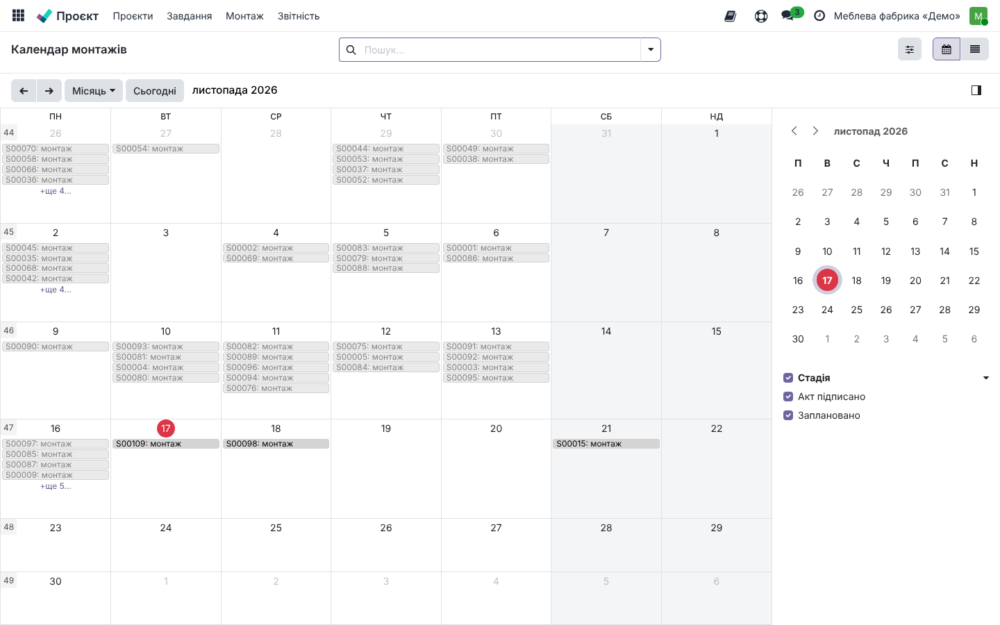
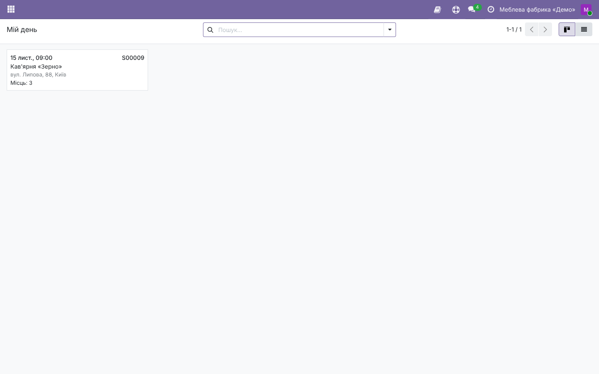
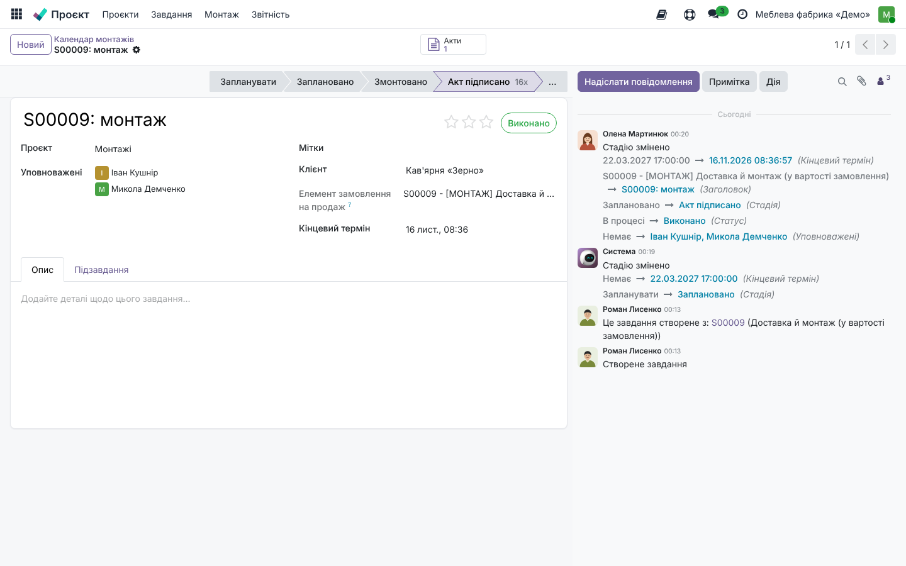
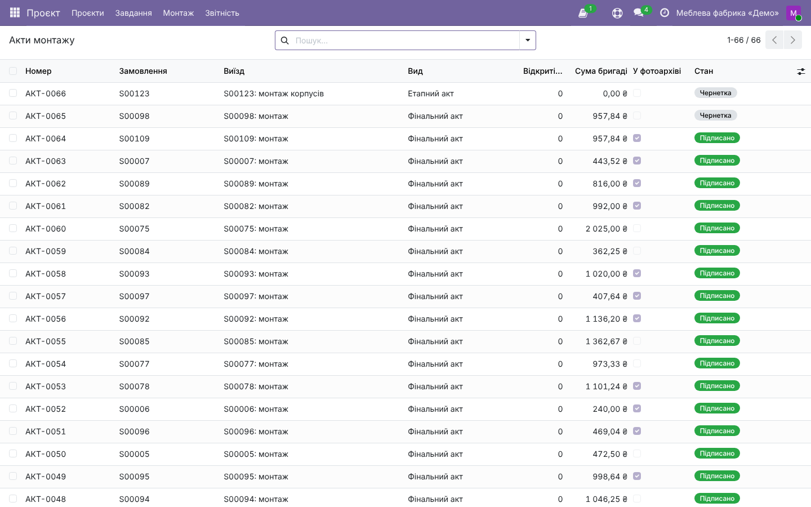
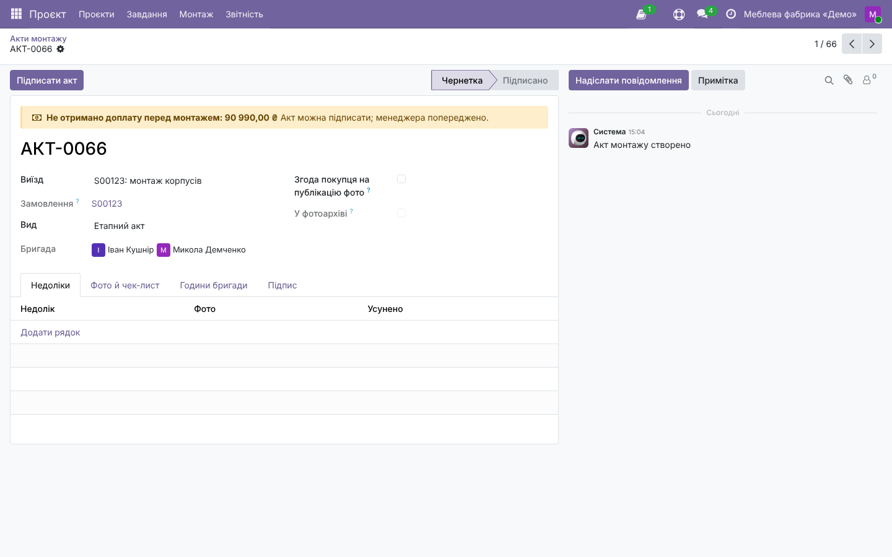
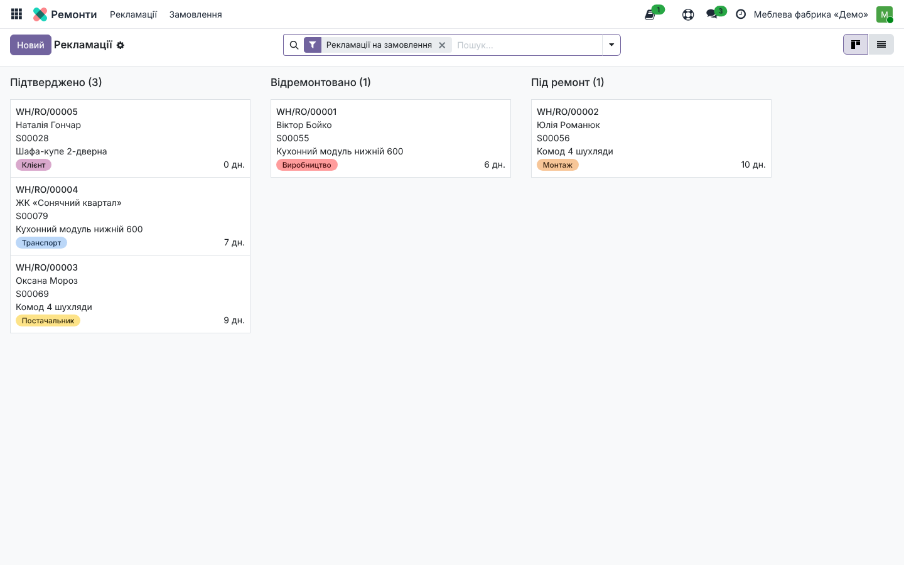
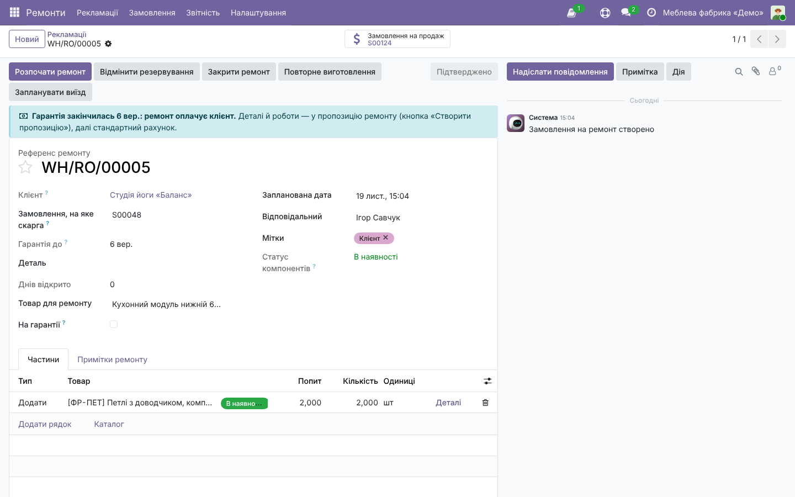
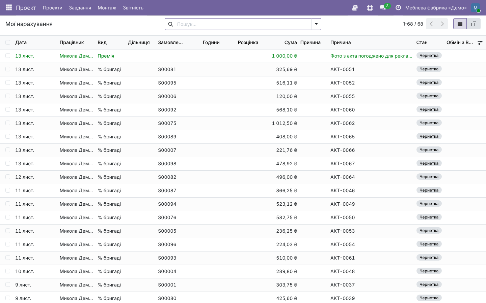

# Посібник: Бригадир монтажу й сервісу

Для кого: бригадир, монтажник, зовнішня бригада-ФОП і сервіс (ROLE-10): монтаж, акт, рекламація. Стенд/SHA: див. INDEX.md. Вхід у систему: демо-користувач `fitter@demo-fabryka.example`; рекламації — користувач із групою «Сервіс» (на стенді `store@demo-fabryka.example`, README стенда).

## SC-08 Монтаж, акт, рекламація
Коли: щодня на виїздах; рекламації — за зверненням покупця.  Результат: акт монтажу підписаний покупцем, фото в архіві за згодою, рекламація з виїздом або повторним виготовленням, нарахування бригади видно.
Статус: готово

| № | Дія | Що видно |
|---|---|---|
| 1 | Відкрийте «Проєкт» → «Монтаж» → «Календар монтажів»: ваші виїзди бригади. | Календар монтажів  |
| 2 | Відкрийте «Монтаж» → «Мій день»: виїзди на сьогодні з адресами й місцями (немає виїздів сьогодні — порожній екран «Створіть новий завдання»); друк «Денний план бригади». | Мій день  |
| 3 | Відкрийте задачу-виїзд і натисніть «Почати монтаж». Якщо доплату не отримано, на задачі банер «Не отримано доплату перед монтажем…» — зателефонуйте клієнту; у режимі блокування кнопка не пустить. | Задача-виїзд з кнопкою «Почати монтаж»  |
| 4 | Відкрийте «Монтаж» → «Акти монтажу» і акт свого виїзду. | Список актів монтажу  |
| 5 | Заповніть вкладки «Недоліки», «Фото й чек-лист», «Години бригади», «Підпис» (підпис покупця) і натисніть «Підписати акт». Друк — «Друк» → «Акт монтажу». Фото в архів — «У фотоархів» (лише якщо «Згода покупця на публікацію фото» відмічена). | Акт монтажу: стани «Чернетка» → «Підписано»; банер про доплату  |
| 6 | Рекламація (користувач із групою «Сервіс»): «Ремонти» → «Рекламації» → «Новий»: замовлення, деталь, причина, фото. Гарантію система рахує за строком категорії. | Рекламації за стадіями  |
| 7 | На рекламації: «Запланувати виїзд» (задача-виїзд сервісу в «Монтажі»), «Повторне виготовлення» (виробниче замовлення на деталь). Після гарантії («На гарантії» не відмічено, банер «Гарантія закінчилась …: ремонт оплачує клієнт») — платний ремонт (AC-112): деталі й роботи додайте на вкладці «Частини», натисніть стандартну «Створити пропозицію» — з'явиться пропозиція ремонту (смарт-кнопка «Замовлення на продаж»), її підтверджує менеджер, рахунок виставляє фінансист (`finansyst.md`, питання й відповіді). | Рекламація після гарантії: банер, кнопки «Запланувати виїзд», «Повторне виготовлення», смарт-кнопка пропозиції ремонту  |
| 8 | Свої нарахування — «Монтаж» → «Мої нарахування» (лише ваші рядки). | Мої нарахування  |

Типові помилки:
- «Підписати акт» без підпису покупця -> відмова; підписаний акт не редагується (AC-098).
- Чужі виїзди не видно -> бригадир бачить лише виїзди своєї бригади (AC-099).
- «У фотоархів» відмовляє -> немає згоди покупця на публікацію фото (AC-100).
- Акт без повної оплати -> акт можна підписати, менеджер отримує повідомлення про борг (AC-065).

Питання й відповіді (FAQ):
- Монтаж у кілька виїздів? — Кожен виїзд — своя задача, акт — фінальний; % бригаді рахується за параметром «База нарахування % бригаді» (VP-15) (AC-103).
- Як ділиться % між монтажниками? — Порівну або за часом — параметр «Поділ % бригаді між виконавцями» (VP-14) (AC-104, AC-106).
- Бригадир без доступу до ремонтів реєструє рекламацію? — Ні, рекламацію веде користувач із групою «Сервіс» (AC-110).

Пов'язані AC: AC-065, AC-095, AC-096, AC-097, AC-098, AC-099, AC-100, AC-102, AC-103, AC-106, AC-110, AC-111, AC-112, AC-132, також AC-080 (повторне виготовлення) і AC-104 (нарахування).
Пов'язані функції концепції: F-07, F-17, F-38, F-39, F-40, F-41, F-49, F-55, F-58.

## Довідка й підтримка
Значок «Довідка» (книжка) у верхній панелі — статті до поточного екрана; «Підтримка ToDo» — звернення в підтримку (див. menedzher.md «Довідка й підтримка»).

## Довідник ролі: меню, кнопки, друк
| Що | Де | Для чого |
|---|---|---|
| «Монтаж»: «Календар монтажів», «Мій день», «Акти монтажу», «Мої нарахування» | Проєкт | виїзди, акти, нарахування бригади |
| «Почати монтаж» | задача-виїзд | старт монтажу з контролем доплати |
| «Підписати акт», «У фотоархів» | акт монтажу | підпис покупця; фото в архів за згодою |
| «Денний план бригади» | «Мій день» → «Друк» | PDF плану бригади на день |
| «Акт монтажу» | акт → «Друк» | PDF акта монтажу |
| «Рекламації» | Ремонти | рекламації покупців (група «Сервіс») |
| «Запланувати виїзд», «Повторне виготовлення» | рекламація | сервісний виїзд; виробниче замовлення на деталь |
