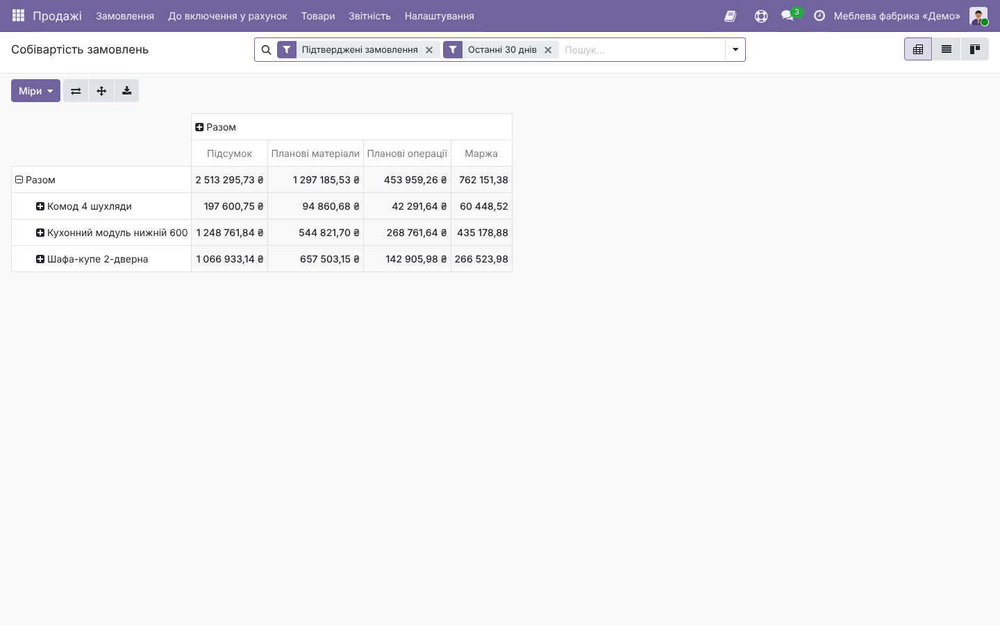

# Посібник: Фінансист

Для кого: фінансист і бухгалтер (ROLE-06): курс, собівартість, нарахування, звірка міграції. Стенд/SHA: див. INDEX.md. Вхід у систему: демо-користувач `fin@demo-fabryka.example` (README стенда).

## SC-05 Курс, собівартість, нарахування
Коли: щодня (оплати, курс), щомісяця (нарахування, собівартість).  Результат: план і факт собівартості перевірені, нарахування підтверджені й надруковані.
Статус: готово

| № | Дія | Що видно |
|---|---|---|
| 1 | Відкрийте «Продажі» → «Звітність» → «Собівартість: план і факт»: планова собівартість пропозиції проти спожитих матеріалів, фактичних годин, порізки й нарахувань. Перевитрату матеріалу показує стандартний діалог при завершенні виробничого замовлення (режим — параметр «Перевитрата матеріалу у виробництві»). Фільтри звіту: «Перевитрата» (замовлення, де спожито матеріалу більше за специфікацію), «Виробництво завершено» (AC-116). | Собівартість: план і факт  |
| 2 | Нарахування: «Виробництво» → «Звітність» → «Нарахування» (зведена таблиця за видами: «Премія», «% бригаді», «Штраф», «Відрядна»); перемкніть на список і натисніть «Нарахувати» (період) — відрядна з робочих завдань і % бригаді з актів. Перевірте, позначте рядки й натисніть «Підтвердити», надрукуйте «Відомість нарахувань» (у бухгалтерію її передає ваша звичайна процедура). Помилково підтверджені нарахування скасовує керівник — начальник виробництва («Виробництво: Адміністратор») або головний бухгалтер («Бухоблік: Адміністратор»): кнопка «Скасувати підтверджені» у списку (фінансист її не бачить) → вікно «Скасувати нарахування» з причиною (AC-106). | Нарахування цеху й бригадам  |
| 3 | (перший місяць після переходу) «Продажі» → «Налаштування» → «Міграція» → «Звірка»: «Порівняти з Odoo», розбіжності пояснити й «Підписати пояснення» («Повернути в чернетку» — переробити); друк «Звірка міграції». | Звірка міграції  |
| 4 | (коробка B) Курс НБУ: курси оновлює розклад «Курси НБУ»; «Продажі» → «Замовлення» → «Оновити ціни за курсом» перераховує прайс і чернетки пропозицій (підтверджені замовлення не змінюються). Собівартість рядків — «Продажі» → «Звітність» → «Собівартість замовлень». | Собівартість замовлень  |

Типові помилки (усі повідомлення системи дослівно — `reference/messages.md`):
- «Онлайн-завантаження курсів НБУ вимкнено (системний параметр td_mebli_ua.nbu_online)» при ручному оновленні -> онлайн-курси вимкнено, вмикає адміністратор (admin.md «Локалізація UA»); на демо-стенді курси — імітація.
- НБУ недоступний -> курс лишається вчорашній, у журналі — повідомлення; ціни не перераховуються (AC-038).
- Нарахування «без розцінки» -> операція маршруту без розцінки; заповніть розцінку операції (AC-105; технолог — `setup.md` § Специфікація й операції).

Питання й відповіді (FAQ):
- Хто бачить собівартість? — Лише групи «Фінансист» і керівник (AC-115).
- Як виставити рахунок за платний ремонт після гарантії? — Пропозицію ремонту створює сервіс з рекламації («Створити пропозицію», `bryhadyr.md` крок 7); після підтвердження менеджером відкрийте замовлення на продаж (смарт-кнопка на рекламації) і «Створити рахунок» — стандартний рахунок клієнту (AC-112, F-55).
- Як вручну зафіксувати оплату перед монтажем? — На замовленні «Оплату підтверджено вручну» → вікно «Підтвердити оплату»: «Сума» (додатна, у валюті замовлення) і «Причина» (обов'язково, напр. «оплата готівкою, квитанція №…»); «Хто позначив» і «Коли позначено» заповнюються самі; позначка видна в «Ручні позначки оплати» замовлення; суму не змінюють — скасуйте позначку й додайте нову; коли оплату зареєстровано в Odoo (рахунок оплачено), зніміть позначку перемикачем «Скасовано» в «Ручні позначки оплати» (AC-021).

Пов'язані AC: AC-021, AC-037, AC-038, AC-089, AC-090, AC-104, AC-105, AC-114, AC-115, AC-116, AC-134.
Пов'язані функції концепції: F-14, F-22, F-26, F-41, F-46, F-52, F-61 (F-61 — кіоск відвідувань, стандарт).

## Довідка й підтримка
Значок «Довідка» (книжка) у верхній панелі — статті до поточного екрана; «Підтримка ToDo» — звернення в підтримку (див. menedzher.md «Довідка й підтримка»).

## Довідник ролі: меню, кнопки, друк
| Що | Де | Для чого |
|---|---|---|
| «Собівартість: план і факт» | Продажі → Звітність | план ↔ факт собівартості замовлень |
| «Собівартість замовлень» | Продажі → Звітність | собівартість і маржа рядків замовлень |
| «Нарахування» (вікно «Нарахувати»; «Скасувати підтверджені» — лише начальник виробництва або головний бухгалтер) | Виробництво → Звітність | відрядна й % бригаді за період |
| «Відомість нарахувань» | нарахування → «Друк» | PDF відомості |
| «Міграція»: «Звірка» (дія «Звірка міграції»; «Порівняти з Odoo», «Повернути в чернетку», «Підписати пояснення»), «Порядок імпорту шаблонів» | Продажі → Налаштування | звірка перенесених даних першого місяця |
| «Звірка міграції» | звірка → «Друк» | PDF звірки |
| «Оновити ціни за курсом» | Продажі → Замовлення | перерахунок прайсу й чернеток за курсом НБУ (коробка B) |
| «Оплату підтверджено вручну» (вікно «Підтвердити оплату») | замовлення | ручне підтвердження доплати перед монтажем |
