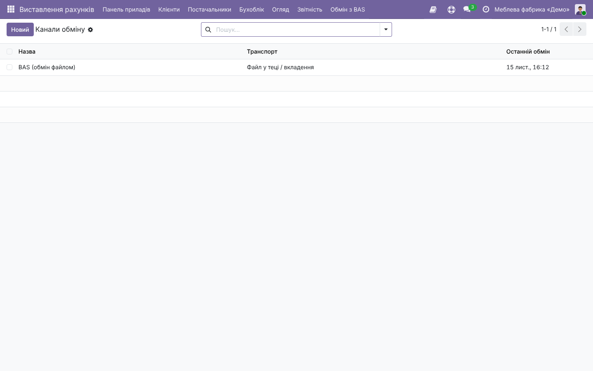
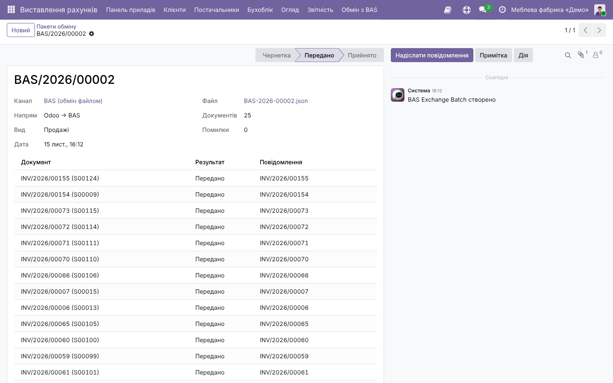
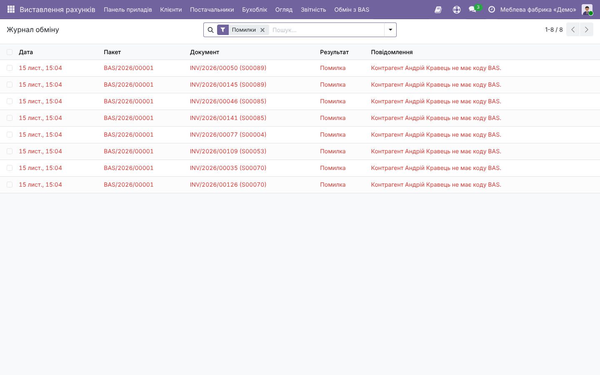
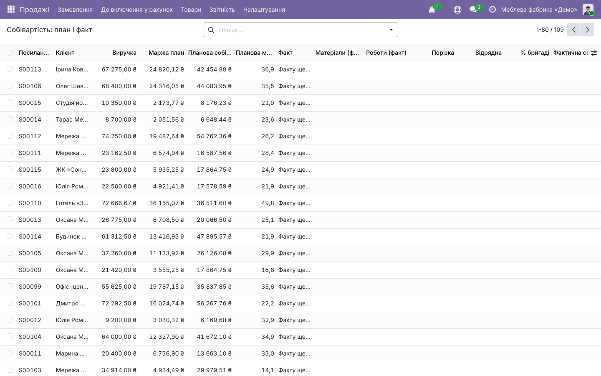
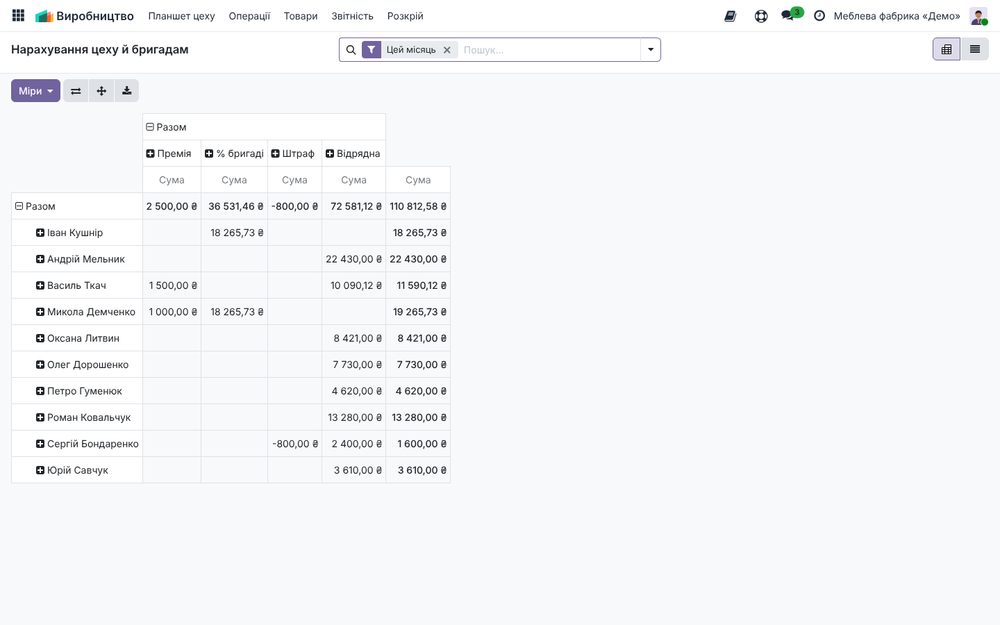
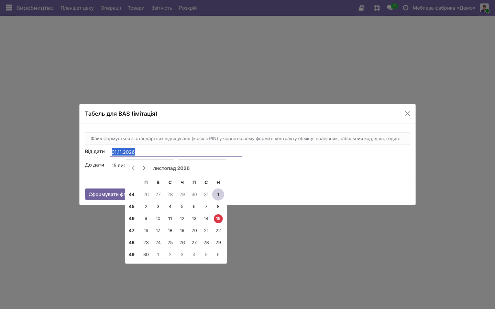
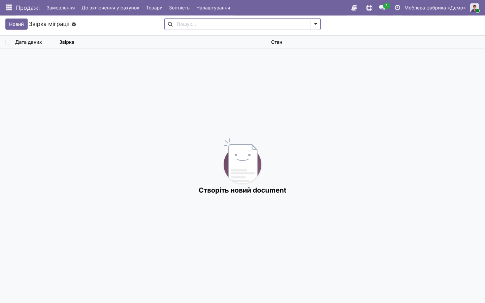

# Посібник: Фінансист

Для кого: фінансист і бухгалтер (ROLE-06): курс, обмін з BAS, собівартість, нарахування. Стенд/SHA: див. INDEX.md. Вхід у систему: демо-користувач `fin@demo-fabryka.example` (README стенда).

## SC-05 Курс, обмін з BAS, собівартість, нарахування
Коли: щодня (обмін, оплати), щомісяця (нарахування, табель, собівартість).  Результат: документи передані в BAS, план і факт собівартості перевірені, нарахування підтверджені й передані, табель вивантажено.
Статус: готово

| № | Дія | Що видно |
|---|---|---|
| 1 | Відкрийте «Виставлення рахунків» → «Обмін з BAS» → «Канали»: канал обміну (транспорт — файл), час останнього запуску; «Передати в BAS» — передати накопичені документи зараз (інакше — за розкладом «Меблі: обмін з BAS»). | Канали обміну  |
| 2 | Відкрийте «Обмін з BAS» → «Пакети»: пакет `BAS/РРРР/NNNNN` має стан «Чернетка» → «Передано» → «Прийнято», «Документів», «Помилки». Пакет від BAS — «Імпортувати»; після помилки — «Повторити». На замовленні й рахунку видно поле «Обмін з BAS»; на замовленні — «Передати в BAS». | Пакет обміну  |
| 3 | Перевірте «Обмін з BAS» → «Журнал»: кожна передача й помилка з поясненням. | Журнал обміну  |
| 4 | Відкрийте «Продажі» → «Звітність» → «Собівартість: план і факт»: планова собівартість пропозиції проти спожитих матеріалів, фактичних годин, порізки й нарахувань. Перевитрату матеріалу показує стандартний діалог при завершенні виробничого замовлення (режим — параметр «Перевитрата матеріалу у виробництві»). | Собівартість: план і факт  |
| 5 | Нарахування: «Виробництво» → «Звітність» → «Нарахування» → «Нарахувати» (період) — відрядна з робочих завдань і % бригаді з актів. Перевірте, підтвердіть, надрукуйте «Відомість нарахувань» і натисніть «Передати в BAS». Помилково підтверджені — «Скасувати підтверджені» у списку → вікно «Скасувати нарахування». | Нарахування цеху й бригадам  |
| 6 | Табель: «Відвідування» → «Управління» → «Табель для BAS (імітація)»: «Від дати», «До дати», «Сформувати файл» (або «Передати в BAS»). | Вікно «Табель для BAS (імітація)»  |
| 7 | (перший місяць після переходу) «Продажі» → «Налаштування» → «Міграція» → «Звірка»: «Порівняти з Odoo», розбіжності пояснити й «Підписати пояснення» («Повернути в чернетку» — переробити); друк «Звірка міграції». | Звірка міграції  |
| 8 | (коробка B) Курс НБУ: курси оновлює розклад «Курси НБУ»; «Продажі» → «Замовлення» → «Оновити ціни за курсом» перераховує прайс і чернетки пропозицій (підтверджені замовлення не змінюються). Собівартість рядків — «Продажі» → «Звітність» → «Собівартість замовлень». | Собівартість замовлень  |

Типові помилки:
- НБУ недоступний -> курс лишається вчорашній, у журналі — повідомлення; ціни не перераховуються (AC-038).
- Помилка обміну -> пакет у стані помилки, рядок у «Журнал»; після виправлення — «Повторити» (AC-040).
- Документ, переданий у BAS, не змінюється -> спершу скасування в BAS за контрактом обміну (AC-041).
- Нарахування «без розцінки» -> операція маршруту без розцінки; заповніть розцінку операції (AC-105).
- Нарахування працівнику не передалось у BAS -> у картці працівника немає табельного коду BAS.

Питання й відповіді (FAQ):
- Оплата з BAS закриває етап графіка? — Так, за контрактом обміну; формат файла оплат — відкрите питання до франчайзі BAS (на стенді не відтворено, AC-042).
- Хто бачить собівартість? — Лише групи «Фінансист» і керівник (AC-115).
- Як вручну зафіксувати оплату перед монтажем? — На замовленні «Оплату підтверджено вручну» → вікно «Підтвердити оплату» (AC-021).

Пов'язані AC: AC-021, AC-037, AC-038, AC-039, AC-040, AC-041, AC-042, AC-078, AC-089, AC-090, AC-104, AC-105, AC-109, AC-114, AC-115, AC-116, AC-134.
Пов'язані функції концепції: F-14, F-22, F-26, F-41, F-46, F-47, F-52, F-61.

## Довідка й підтримка
Значок «Довідка» (книжка) у верхній панелі — статті до поточного екрана; «Підтримка ToDo» — звернення в підтримку (див. menedzher.md «Довідка й підтримка»).

## Довідник ролі: меню, кнопки, друк
| Що | Де | Для чого |
|---|---|---|
| «Обмін з BAS»: «Пакети» (дія «Пакети обміну»), «Канали» (дія «Канали обміну»), «Журнал» (дія «Журнал обміну») | Виставлення рахунків | обмін документами з BAS/BAF |
| «Передати в BAS» | канал, замовлення, табель, нарахування | передача документів у BAS |
| «Імпортувати», «Повторити» | пакет обміну | прийняти пакет від BAS; повторити після помилки |
| «Собівартість: план і факт» | Продажі → Звітність | план ↔ факт собівартості замовлень |
| «Собівартість замовлень» | Продажі → Звітність | собівартість і маржа рядків замовлень |
| «Нарахування» (вікно «Нарахувати»; «Скасувати підтверджені» → вікно «Скасувати нарахування») | Виробництво → Звітність | відрядна й % бригаді за період |
| «Відомість нарахувань» | нарахування → «Друк» | PDF відомості |
| «Табель для BAS (імітація)» (вікно «Сформувати файл») | Відвідування → Управління | файл табеля з відвідувань |
| «Міграція»: «Звірка» (дія «Звірка міграції»; «Порівняти з Odoo», «Повернути в чернетку», «Підписати пояснення»), «Порядок імпорту шаблонів» | Продажі → Налаштування | звірка перенесених даних першого місяця |
| «Звірка міграції» | звірка → «Друк» | PDF звірки |
| «Оновити ціни за курсом» | Продажі → Замовлення | перерахунок прайсу й чернеток за курсом НБУ (коробка B) |
| «Оплату підтверджено вручну» (вікно «Підтвердити оплату») | замовлення | ручне підтвердження доплати перед монтажем |
