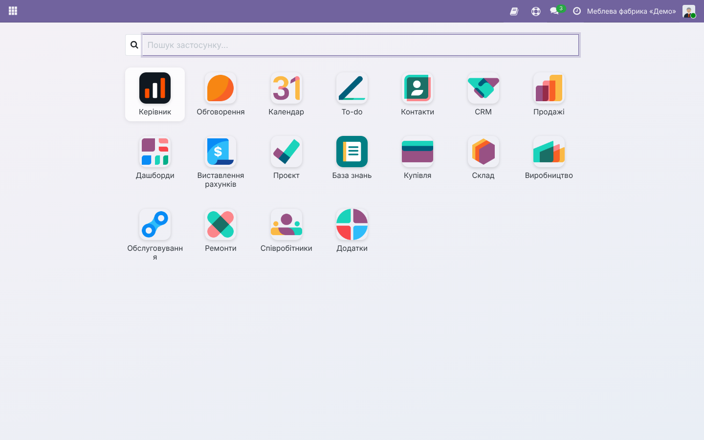
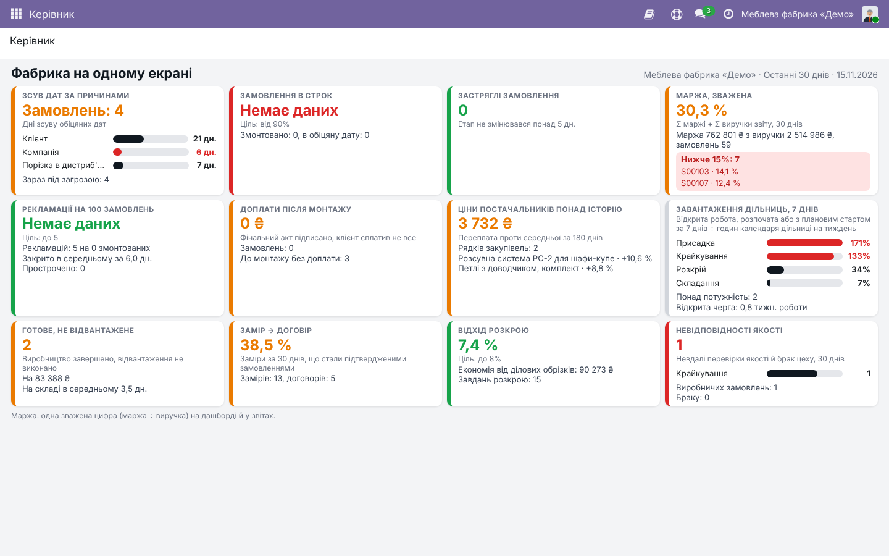
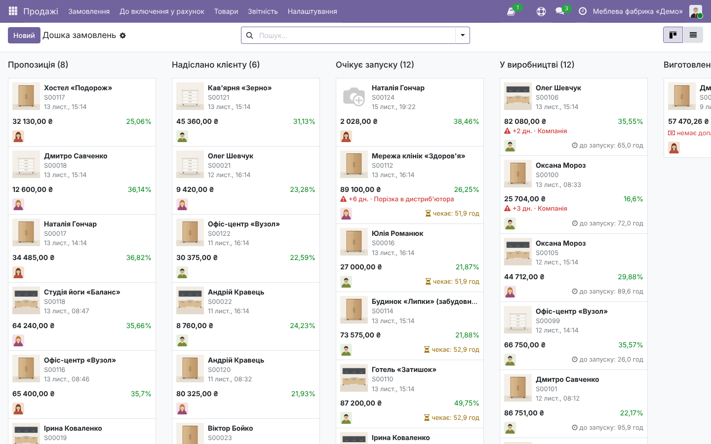
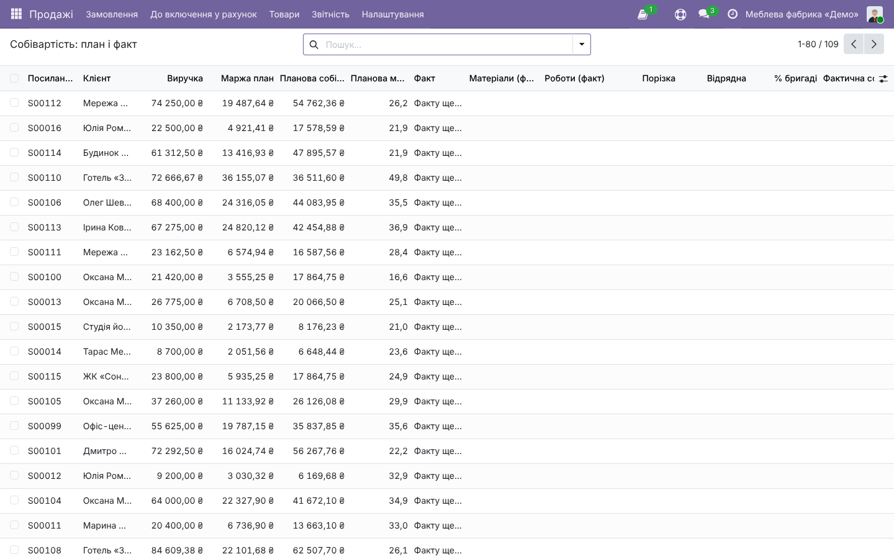
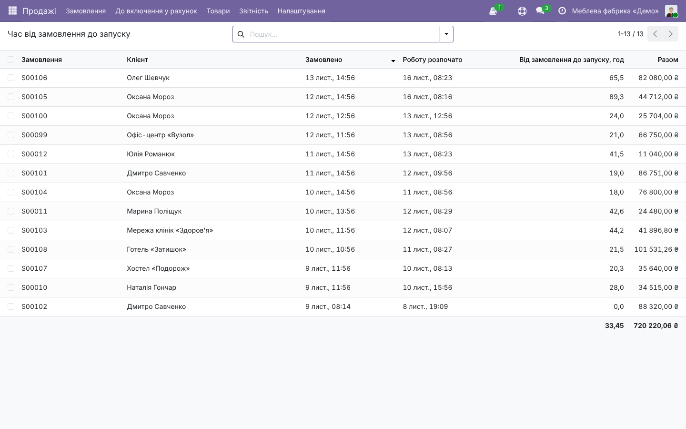
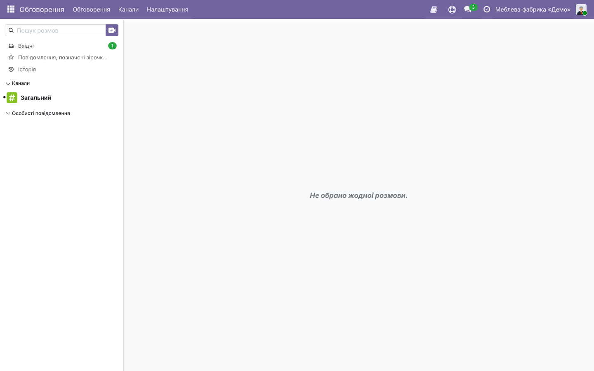

# Посібник: Керівник

Для кого: власник або керівник фабрики (ROLE-08, покупець пакета): ранковий брифінг, дашборд і перехід до записів. Стенд/SHA: див. INDEX.md. Вхід у систему: демо-користувач `owner@demo-fabryka.example` (README стенда).

## SC-06 Від дашборда до рішення
Коли: щоранку і за потреби протягом дня.  Результат: керівник бачить стан фабрики на одному екрані й відкриває записи, що потребують рішення.
Статус: готово

| № | Дія | Що видно |
|---|---|---|
| 1 | Увійдіть: головний екран показує плитки всіх ваших застосунків, серед них «Керівник». | Головний екран керівника  |
| 2 | Відкрийте «Керівник» («Фабрика на одному екрані», останні 30 днів): 12 карток — «Зсув дат за причинами», «Замовлення в строк», «Застряглі замовлення», «Маржа, зважена», «Рекламації на 100 замовлень», «Доплати після монтажу», «Ціни постачальників понад історію», «Завантаження дільниць, 7 днів», «Готове, не відвантажене», «Замір → договір», «Відхід розкрою», «Невідповідності якості» (коробка B). Натисніть картку — відкриються записи, з яких вона рахується. | Дашборд «Керівник»  |
| 3 | Відкрийте «Продажі» → «Замовлення» → «Дошка замовлень»: картки з причиною зсуву і часом очікування клієнта. | Дошка замовлень  |
| 4 | Відкрийте «Продажі» → «Звітність» → «Собівартість: план і факт» — завершені замовлення з плановою і фактичною собівартістю; з рядка — до замовлення і його специфікації. | Собівартість: план і факт  |
| 5 | Відкрийте «Продажі» → «Звітність» → «Час від замовлення до запуску» — скільки днів замовлення чекають запуску у виробництво. | Час від замовлення до запуску  |
| 6 | Ранковий брифінг приходить щоранку о 07:30 у «Обговорення» (лист «Меблі: ранковий брифінг власника» за даними дашборда, без AI). Якщо звітувати нічого, брифінг не надсилається. | Вхідні в «Обговорення»  |

Типові помилки:
- Картки показують 0 або «Немає даних» -> за останні 30 днів немає даних для цієї картки; період дашборда фіксований (30 днів), це не помилка (AC-123).
- Меню «Керівник» немає -> у користувача немає групи «Керівник фабрики (дашборд)»; призначає адміністратор (AC-122).
- Брифінг не прийшов -> вихідна пошта не налаштована або звітувати нічого (AC-124, AC-125).

Питання й відповіді (FAQ):
- Що таке «застряглі» замовлення? — Без руху понад кількість днів з параметра «Застряглі замовлення, днів без руху» (VP-10, за замовчуванням 5) (AC-067).
- Чи можна змінити час брифінгу? — Ні, фіксовано 07:30 за часовим поясом компанії (SPEC §11.4).

Пов'язані AC: AC-067, AC-121, AC-122, AC-123, AC-124, AC-125, також AC-114 і AC-051 (переходи до собівартості й специфікації).
Пов'язані функції концепції: F-07, F-45, F-64.

## Довідка й підтримка
Значок «Довідка» (книжка) у верхній панелі — статті до поточного екрана; «Підтримка ToDo» — звернення в підтримку (див. menedzher.md «Довідка й підтримка»).

## Довідник ролі: меню, кнопки, друк
| Що | Де | Для чого |
|---|---|---|
| «Керівник» | головний екран (застосунок) | дашборд керівника з переходом до записів |
| «Дошка замовлень» | Продажі → Замовлення | етапи й зсуви замовлень |
| «Собівартість: план і факт», «Собівартість замовлень», «Час від замовлення до запуску» | Продажі → Звітність | собівартість і швидкість запуску |
| «Ціни проти історії» | Купівля → Звітність | ціни постачальників вище історії |
| «Меблі: ранковий брифінг власника» | розклад і шаблон листа | щоденний брифінг о 07:30 |
