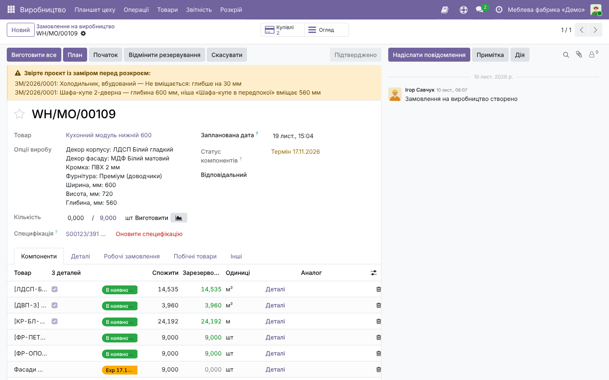
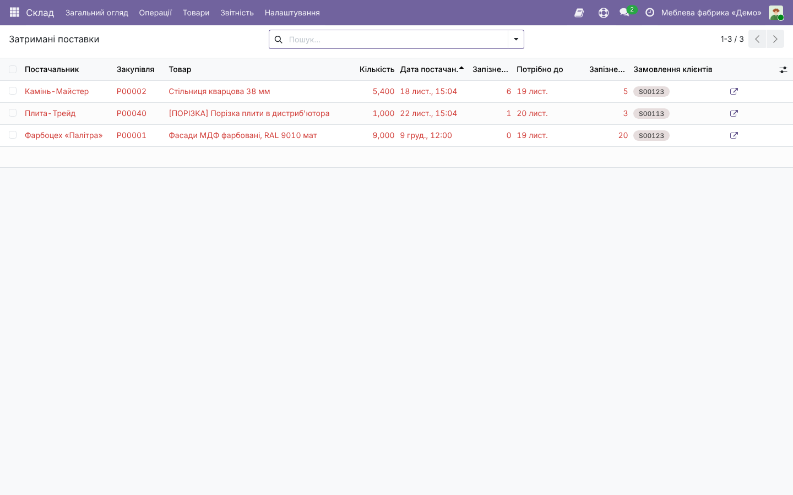
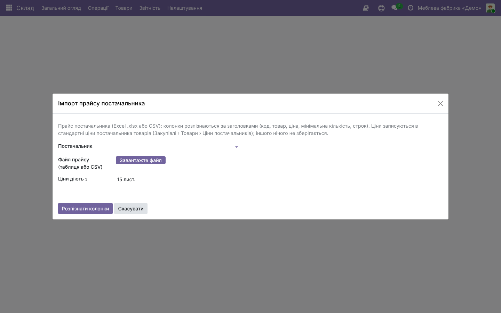
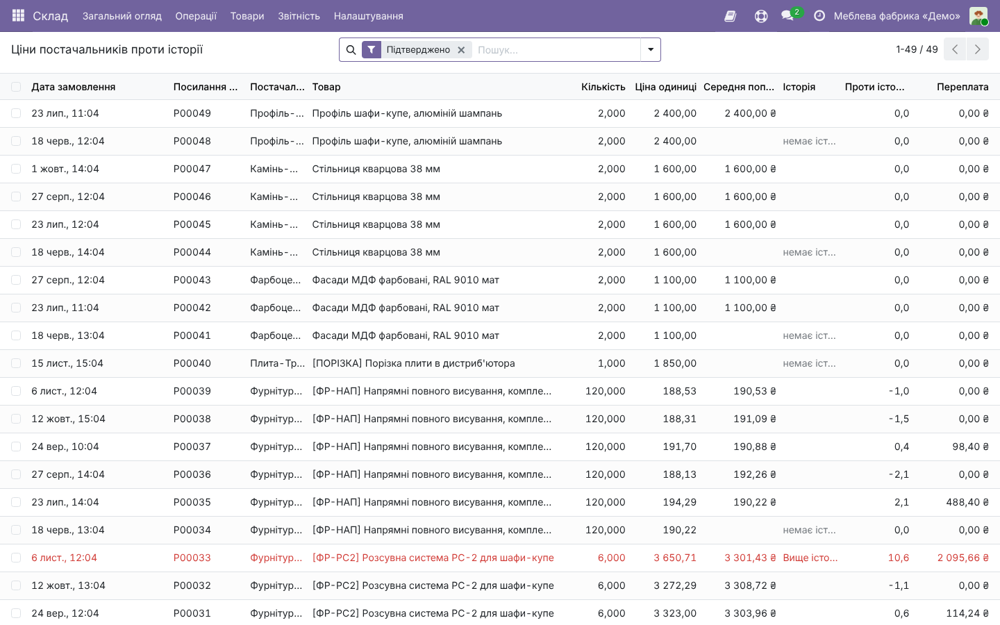
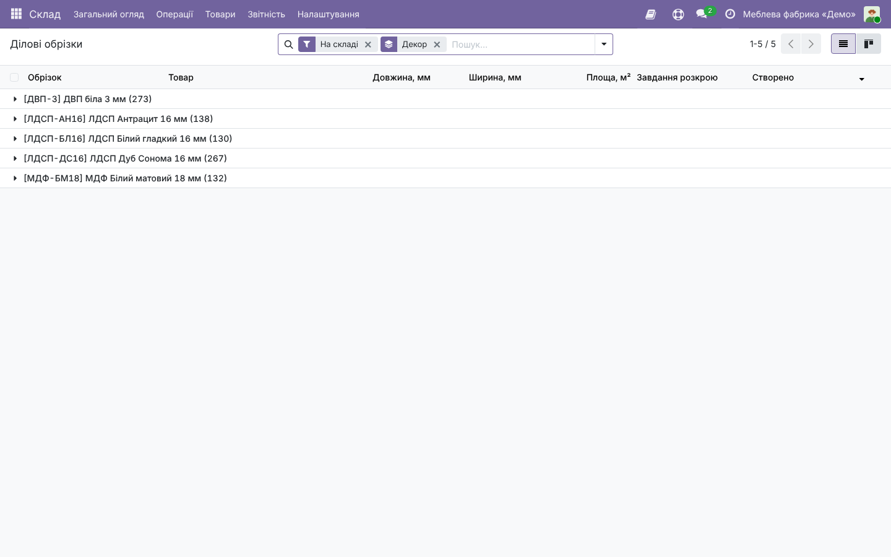
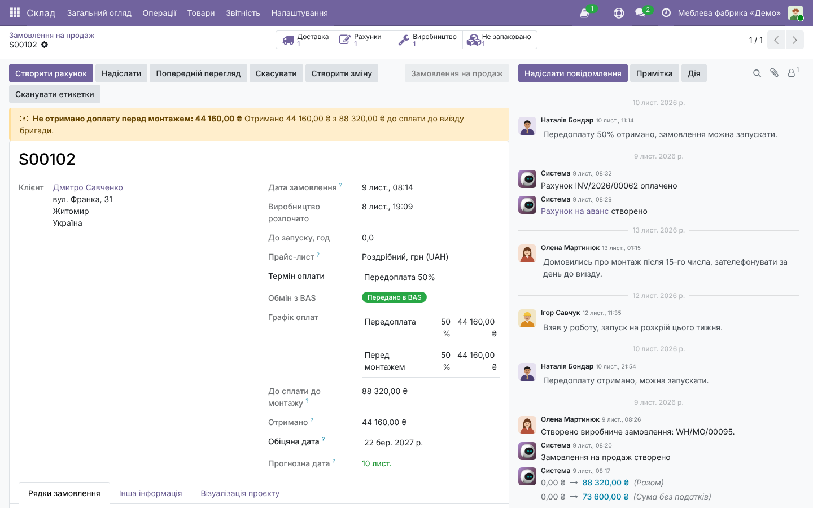
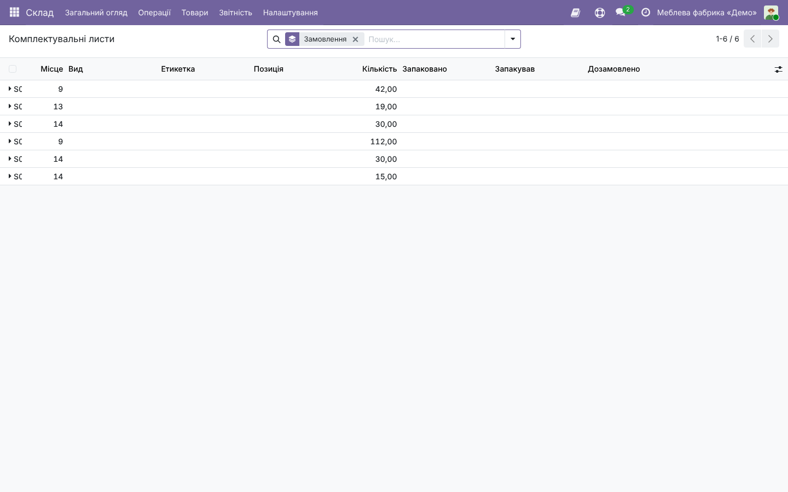
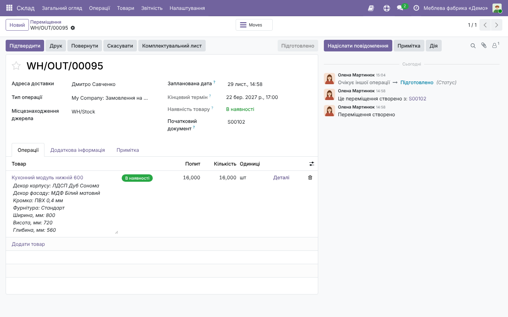

# Посібник: Комірник-комплектувальник і закупівля

Для кого: комірник, комплектувальник і закупівельник (ROLE-05): резерв, закупівля, прайси, обрізки, повний комплект. Стенд/SHA: див. INDEX.md. Вхід у систему: демо-користувач `store@demo-fabryka.example` (README стенда).

## SC-04 Резерв, закупівля, обрізки, повний комплект
Коли: щодня; прайси — коли постачальник надіслав новий.  Результат: матеріали зарезервовані, затримки постачальників видно разом із зачепленими замовленнями, ціни постачальників оновлені, комплект запакований і відвантажений лише повним.
Статус: готово

| № | Дія | Що видно |
|---|---|---|
| 1 | Відкрийте виробниче замовлення: наявні компоненти Odoo резервує автоматично, «Статус компонентів» показує нестачу; закупівлі під замовлення — смарт-кнопка «Купівлі». (коробка B) Немає матеріалу — «Взяти аналог». | Виробниче замовлення з резервом і повідомленням «Звірте проєкт із заміром…»  |
| 2 | Відкрийте «Склад» → «Операції» → «Затримані поставки» (те саме — «Купівля» → «Замовлення» → «Затримані поставки»): рядки закупівель, що запізнюються, із замовленнями клієнтів, які вони зсувають. Внесіть нову дату постачальника в закупівлі — прогнозна дата замовлення клієнта перерахується. | Список затриманих поставок  |
| 3 | Імпортуйте прайс: «Купівля» → «Товари» → «Імпорт прайсу». Оберіть «Постачальник», файл Excel або CSV, «Ціни діють з», натисніть «Розпізнати колонки», перегляньте нові, змінені й невідомі коди і натисніть «Записати ціни». | Вікно «Імпорт прайсу постачальника»  |
| 4 | Перевірте ціни: «Купівля» → «Звітність» → «Ціни проти історії» — рядки закупівель з ціною вище історії понад поріг позначено. | Ціни постачальників проти історії  |
| 5 | (коробка B) Прийміть ділові обрізки після розкрою: «Склад» → «Товари» → «Ділові обрізки» — партії-обрізки з розмірами. | Ділові обрізки  |
| 6 | На замовленні клієнта натисніть «Сформувати комплектувальний лист» (смарт-кнопка «Не запаковано» — скільки лишилось), друк — «Друк» → «Комплектувальний лист». (коробка B) «Сканувати етикетки»: зчитайте QR етикетки і натисніть «Запакувати». | Замовлення з кнопками «Сформувати комплектувальний лист», «Сканувати етикетки»  |
| 7 | Позначайте запаковане у «Склад» → «Операції» → «Комплектувальні листи»: місце — вид — деталь — кількість — етикетка, позначка «Запаковано». | Комплектувальні листи  |
| 8 | Відвантаження: на доставці «Комплектувальний лист» показує комплект; «Підтвердити» неповного комплекту відмовляє з переліком незапакованих деталей. Відсутню деталь — «Створити дозамовлення» (виробниче замовлення на деталь). | Доставка з кнопкою «Комплектувальний лист»  |

Типові помилки:
- Немає історії цін товару -> позначки «вище історії» немає, рядок без порівняння (AC-086).
- Невідомий код у прайсі -> рядок не записується, лишається в переліку «не знайдено» (AC-087).
- Невідома етикетка при скануванні -> повідомлення, нічого не позначено (AC-062).
- Відвантаження не підтверджується -> комплект неповний: допакуйте або створіть дозамовлення (AC-092, AC-093).

Питання й відповіді (FAQ):
- Який поріг «вище історії»? — Параметр компанії «Поріг ціни закупівлі вище історії, %» (VP-11, за замовчуванням 5 %).
- Чи можна надрукувати комплектувальний лист? — Так, «Друк» → «Комплектувальний лист» на замовленні (AC-094).
- Де ціни в динаміці? — Стандартний аналіз закупівель у «Купівля» → «Звітність» (AC-084).

Пов'язані AC: AC-059, AC-062, AC-082, AC-083, AC-084, AC-085, AC-086, AC-087, AC-088, AC-091, AC-092, AC-093, AC-094.
Пов'язані функції концепції: F-09, F-10, F-11, F-12, F-29, F-35, F-37, F-49, F-57, F-59.

## Довідка й підтримка
Значок «Довідка» (книжка) у верхній панелі — статті до поточного екрана; «Підтримка ToDo» — звернення в підтримку (див. menedzher.md «Довідка й підтримка»).

## Довідник ролі: меню, кнопки, друк
| Що | Де | Для чого |
|---|---|---|
| «Затримані поставки» | Склад → Операції; Купівля → Замовлення | рядки закупівель, що запізнюються, з замовленнями клієнтів |
| «Імпорт прайсу» (дія «Імпорт прайсу постачальника»; вікно: «Розпізнати колонки», «Записати ціни») | Купівля → Товари | прайс постачальника з Excel/CSV у ціни постачальників |
| «Ціни проти історії» (дія «Ціни постачальників проти історії») | Купівля → Звітність | ціни, вищі за історію понад поріг |
| «Комплектувальні листи» | Склад → Операції | рядки комплектування по місцях |
| «Сформувати комплектувальний лист», «Сканувати етикетки» (вікно «Запакувати») | замовлення клієнта | комплектування й сканування етикеток |
| «Комплектувальний лист» | доставка (кнопка); замовлення → «Друк» | комплект на відвантаження; друк листа |
| «Акт приймання-передачі» | доставка → «Друк» | акт для виробу без монтажу |
| «Ділові обрізки» | Склад → Товари | партії-обрізки з розмірами (коробка B) |
| «Взяти аналог» | виробниче замовлення | заміна відсутнього матеріалу аналогом (коробка B) |
| «Рекламації» | Ремонти | реєстрація рекламації користувачем із групою «Сервіс» (див. bryhadyr.md) |
