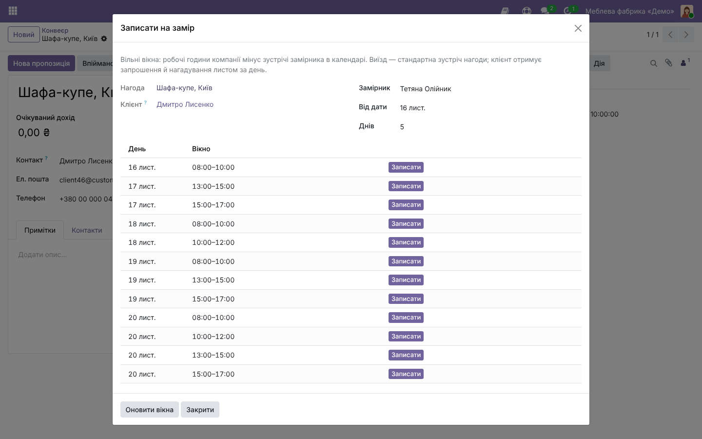
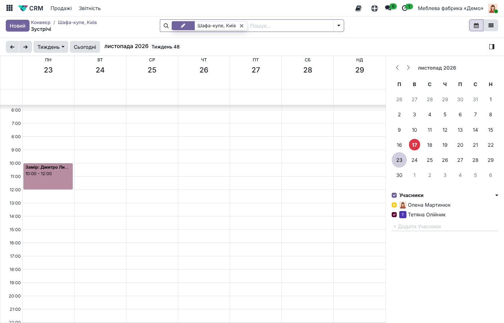
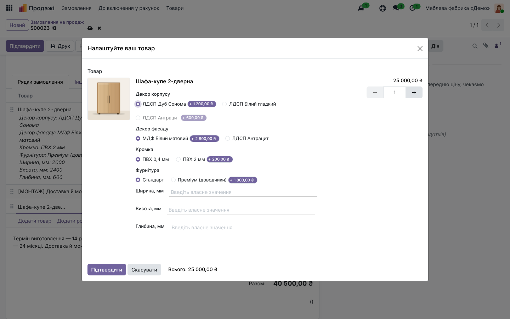
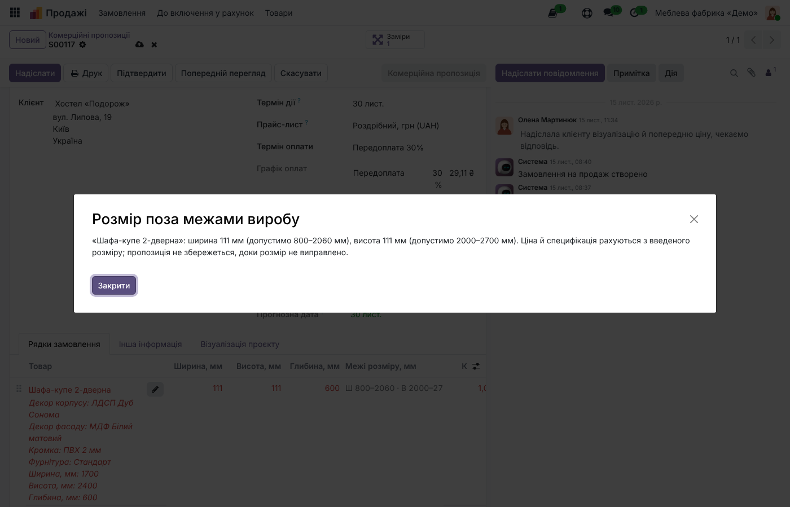
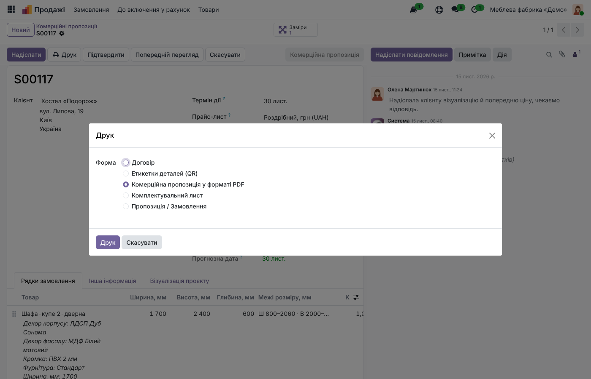
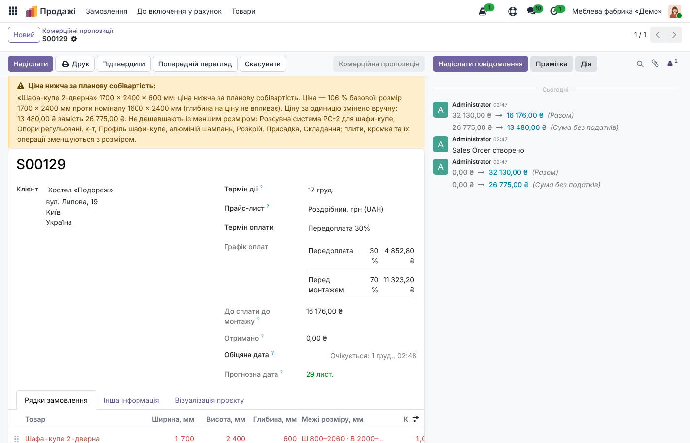
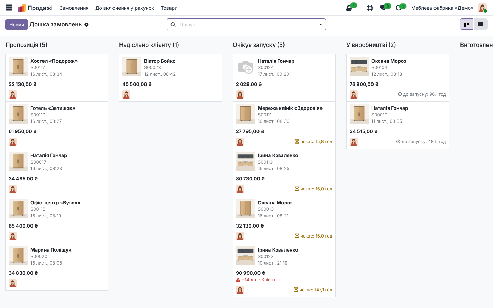
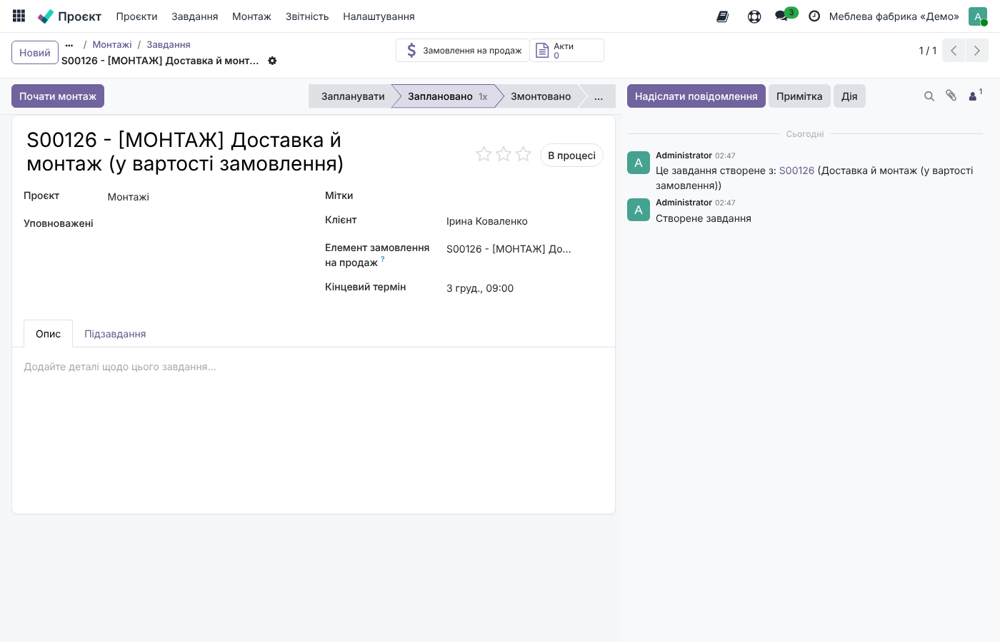

# Посібник: Менеджер продажу

Для кого: менеджер салону (ROLE-02), який веде замовлення від заявки до запланованого монтажу. Стенд/SHA: див. INDEX.md.

Вхід: `salon@demo-fabryka.example`; пароль — змінна `DEMO_USERS_PASSWORD` (README стенда; без неї — пароль демо-ролей, який дав той, хто піднімав стенд, або Тімлід; у посібник пароль не пишемо).

## SC-01 Від заявки до запланованого монтажу
Коли: щодня, на кожну нову заявку й замовлення.  Результат: нагода із зустріччю заміру, замовлення з ціною з розмірів, графіком оплат, договором, обіцяною й прогнозною датою, задача-виїзд монтажу.
Статус: готово

| № | Дія | Що видно |
|---|---|---|
| 1 | Увійдіть у систему. Відкривається головний екран із плитками застосунків; натисніть плитку «CRM» (пошук застосунку — поле вгорі, Enter відкриває). | Головний екран: плитки застосунків менеджера  |
| 2 | Відкрийте нагоду в «Конвеєр» (заявка покупця). На картці — кнопки «Нова пропозиція», «Записати на замір», смарт-кнопка «Наступна зустріч». | Картка нагоди з кнопкою «Записати на замір»  |
| 3 | Натисніть «Записати на замір». У вікні — вільні вікна замірника на найближчі дні; натисніть «Записати» біля зручного вікна («Оновити вікна» — перерахувати після зміни днів). Смарт-кнопка зустрічей нагоди («Наступна зустріч», «Остання зустріч» або «Немає зустрічі») відкриває календар, де вже позначено (фільтр «Учасники» праворуч) календарі ваш, відповідального нагоди, внутрішніх учасників її зустрічей і замірника її замір-листів; поки замір-листа немає — усіх замірників, щоб вибрати вільного. Календаря покупця там немає (AC-135). Зайвого учасника знімає хрестик біля імені. | Вікно «Записати на замір» зі списком вільних вікон; після запису зустріч є в календарі замірника, покупцю йде лист «Меблі: запис на замір»  Календар зі смарт-кнопки «Наступна зустріч»: позначено замірників  |
| 4 | На нагоді натисніть «Нова пропозиція», у «Рядки замовлення» — «Додати товар» і виріб. (коробка B) Для виробу з опціями відкривається конфігуратор «Налаштуйте ваш товар»: оберіть «Декор корпусу», «Декор фасаду», «Кромка», «Фурнітура» (доплата значення — поруч), впишіть «Ширина, мм», «Висота, мм», «Глибина, мм» і натисніть «Підтвердити». Несумісні значення (напр. кромка не до цього декору) не пропонуються; розмір поза межами виробу — одразу після «Підтвердити» в конфігураторі або після введення в колонці рядка — вікно-попередження «Розмір поза межами виробу» (кнопка «Закрити») з усіма хибними розмірами й межами, напр. «Шафа-купе 2-дверна»: ширина 111 мм (допустимо 800–2060 мм); висота 111 мм (допустимо 2000–2700 мм); глибина 1111 мм (допустимо 450–700 мм)…»; межі виробу видно й у колонці рядка «Межі розміру, мм» (напр. «Ш 800–2060 · В 2000–2700 · Г 450–700»). Виправте розмір: з хибним розміром пропозиція не збережеться — помилка «`«%(product)s»: розмір поза межами виробу: %(problems)s.`» (AC-015, AC-136). Під час підтвердження замовлення з опцій і правил деталей створюється чернетка специфікації замовлення (AC-011…AC-013). У рядку замовлення значок «Сформувати специфікацію» (шестерні) будує специфікацію рядка з опцій і правил деталей одразу, без підтвердження; значок «Специфікація» відкриває її (на специфікації смарт-кнопка «Замовлення на продаж» веде назад). | Конфігуратор «Налаштуйте ваш товар»  Попередження «Розмір поза межами виробу» одразу після введення  |
| 5 | Ціна рядка рахується з розмірів (зміна ширини в рядку перераховує ціну). Оберіть «Термін оплати» з етапами — заповниться «Графік оплат». Кнопка «Друк» у шапці пропозиції й замовлення відкриває список друкованих форм: «Комерційна пропозиція у форматі PDF», «Пропозиція / Замовлення», «Договір» (PDF у режимі договору компанії), «Комплектувальний лист», «Етикетки деталей (QR)» — виберіть форму й натисніть «Друк» (AC-138; ті самі форми — у ⚙ → «Друк»). «Надіслати» — покупець отримає пропозицію з візуалізацією й підпише її порталом; потім «Підтвердити». Вкладка «Собівартість» пропозиції (бачать група «Меблі: Бачить маржу», фінансист, керівник продажу; менеджеру — лише при VP-08): по кожному рядку «Планові матеріали», «Планові операції», собівартість, сума, маржа й маржа %, внизу «Маржа замовлення» і «Маржа замовлення, %» (AC-017). Вкладка «Візуалізація проєкту»: завантажте зображення проєкту від дизайнера — воно друкується в PDF пропозиції («Друк» → «Пропозиція / Замовлення») під реквізитами замовлення (AC-032). Якщо ціна рядка нижча за планову собівартість (напр. малий розмір: ціна рахується від площі, а фурнітура й складання від розміру не дешевшають), над формою — жовтий блок «Ціна нижча за планову собівартість:» з причиною (частка базової ціни, розмір проти номіналу, що не дешевшає), рядок — червоний; хто бачить маржу — ще ціна, собівартість, маржа й складові. Надіслати й підтвердити можна — це попередження, не заборона; рішення — за вами чи керівником (AC-137). | Пропозиція: «Термін оплати», «Графік оплат», «До сплати до монтажу», «Обіцяна дата», «Прогнозна дата»  Кнопка «Друк» зі списком форм  Попередження «Ціна нижча за планову собівартість»  |
| 6 | На підтвердженому замовленні стежте за датою: якщо замовна позиція (напр. фарбований фасад, маршрут «Купити» під замовлення) запізнюється, закупівельник змінює дату отримання в рядку закупівлі (вкладка замовлення «Закупівлі під замовлення» веде до неї, див. `komirnyk.md` крок 2) — прогнозна дата замовлення перераховується з урахуванням надійності постачальника, з'являється банер «Прогнозна дата пізніша за обіцяну на N дн. Її зсуває закупівля: …» з назвою закупівлі, «Причина зсуву» «Постачальник» і дія менеджеру (AC-024, AC-025); якщо в замовленні є версія зміни на прохання покупця, причина — «Клієнт» (так на знімку: замовлення змінювалось, а банер називає закупівлю фасадів). Тоді «Повідомити клієнта про нову дату». Зміна замовлення — «Створити зміну», причина, «Створити»; після правок «Зафіксувати зміну» (коробка B — «Надіслати зміну на підпис»), версії — вкладка «Зміни». | Підтверджене замовлення: банер зсуву з закупівлею фасадів, «Зсув, дн.» 14, «Причина зсуву» «Клієнт» (є версія зміни), кнопки «Створити зміну», «Повідомити клієнта про нову дату»  |
| 7 | Перевірте етап на «Продажі» → «Замовлення» → «Дошка замовлень» (крок менеджера продажу). Етап рахується з документів: щоб посунути етап, зробіть дію в документі — надішліть пропозицію, підтвердіть замовлення; виробництво запускає й завершує виробничі замовлення. Менеджеру продажу перетягнути картку не можна. Користувачу з правами виробництва (начальник виробництва, адміністратор) дозволено один перехід — «Очікує запуску» → «У виробництві»: він запускає перше робоче завдання кожного виробничого замовлення; інші переходи відхиляються для всіх (AC-064). | Дошка: колонки «Пропозиція», «Надіслано клієнту», «Очікує запуску», «У виробництві», «Виготовлено», «Очікує клієнта», «Відвантажено / на доставці», «Монтаж», «Закрито»  |
| 8 | Заплануйте монтаж. (1) Ще в пропозиції додайте рядок-послугу «Доставка й монтаж (у вартості замовлення)» (код `МОНТАЖ` на демо-стенді; ціна 0, бо монтаж у вартості замовлення — VP-16): без цього рядка задача-виїзд не створюється (AC-043). Задайте «Дата доставки» (вкладка «Інша інформація» → «Доставка»; на формі — «Обіцяна дата») — це дата виїзду. (2) Натисніть «Підтвердити»: у проєкті «Монтажі» створюється задача «S000NN - …» у стадії «Заплановано» з «Кінцевим терміном» = дата доставки (без дати — у стадії «Запланувати»; дата, введена пізніше, переводить у «Заплановано»; нова дата доставки замовлення переносить і виїзд, якщо його не переплановано вручну) (AC-140). Рядок монтажу, доданий до вже підтвердженого замовлення, теж створює задачу. (3) Де її знайти: «Продажі» → «Замовлення» → «Календар монтажів» (у бригадира — «Проєкт» → «Монтаж» → «Календар монтажів»); стадії виїздів — «Запланувати», «Заплановано», «Змонтовано», «Акт підписано» (ставиться сама, коли підписано фінальний акт), «Скасовано». (4) Як запланувати: у задачі «Кінцевий термін» — дата й час виїзду (його показують «Календар монтажів» і «Мій день» бригадира), «Уповноважені» — бригада (користувачі-монтажники); у календарі задачу можна перетягнути на інший день. Окремого інтервалу «з–до» і діаграми Ганта в CE немає (час кінця — в описі задачі; Ганта — EE, міст `Planning`). Виїзди однієї бригади: у пошуку календаря введіть ім'я монтажника й оберіть пошук за уповноваженими (AC-095). Заміри всіх замірників — «Продажі» → «Замовлення» → «Календар замірів», замір-листи — «Замір-листи». Смарт-кнопки замовлення: «Виробництво» (виробничі замовлення; одна кнопка в кожного — і в менеджера, і в користувача з правами виробництва), «Заміри» (замір-листи), «Рекламації», «Не запаковано» (комплектувальний лист), на нагоді — «Заміри»; на задачі-виїзді — «Акти». Менеджер змінює у виїздах своїх замовлень лише «Кінцевий термін» і «Уповноважені» (менеджер «усі документи» — у всіх замовленнях); спроба змінити інше поле — «Менеджер змінює у виїзді лише дату й бригаду (не: …).» | Календар монтажів (виїзди бригад)  Задача-виїзд у стадії «Заплановано» з кінцевим терміном  |

Типові помилки (усі повідомлення системи дослівно — `reference/messages.md`):
- «Немає вільних вікон» у вікні запису на замір -> збільште кількість днів і натисніть «Оновити вікна» або домовтеся з замірником; зустріч не створюється (AC-003).
- Друк договору відмовляє: «Задайте режим договору в налаштуваннях компанії (Продажі → Налаштування)» -> режим договору компанії задає адміністратор (`contract_mode`, див. admin.md «Параметри») (AC-034).
- Ціна рядка не перераховується після зміни розмірів (налаштування виробу — `setup.md` § Параметричний виріб і правила деталей) -> у товару немає формули ціни (правила деталей і межі розмірів — у технолога); ціна лишається стандартною (AC-016).
- Зміна після передачі специфікації на розкрій -> можливе лише дозамовлення (AC-119).
- Задача монтажу не з'являється -> у замовленні немає рядка-послуги монтажу (`МОНТАЖ`) або замовлення ще не підтверджене (AC-043, AC-044).
- Задачі-виїзду немає в «Календарі монтажів» -> у задачі порожній «Кінцевий термін» (стадія «Запланувати»): введіть дату виїзду або «Дата доставки» замовлення (AC-140).
- Попередження «Розмір поза межами виробу» -> розмір виходить за межі виробу (колонка «Межі розміру, мм»); виправте ширину, висоту чи глибину (AC-136).
- Жовтий блок «Ціна нижча за планову собівартість» -> пропозиція збиткова: перевірте розмір і знижку, погодьте з керівником; підтвердження не заблоковано (AC-137).

Питання й відповіді (FAQ):
- Чому я не бачу маржу? — Видимість маржі менеджеру вмикає параметр компанії «Менеджер бачить маржу» (VP-08); за замовчуванням вимкнено (AC-017, AC-018).
- Звідки прогнозна дата? — З цеху, замовних позицій, порізки в дистриб'ютора і надійності постачальника; при зсуві менеджер отримує дію типу «Прогноз пізніший за обіцяну дату» (крок 6).
- Чому в пропозиції є прогнозна дата, хоча виробництва ще немає? — Для пропозиції без виробничого замовлення або замовлення без обіцяної дати прогноз рахується від сьогодні плюс тривалість виробництва шаблонної специфікації; без обіцяної дати банера зсуву немає (AC-023).
- Чи можна в одному замовленні кілька виробів? — Так, кожен рядок має свою специфікацію (AC-014).
- Покупцю не прийшло нагадування про доплату -> нагадування йде автоматично за кілька днів до виїзду (параметр «Нагадування про доплату, днів до виїзду», VP-07) лише при оплаті етапами.

Пов'язані AC: AC-001, AC-002, AC-003, AC-004, AC-011, AC-012, AC-013, AC-014, AC-015, AC-016, AC-017, AC-018, AC-019, AC-020, AC-022, AC-023, AC-024, AC-025, AC-026, AC-029, AC-030, AC-031, AC-032, AC-033, AC-034, AC-035, AC-043, AC-044, AC-063, AC-064, AC-101, AC-117, AC-118, AC-119, AC-120, AC-135, AC-136, AC-137, AC-138, AC-140.
Пов'язані функції концепції: F-03, F-04, F-07, F-15, F-21, F-22, F-23, F-24, F-25, F-28, F-36, F-43, F-44, F-48, F-49, F-50, F-51, F-53, F-54, F-56, F-63.
Коробка B: конфігуратор виробу (AC-011…AC-013), продаж від кількох юросіб і монтаж від ФОП (AC-035, модуль `td_mebli_multico`, на демо-стенді не встановлено — VP-03 = `single`), підпис зміни (AC-120).

## Довідка й підтримка
Значок «Довідка» (книжка) у верхній панелі показує статті бази знань до поточного екрана; число — скільки їх. Застосунок «База знань» — усі статті, пошук враховує форми слова.
Значок «Підтримка ToDo» (рятувальний круг) відкриває вікно звернення: тема, опис, вкладення, «Що буде надіслано»; кнопка «Надіслати» активна лише після згоди. Посилання «Мої звернення» — ваша історія. На діалогах помилок є кнопка «Надіслати в підтримку ToDo».

## Довідник ролі: меню, кнопки, друк
| Що | Де | Для чого |
|---|---|---|
| значки рядка «Сформувати специфікацію», «Специфікація»; вкладки «Собівартість», «Візуалізація проєкту»; смарт-кнопки «Виробництво», «Заміри», «Рекламації», «Не запаковано» | замовлення | специфікація рядка; план собівартості й маржа; зображення в PDF; переходи до пов'язаних документів |
| «Монтаж (ФОП)» / «Основне замовлення» (смарт-кнопки, коробка B, модуль `td_mebli_multico`) | замовлення | замовлення-послуга монтажу в компанії ФОП і повернення до основного |
| «Дошка замовлень» | Продажі → Замовлення | етапи замовлень, рахуються з документів; червона картка — зсув дати з причиною |
| «Календар замірів», «Замір-листи» | Продажі → Замовлення | зустрічі всіх замірників; замір-листи замовлень |
| «Записати на замір» (вікно: «Записати», «Оновити вікна») | картка нагоди CRM | запис покупця на замір у вільне вікно замірника |
| «Наступна зустріч» / «Остання зустріч» / «Немає зустрічі» (смарт-кнопка зустрічей) | картка нагоди CRM | календар з позначеними календарями учасників нагоди й замірників (AC-135) |
| «Створити зміну» (вікно «Створити»), «Зафіксувати зміну», «Надіслати зміну на підпис» | замовлення | версія зміни з причиною, ціна й дата до/після; підпис — коробка B |
| «Повідомити клієнта про нову дату» | замовлення | лист покупцю про нову дату (шаблон «Меблі: нова дата замовлення») |
| «Друк» (кнопка в шапці; список: «Комерційна пропозиція у форматі PDF», «Пропозиція / Замовлення», «Договір», «Комплектувальний лист», «Етикетки деталей (QR)») | пропозиція, замовлення | друковані форми замовлення в одному місці (AC-138) |
| «Договір» | замовлення → «Друк» | PDF договору в режимі компанії (підряд або купівля-продаж) |
| «Акт приймання-передачі» | доставка → «Друк» | акт для виробу без монтажу (AC-101) |
| «Календар монтажів» | Продажі → Замовлення | дати й бригади виїздів своїх замовлень (змінюються лише дата й бригада) |
| Листи покупцю: «Меблі: запис на замір», «Меблі: нова дата замовлення», «Меблі: доплата перед монтажем», «Меблі: дата монтажу», «Меблі: монтаж завтра», «Меблі: зміна замовлення на підпис» | надсилаються автоматично або кнопкою | шаблони модулів пакета; тексти змінює адміністратор (admin.md «Пошта») |
