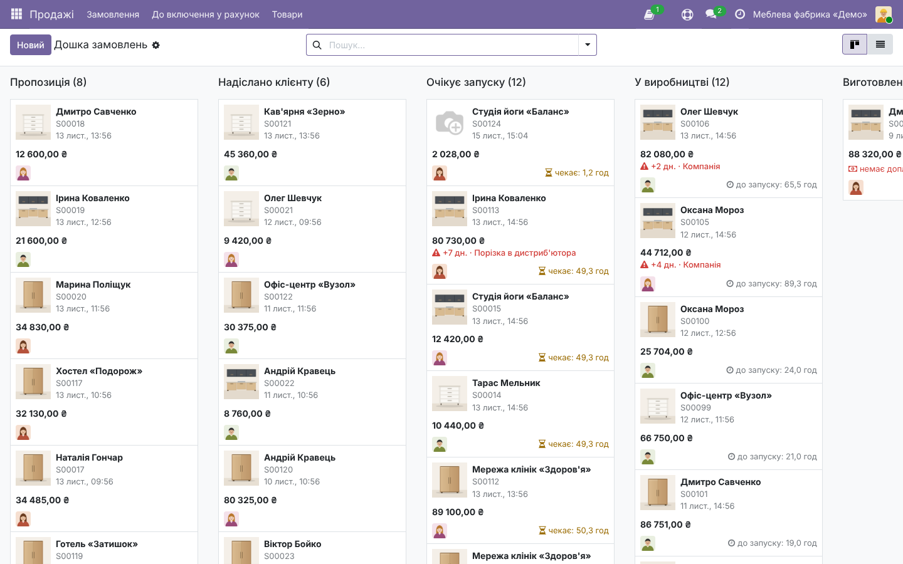
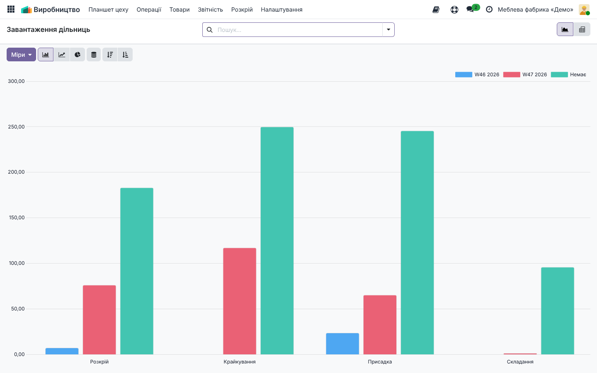
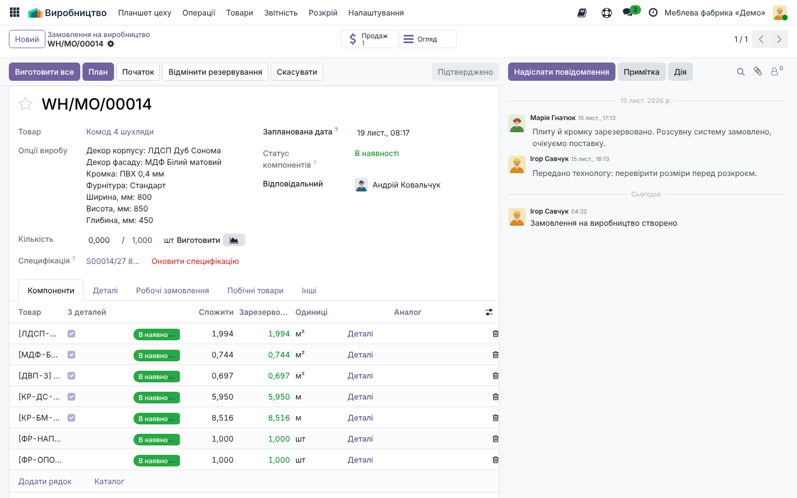
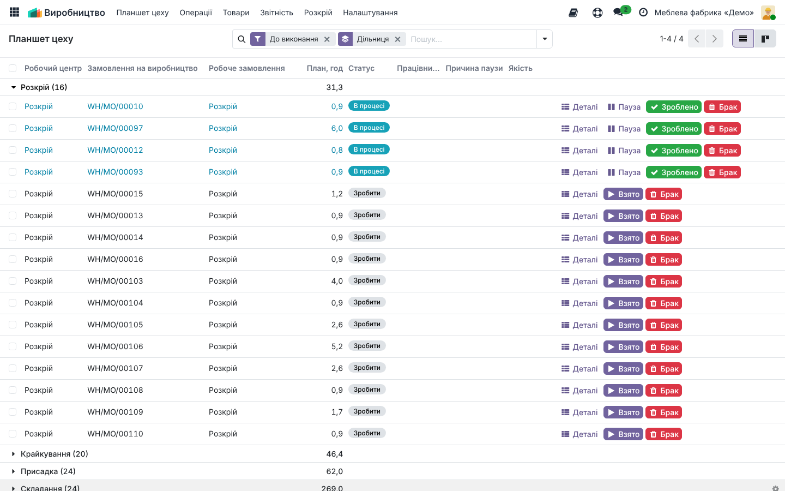
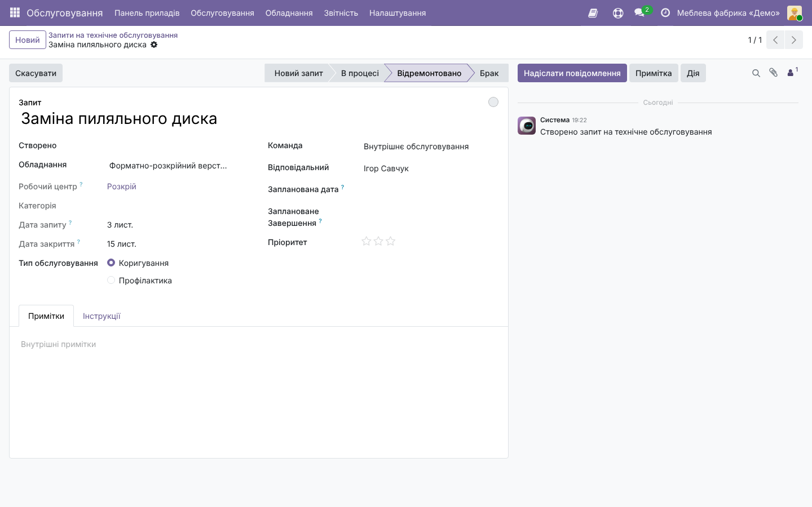
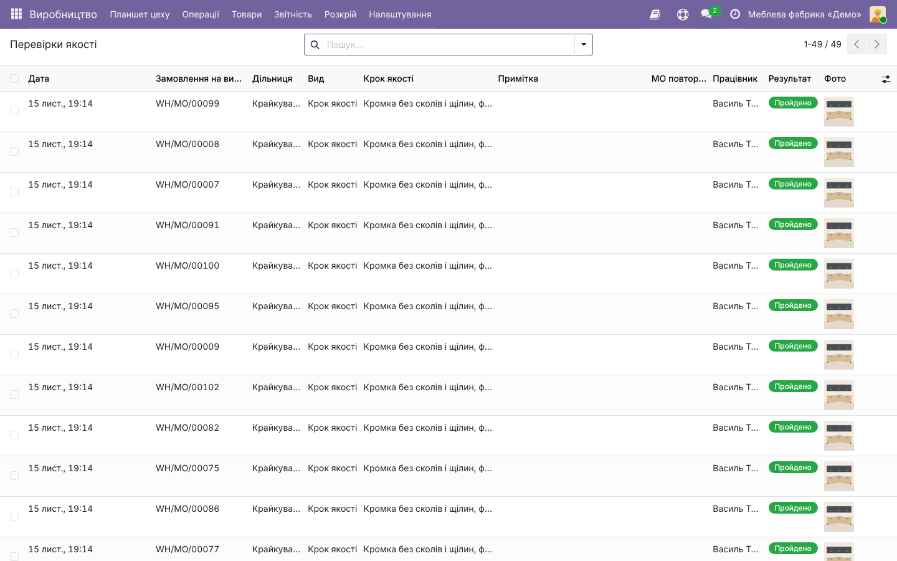
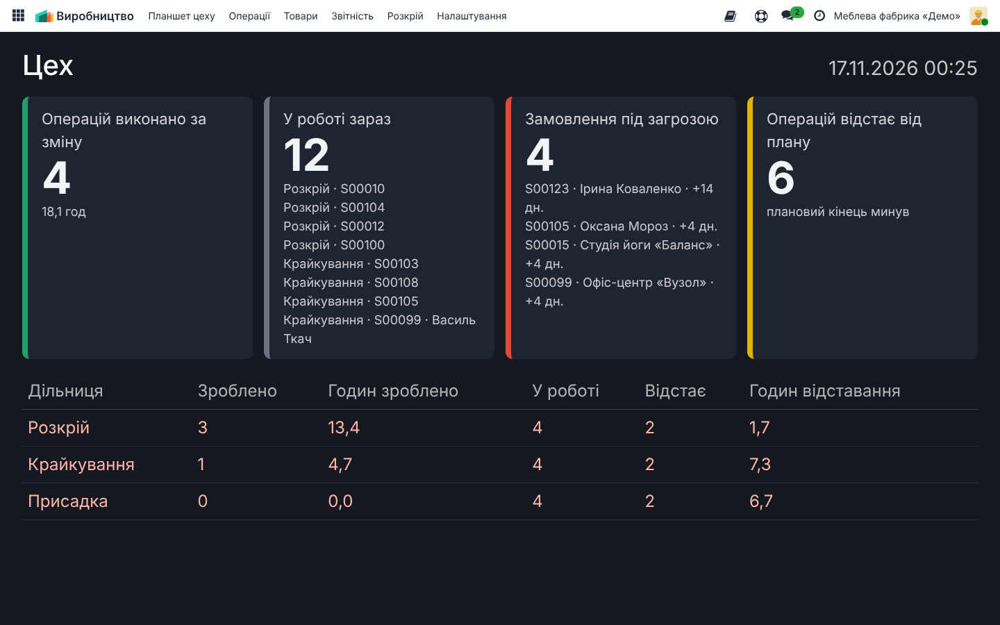
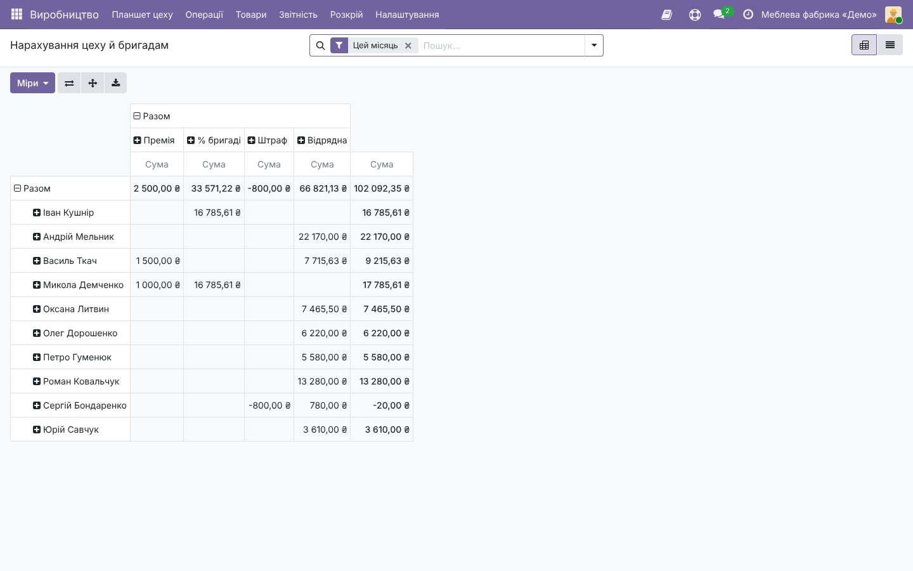

# Посібник: Начальник виробництва

Для кого: начальник виробництва і майстер цеху (ROLE-03): зміна з простоєм, якістю й рекламацією. Стенд/SHA: див. INDEX.md. Вхід у систему: демо-користувач `chief@demo-fabryka.example`; планшет цеху — `tablet@demo-fabryka.example` (README стенда).

## SC-03 Зміна з простоєм, якістю й рекламацією
Коли: щодня, на початку й протягом зміни.  Результат: виробничі замовлення запущені за маршрутом, робочі завдання відмічені працівниками, простої й перевірки якості зафіксовані, премії й штрафи записані.
Статус: готово

| № | Дія | Що видно |
|---|---|---|
| 1 | Відкрийте «Продажі» → «Замовлення» → «Дошка замовлень»: червоні картки — замовлення, що зсувають дату, з причиною зсуву. | Дошка замовлень за етапами  |
| 2 | Відкрийте «Виробництво» → «Звітність» → «Завантаження дільниць»: завантаження кожної дільниці за тижнями у відсотках тижневої потужності (без діаграми Ганта). | Графік і зведена таблиця завантаження дільниць  |
| 3 | Відкрийте виробниче замовлення і запустіть його: робочі замовлення створено за маршрутом замовлення (дільниці «Розкрій», «Крайкування», «Присадка», «Складання»), на вкладці «Деталі» — деталі. Паперовий наряд при відключенні світла — «Друк» → «Наряд на замовлення». | Виробниче замовлення з вкладками «Компоненти», «Деталі», «Робочі замовлення»  |
| 4 | Працівники відмічають прихід у кіоску відвідувань (PIN), а завдання — на «Виробництво» → «Планшет цеху»: «Взято», «Пауза» (з причиною простою), «Зроблено» з підтвердженням PIN у вікні «PIN працівника» → «Підтвердити». Відмітки після відновлення світла — заднім числом, вікно «Підтвердити». | Планшет цеху: робочі замовлення дільниць  |
| 5 | Простій верстата: запит на обслуговування (Обслуговування) → «Дільниця стоїть»; після ремонту — «Дільниця знову працює». Планові ТО видно в календарі обслуговування. | Запит на обслуговування з робочим центром  |
| 6 | (коробка B) Крок якості з фото: на планшеті кнопка «Якість» (значок камери) — фото й результат перевірки з PIN; «Зроблено» на кроці з контрольною точкою вимагає перевірки; результати — «Виробництво» → «Операції» → «Перевірки якості». | Список перевірок якості  |
| 7 | (коробка B) Табло цеху для телевізора: «Виробництво» → «Звітність» → «Табло цеху (ТВ)». Повторне виготовлення з рекламації створює виробниче замовлення на деталь (кнопка «Повторне виготовлення» на рекламації — див. `bryhadyr.md`). | Табло цеху  |
| 8 | Запишіть премію або штраф із причиною: «Виробництво» → «Звітність» → «Нарахування»; причини — «Виробництво» → «Налаштування» → «Причини премій і штрафів». Рядок створюється в чернетці, підтверджує фінансист. | Нарахування цеху й бригадам  |

Типові помилки:
- Невірний PIN у кіоску -> повідомлення «Невірний PIN», після кількох спроб — блокування; PIN задає адміністратор у картці працівника (AC-071).
- Другий працівник бере те саме завдання -> система повідомляє, хто вже працює (AC-072).
- «Зроблено» без перевірки якості -> відмова з назвою кроку якості (AC-075).
- «Завантаження дільниць» показує помилку часового поясу -> див. admin.md «Типові помилки» (часовий пояс користувача).

Питання й відповіді (FAQ):
- Чи потрібен працівникам цеху користувач Odoo? — Ні: працівник цеху — картка працівника з PIN; планшет працює під користувачем «Планшет цеху» (AC-071).
- Де бачити причини втрат? — Пауза з причиною пише рядок втрат на робочому замовленні; простій верстата — у запиті на обслуговування (AC-070, AC-076).

Пов'язані AC: AC-066, AC-068, AC-069, AC-070, AC-071, AC-072, AC-073, AC-074, AC-075, AC-076, AC-077, AC-079, AC-080, AC-081, AC-107, AC-108, AC-133.
Пов'язані функції концепції: F-06, F-08, F-18, F-31, F-32, F-33, F-34, F-42, F-60, F-61, F-65.

## Довідка й підтримка
Значок «Довідка» (книжка) у верхній панелі — статті до поточного екрана; «Підтримка ToDo» — звернення в підтримку (див. menedzher.md «Довідка й підтримка»).

## Довідник ролі: меню, кнопки, друк
| Що | Де | Для чого |
|---|---|---|
| «Планшет цеху» | Виробництво | робочі замовлення дільниць для працівників цеху (кнопки «Взято», «Пауза», «Зроблено») |
| «PIN працівника» (вікно «Підтвердити») | планшет цеху | підтвердження дії працівника його PIN |
| «Якість» | планшет цеху (рядок робочого замовлення) | крок якості з фото (коробка B) |
| вікно відмітки заднім числом («Підтвердити») | робоче замовлення | відмітки після відключення світла за паперовим нарядом |
| «Перевірки якості» | Виробництво → Операції | результати кроків якості з фото (коробка B) |
| «Завантаження дільниць» | Виробництво → Звітність | завантаження дільниць за тижнями |
| «Табло цеху (ТВ)» | Виробництво → Звітність | табло для телевізора в цеху (коробка B) |
| «Нарахування» (дія «Нарахування цеху й бригадам») | Виробництво → Звітність | премії, штрафи, відрядна |
| «Причини премій і штрафів» | Виробництво → Налаштування | довідник причин |
| «Наряд на замовлення» | виробниче замовлення → «Друк» | паперовий наряд дільниць |
| «Дільниця стоїть», «Дільниця знову працює» | запит на обслуговування | простій дільниці з причиною і повернення в роботу |
| «Взяти аналог» | виробниче замовлення | заміна компонента аналогом (коробка B, див. komirnyk.md) |
