# Налаштування довідників і товарів

Для кого: адміністратор системи (група «Налаштування») і конструктор-технолог (група «Технолог»). Тут — як з нуля завести кожен довідник пакета і кожне поле, яке модулі `td_*` додають до стандартних форм Odoo: хто робить, де в меню, кроки, обов'язкові поля, що від них залежить (на якому екрані якої ролі це видно), типова помилка, кадр. Параметри коробки (VP-NN) і перший запуск бази — `admin.md`; тут — дані, які вводять після встановлення модулів.

Кадри знято на демо-стенді (SHA стенда — у `INDEX.md`) під тим користувачем, який робить налаштування: адміністратор (`admin`) або технолог (`tech@demo-fabryka.example`). Повний перелік полів і довідників з коду та розділ для кожного — таблиця (г) «Покриття: налаштування довідників» в `INDEX.md`; її звіряє з кодом `reference/check_setup.py`.

Хто що робить (права перевірено на стенді):

| Роль | Що налаштовує | Чого не бачить |
|---|---|---|
| Адміністратор | «Налаштування» → «Меблі»; категорії; контрагенти, коди BAS; ціни постачальників; атрибути; послуги порізки й монтажу; терміни оплати; працівники й PIN; причини премій і штрафів; обладнання; канал BAS; міграція | — |
| Технолог | товари-матеріали й вироби (вкладки «Деталі виробу», «Аналоги», «Атрибути та Варіанти» → «Налаштувати»); специфікації й операції; робочі центри; «Правила деталей»; «Шаблони імпорту» | меню «Атрибути» й «Категорії» (налаштування Продажів/Складу), вкладку «Купівля» товару (немає прав закупівель) — це робить адміністратор |

## Порядок налаштування з нуля
Порядок такий самий, як у «Порядок імпорту шаблонів» (`package/master-data/README.md`, розділ «Порядок імпорту»): від чого залежить запис, те заводиться раніше.

1. Адміністратор: «Налаштування» → «Меблі» — параметри компанії (розділ «Налаштування «Меблі» і параметри компанії»).
2. Адміністратор: категорії товарів з гарантією.
3. Адміністратор: контрагенти — постачальники плит, фурнітури, порізки; коди BAS.
4. Адміністратор: атрибути й значення (декор, кромка, фурнітура, розміри).
5. Технолог: товари — плити, кромка, фурнітура, готові фасади; потім параметричні вироби з правилами деталей і аналоги.
6. Адміністратор: послуги порізки й монтажу; ціни постачальників.
7. Технолог: робочі центри, специфікації й операції; адміністратор — обладнання дільниць.
8. Адміністратор: терміни оплати з етапами, працівники (PIN, код BAS), причини премій і штрафів, канал BAS.
9. Технолог: шаблони імпорту деталей (з першого файлу програми проєктування).

Масове заповнення: CSV-шаблони `package/master-data/*.csv` і `package/master-data/td/*.csv` (поля пакета — другим проходом тих самих записів). Імпорт — «Продажі» → «Налаштування» → «Міграція» → «Порядок імпорту шаблонів» → «Імпортувати» в рядку кроку (див. розділ «Міграція: порядок імпорту шаблонів і звірка»). Для кожного довідника нижче названо його шаблон.

## Налаштування «Меблі» і параметри компанії
Хто: адміністратор. Де: «Налаштування» → «Меблі» (ліва панель). Модель — `res.config.settings`; значення зберігаються на компанії (`res.company`), тож у кожної компанії свої.

1. Відкрийте «Налаштування» → «Меблі».
2. Блок «Договір і оплата»: «Контроль доплати перед виїздом» («Попереджати» / «Блокувати»), «Нагадування про доплату» (1–7 днів), «Тексти перевірено юристом», «Менеджер бачить маржу».
3. Блок «Монтаж»: «% бригаді» (типовий відсоток від суми замовлення для нового акта), «Поділ % бригаді» («Порівну» / «За часом»), «База % бригаді» («За фінальним актом» / «За етапами»), «Монтаж у вартості замовлення», «Чек-лист акта» — пункти акта монтажу, по одному в рядку.
4. Блок «Контроль»: «Застряглі замовлення» (1–30 днів), «Ціна вище історії» (1–50 %), «Прострочка рекламації» (1–60 днів), «Мінімальний обрізок» (100–1000 мм), «Розкрій плит», «Профіль коробки» (лише інформаційно), «Собівартість: відрядна замість годин».
5. Блок «Функції коробки B»: прапорці функцій (конфігуратор, обрізки, пакети розкрою, кіоск цеху, контроль якості, сканування етикеток, підпис зміни замовлення, курс НБУ, AI-підказка колонок, аналоги, табло цеху).
6. Натисніть «Зберегти».

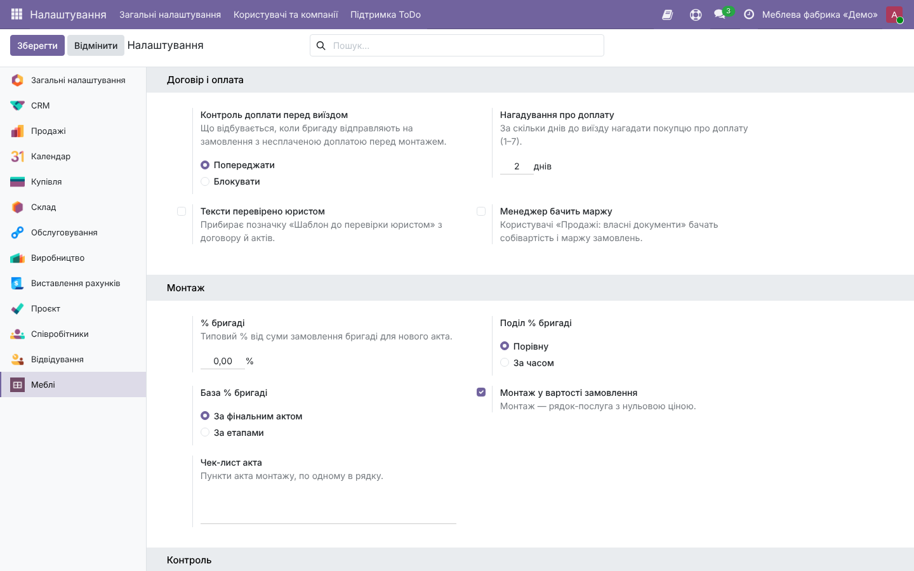
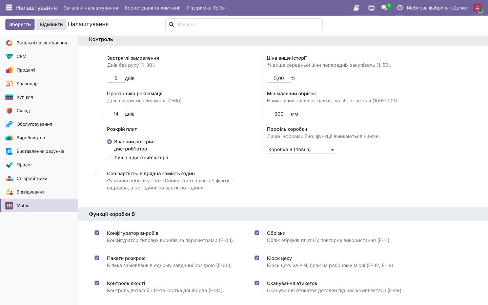

Обов'язкові поля й наслідки:
- «% бригаді» і «Чек-лист акта» — дані клієнта; порожній чек-лист = в акті монтажу немає пунктів для відмітки (бригадир, `bryhadyr.md` SC-08); «% бригаді» = 0 — у новому акті сума бригаді нульова, нарахування «% бригаді» не з'являться у фінансиста (`finansyst.md` SC-05).
- «Контроль доплати перед виїздом» = «Блокувати» — бригаду не можна відправити на монтаж з несплаченою доплатою (менеджер і бригадир бачать «Бракує до монтажу» на завданні монтажу).
- «Ціна вище історії» — поріг червоної позначки «Історія» в рядках закупівлі (комірник, `komirnyk.md` SC-04); «Мінімальний обрізок» — менші залишки плити не стають діловими обрізками.
- «Монтаж у вартості замовлення» — рядок послуги монтажу в замовленні має нульову ціну (розділ «Послуга монтажу»).
- Значення параметрів і їхні VP-NN — `admin.md` § Параметри і § Довідник налаштувань модулів; службове поле користувача `td_margin_auto` («Бачить маржу» за параметром компанії) ставиться автоматично з «Менеджер бачить маржу».

Типова помилка: значення поза діапазоном -> «%(field)s: значення %(value)s поза допустимим діапазоном %(low)s–%(high)s.» — виправте число в межах з підказки під полем.

## Категорії товарів
Хто: адміністратор. Де: «Продажі» → «Налаштування» → «Товари» → «Категорії» (також «Склад»/«Купівля» → «Налаштування» → «Товари» → «Категорії»). Модель — `product.category`.

1. «Новий» або відкрийте категорію.
2. Заповніть «Категорія» (назва) і «Батьківська категорія».
3. «Гарантія, міс.» — строк гарантії товарів категорії (0 — не задано).
4. «Зберегти».

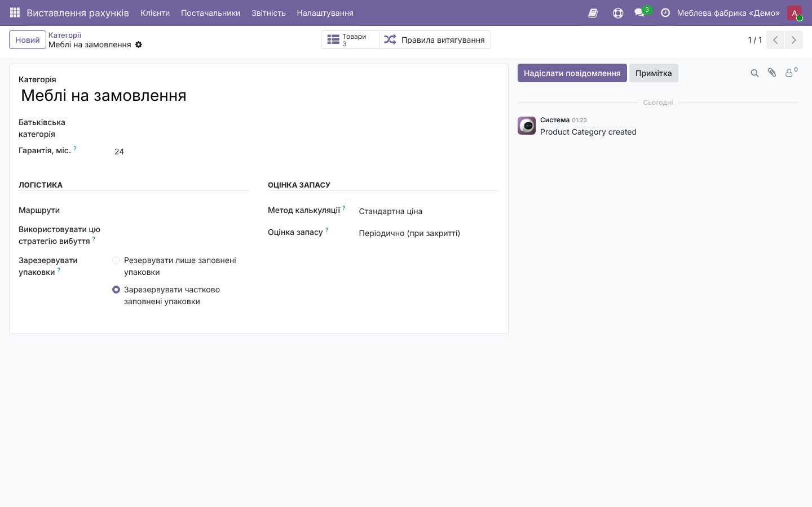

Обов'язкові поля й наслідки: «Гарантія, міс.» — від неї рахуються «Гарантія до» і «Після гарантії» в рекламації (сервіс і бригадир, `bryhadyr.md` SC-08; керівник бачить прострочені рекламації). Порожня гарантія -> у рекламації позначка «Гарантійний строк не задано». Від'ємне число не зберігається.
Типова помилка: гарантію задали на батьківській категорії, а товари лежать у дочірній — значення не успадковується, задайте на категорії самого товару.
Масово: `01_product.category.csv`, поле пакета — `td/01b_product.category.csv`.

## Контрагенти й постачальники
Хто: адміністратор. Де: «Купівля» → «Замовлення» → «Постачальники» (або «Виставлення рахунків» → «Постачальники»). Модель — `res.partner`.

1. Відкрийте або створіть контрагента: тип «Компанія», назва, ІПН.
2. Вкладка «Продажі та купівля»: «Термін оплати» (для покупців — розділ «Терміни оплати з етапами»), «Прайс-лист».
3. Блок «Різне»: «Код BAS» — код контрагента в обліковій системі BAS/BAF.
4. «Зберегти».

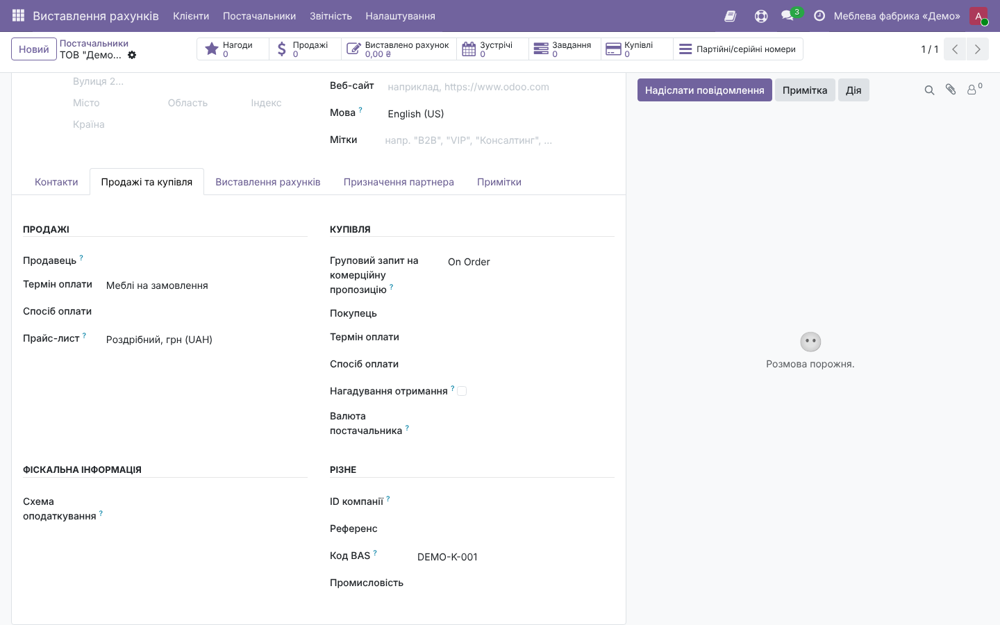

Обов'язкові поля й наслідки: «Код BAS» обов'язковий для обміну з BAS: документ контрагента без коду в пакет BAS не потрапляє, фінансист бачить позначку «Немає коду BAS» у журналі (`finansyst.md` SC-05). Смарт-кнопка «Середнє запізнення, дн.» (службові поля «Середнє запізнення, дн.», «Приймань у статистиці») рахується сама з приймань за рік і видна закупівельнику.
Типова помилка: код BAS заповнено на контактній особі, а не на компанії — обмін бере код комерційного контрагента (компанії).
Масово: `02_res.partner.csv`, код BAS — `td/19b_res.partner.csv`.

## Ціни постачальників
Хто: адміністратор (або закупівельник). Де: «Купівля» → «Налаштування» → «Прайс-листи постачальника»; або в товарі — вкладка «Купівля». Модель — стандартна `product.supplierinfo` (пакет її не розширює).

1. «Новий»: «Постачальник», «Товар», «Ціна одиниці», «Валюта», «Термін поставки» (днів).
2. «Зберегти». Масове оновлення з прайсу постачальника — «Купівля» → «Товари» → «Імпорт прайсу» (`komirnyk.md` SC-04).

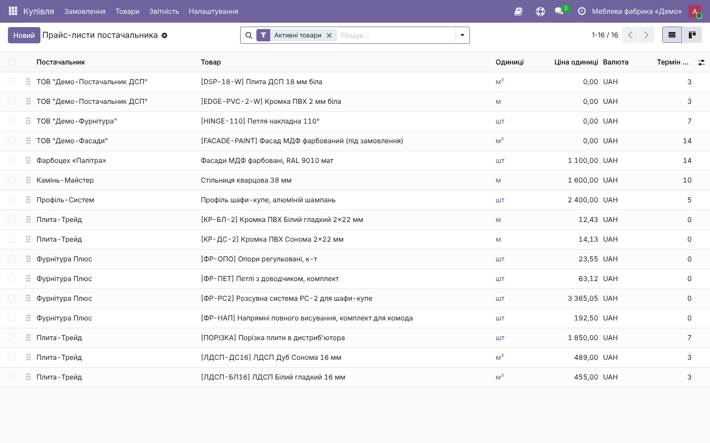

Наслідки: ціна й термін постачальника — основа закупівлі під замовлення і прогнозної дати (менеджер бачить «Прогнозна дата», комірник — «Потрібно до»); середня ціна попередніх закупівель — база «Історія» в рядках замовлення на купівлю.
Типова помилка: термін поставки 0 — прогнозна дата замовлення не враховує доставку матеріалу.
Масово: `08_product.supplierinfo.csv`.

## Атрибути й значення
Хто: адміністратор (технолог відкриває атрибут лише з товару). Де: «Продажі» → «Налаштування» → «Товари» → «Атрибути» (так само в «Склад»/«Купівля» → «Налаштування» → «Товари»). Модель — `product.attribute` і значення `product.attribute.value`.

1. «Новий» атрибут: «Назва атрибуту», «Тип відображення», «Створення варіанту» — для конфігуратора меблів «Ніколи» (варіанти не множаться).
2. Атрибут-розмір: «Розмір виробу» = «Ширина» / «Висота» / «Глибина»; одне значення «Власний розмір» з прапорцем `Free text` — менеджер вводить розмір числом.
3. Атрибут-матеріал: «Роль компонента» = «Плита корпусу» / «Плита фасаду» / «Кромка» / «Набір фурнітури».
4. Вкладка «Значення атрибутів»: для ролей плит і фурнітури в кожному значенні — «Товар-компонент» (яку плиту чи набір фурнітури означає значення); для ролі «Кромка» — «Товщина кромки, мм». «Типова додаткова ціна» — доплата за значення за замовчуванням.
5. «Зберегти».

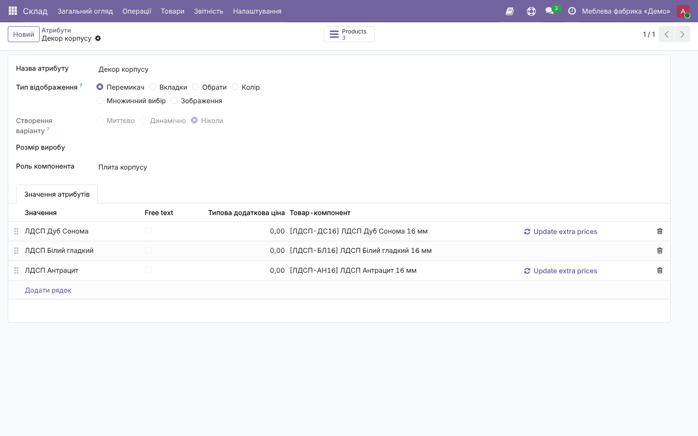
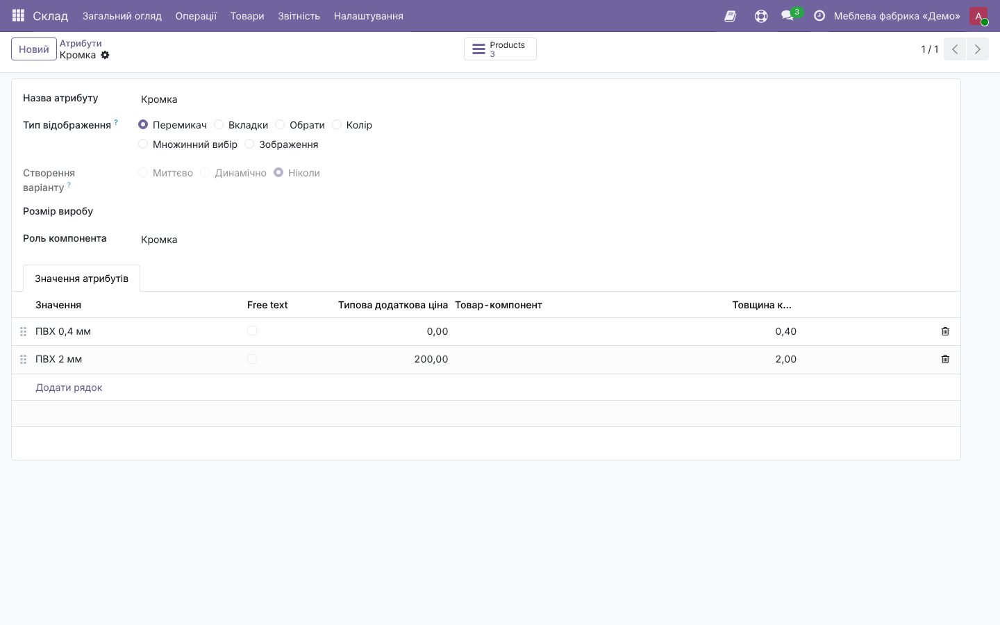
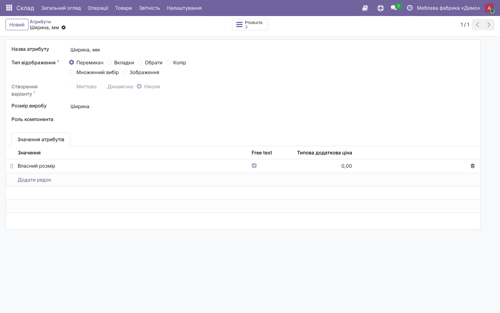

Обов'язкові поля й наслідки: з «Роль компонента» і «Товар-компонент» специфікація під замовлення знає, з якої плити кроїти корпус і фасад і яку фурнітуру класти; з «Товщина кромки, мм» — яку кромку підібрати до плити. Без «Декор корпусу» менеджер отримає «Оберіть декор корпусу для %s.» (`menedzher.md` SC-01); без кромки потрібної товщини — «Не знайдено кромки %(thickness)s мм для %(board)s.» (технолог, `tekhnolog.md` SC-02). «Розмір виробу» — звідки беруться ширина/висота/глибина рядка замовлення (ціна й деталі).
Типова помилка: «Створення варіанту» = «Миттєво» — на кожну комбінацію створюються варіанти товару; для конфігуратора ставте «Ніколи».
Масово: `03_product.attribute.csv`, `04_product.attribute.value.csv`; поля пакета — `td/03b_product.attribute.csv`, `td/04b_product.attribute.value.csv`.

## Доплати й несумісні значення (конфігуратор)
Хто: технолог (або адміністратор). Де: товар-виріб → вкладка «Атрибути та Варіанти» → «Налаштувати» в рядку атрибута. Модель — стандартна `product.template.attribute.value` (пакет її не розширює).

1. Відкрийте виріб, вкладка «Атрибути та Варіанти»: додайте рядки атрибутів і значення, доступні для цього виробу.
2. У рядку атрибута натисніть «Налаштувати» — список значень виробу з колонкою `Extra Price` (доплата саме для цього виробу).
3. Відкрийте значення: `Extra Price` — доплата; «Виключити для» — з якими значеннями інших атрибутів воно несумісне (напр. декор «Антрацит» не поєднується з кромкою 0,4 мм).
4. «Зберегти».

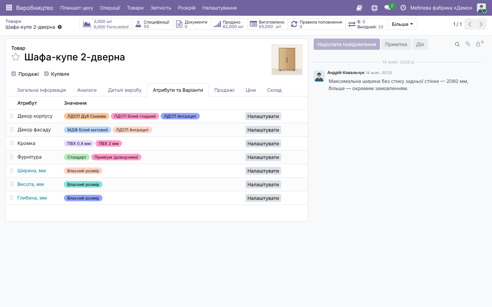
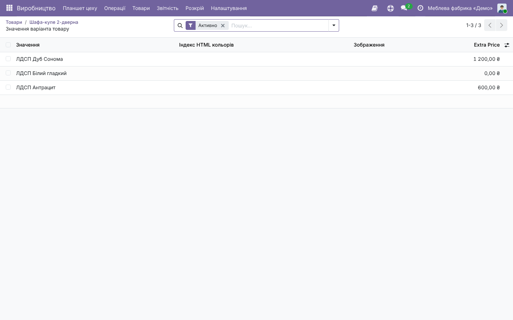
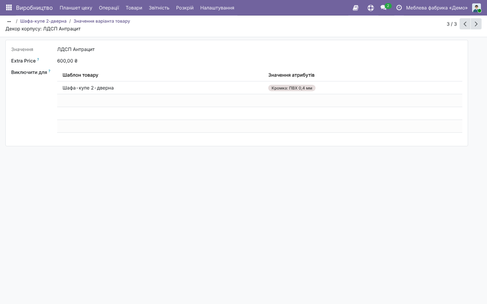

Наслідки: доплата додається до ціни в конфігураторі й рядку замовлення менеджера; несумісні значення конфігуратор не дає обрати разом.
Типова помилка: доплату задали в атрибуті («Типова додаткова ціна»), а у вже доданому виробі вона не змінилась — значення виробу мають власну доплату; оновіть її тут.
Масово: рядки атрибутів виробу — `07_product.template.attribute.line.csv`.

## Товари: плита, кромка, фурнітура, готовий фасад
Хто: технолог (вкладка «Деталі виробу»); ціни й постачальників — адміністратор. Де: «Виробництво» → «Товари» → «Товари». Модель — `product.template` (варіант — `product.product`).

1. «Новий»: назва, «Тип товару» = «Товари», «Референс» (артикул), «Категорія», одиниця: плита — м², кромка — м, фурнітура — шт.
2. Вкладка «Деталі виробу», блок «Матеріал»: «Вид матеріалу» = «Плита» / «Кромка» / «Фурнітура» / «Готовий фасад».
3. Плита: «Довжина листа, мм», «Ширина листа, мм», «Товщина, мм», «Плановий відхід, %» (0–99, за замовчуванням 15).
4. Кромка: «Товщина, мм», «Підходить до плити» (декор плити, до якого ця кромка), «Товщина кромки, мм» (0,4 / 2 тощо).
5. Фурнітура й готовий фасад: досить «Вид матеріалу».
6. Код для BAS — у формі варіанта товару («Виробництво» → «Товари» → «Варіанти товару», поле «Код BAS» після «Референс»; для обміну з BAS).
7. «Зберегти».

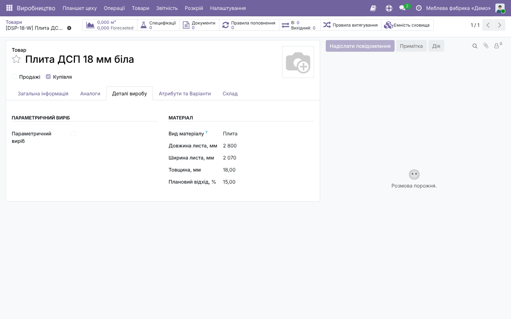
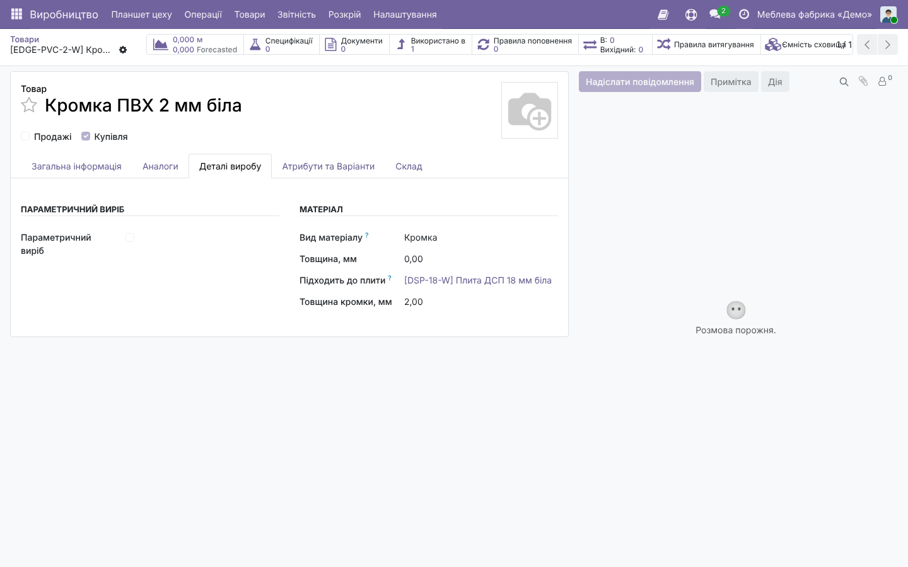
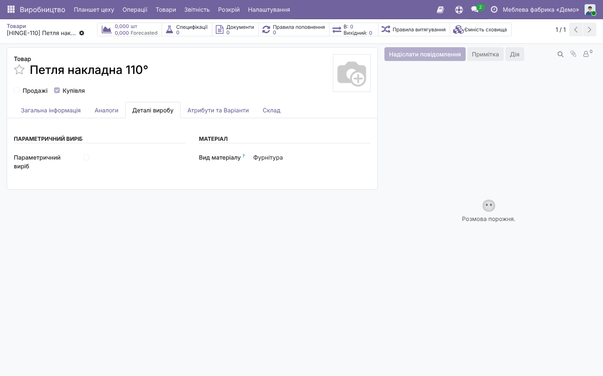

Обов'язкові поля й наслідки: «Вид матеріалу» визначає, як матеріал іде в розкрій і специфікацію (плита й кромка — з деталей, фурнітура — штуками; «Готовий фасад» — фасадні деталі з плити не кроїться). Розміри листа й відхід — потреба в плитах і площа в завданні розкрою (технолог, `tekhnolog.md` SC-02) та собівартість (фінансист). Без «Підходить до плити» і «Товщина кромки, мм» специфікація не знайде кромку: «Не знайдено кромки %(thickness)s мм для %(board)s.».
Типова помилка: «Плановий відхід, %» = 100 або більше не зберігається («Плановий відхід має бути від 0 до 100 відсотків»).
Масово: `05_product.product.csv`, `06_product.template.csv`; поля пакета — `td/05b_product.product.csv`, `td/06b_product.template.csv`, коди BAS товарів — `td/20b_product.product.csv`.

## Параметричний виріб і правила деталей
Хто: технолог. Де: товар-виріб → вкладка «Деталі виробу»; список усіх правил — «Виробництво» → «Налаштування» → «Правила деталей». Модель — `product.template` і довідник `td.mebli.part.rule`.

1. Відкрийте виріб («Тип товару» = «Товари», «Продажі» і «Купівля» за потреби).
2. Вкладка «Деталі виробу»: увімкніть «Параметричний виріб»; «Припуск кромки, мм» (запас кромки на кожну кромковану сторону, за замовчуванням 30).
3. Блок «Розміри, мм»: «Номінальна ширина/висота/глибина, мм» і межі «Ширина мін / макс», «Висота мін / макс», «Глибина мін / макс». Має виконуватись мін ≤ номінал ≤ макс.
4. Таблиця правил деталей («Додати рядок»): «Деталь» (назва), «Кількість», «Матеріал» («Плита корпусу» / «Плита фасаду» / «Постійний матеріал» + «Постійний матеріал»), довжина й ширина як формула від розмірів виробу: «Довжина: × ширина», «× висота», «× глибина», «Довжина: стала, мм» (так само для ширини), «Кромковані довгі сторони», «Кромковані короткі сторони».
5. Ціна з розмірів: «Продажна ціна» виробу — ціна номінального розміру; у замовленні ціна множиться на (ширина × висота) / (номінальна ширина × номінальна висота).
6. «Зберегти». Окремо правила можна переглядати й правити списком «Правила деталей» (групування за товаром).

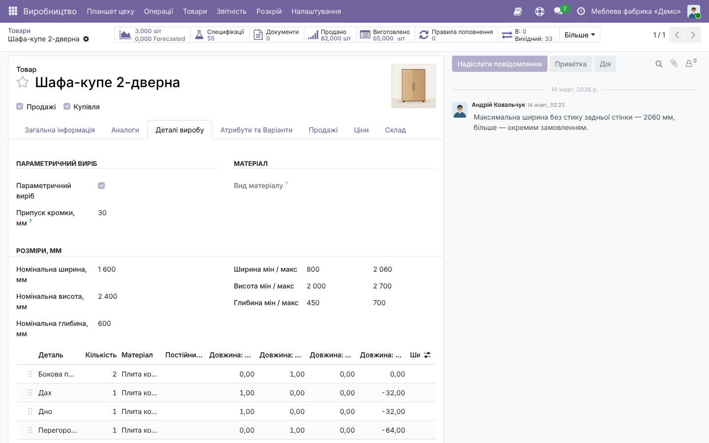
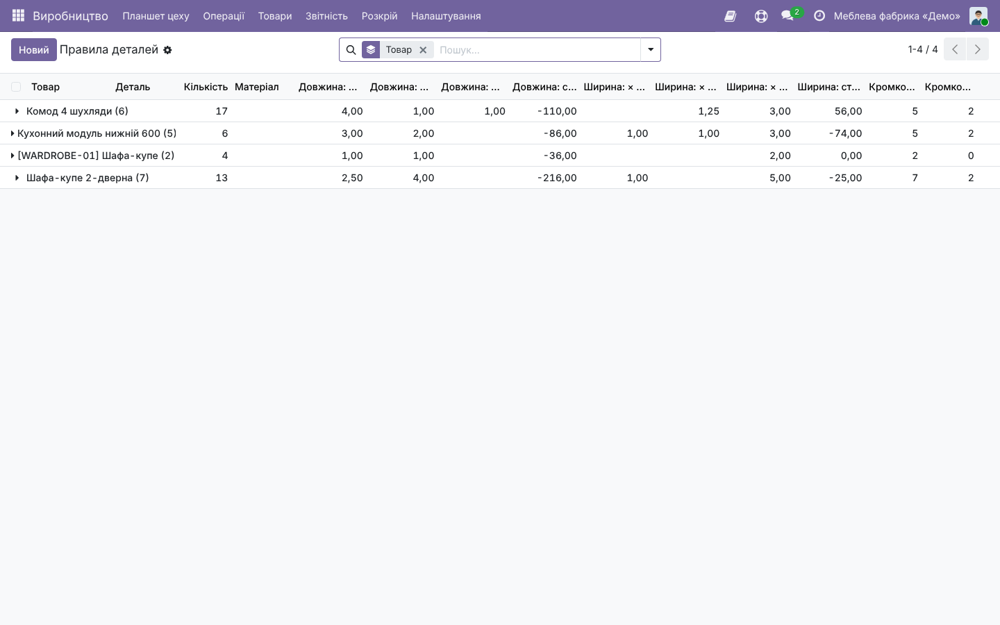

Обов'язкові поля й наслідки: з правил і розмірів рядка будується специфікація під замовлення (деталі, площа плит, кромка) — її бачать технолог у специфікації й завданні розкрою та менеджер у собівартості рядка; межі розмірів не дають менеджеру продати розмір поза межами: «%(product)s: %(axis)s %(value)s мм поза межами %(low)s-%(high)s мм.».
Типові помилки: межі не по порядку -> «%(product)s: %(axis)s має задовольняти мін <= номінал <= макс (…)»; правило дає нульову чи від'ємну довжину на номіналі -> «Деталь %(part)s має недодатний розмір при номінальних розмірах (…)» — виправте сталу частину формули.
Масово: `td/06b_product.template.csv` (межі), `td/16_td.mebli.part.rule.csv` (правила).

## Аналоги матеріалів
Хто: технолог. Де: товар-матеріал → вкладка «Аналоги» (видно для «Тип товару» = «Товари»; функція «Аналоги» в «Налаштування» → «Меблі»). Поле `td_analog_ids` моделі `product.template`.

1. Відкрийте матеріал, вкладка «Аналоги».
2. У полі «Аналоги» оберіть товари, якими можна замінити матеріал (порядок = пріоритет).
3. «Зберегти».

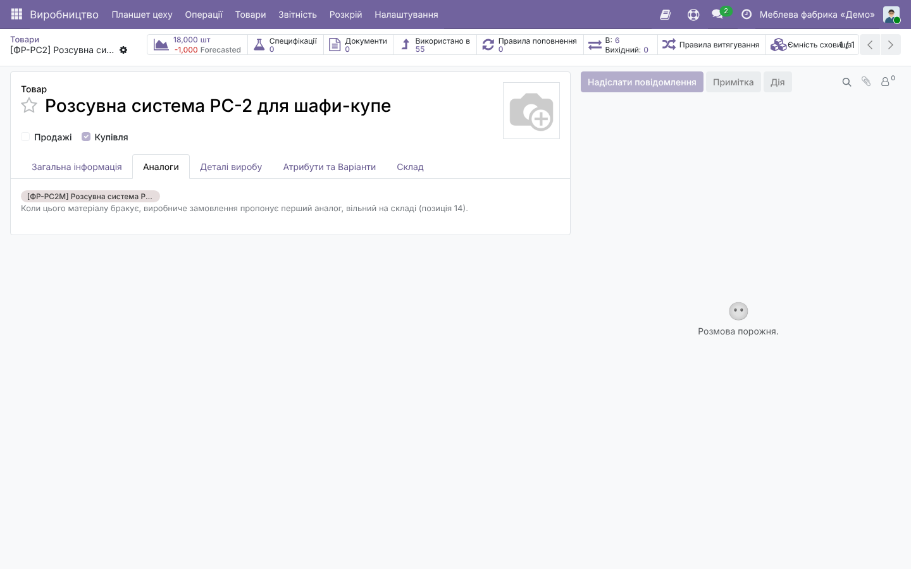

Наслідки: коли матеріалу бракує, виробниче замовлення пропонує перший аналог, вільний на складі (колонки «Аналог», «Аналог на складі» в компонентах — технолог і начальник виробництва).
Типова помилка: аналог в іншій одиниці виміру -> «Аналог %(new)s обліковується в %(unit)s, компонент — у %(old_unit)s: кількість не перераховується.» — заводьте аналоги в тій самій одиниці.

## Послуга порізки з дистриб'ютором
Хто: адміністратор (технолог не має вкладки «Купівля»). Де: «Купівля» → «Товари» → «Товари». Поля `td_material_kind` (`product.template`) і стандартні постачальники.

1. «Новий»: назва (напр. «Порізка плити в дистриб'ютора»), «Тип товару» = «Послуга», прапорець «Купівля».
2. Вкладка «Деталі виробу»: «Вид матеріалу» = «Послуга порізки».
3. Вкладка «Купівля»: «Додати рядок» — «Постачальник» (дистриб'ютор), «Ціна одиниці», «Термін поставки» (днів до повернення деталей).
4. «Зберегти».

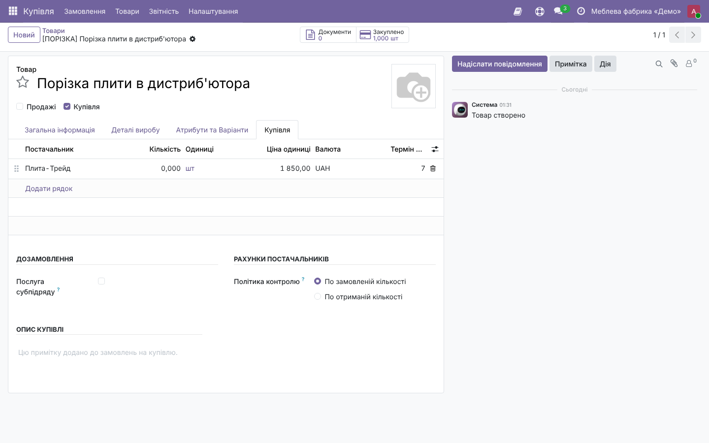
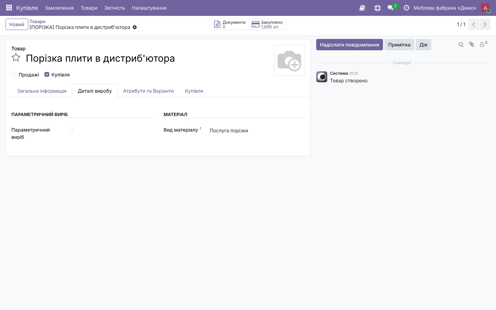

Наслідки: кнопка технолога «Передати дистриб'ютору» на завданні розкрою створює замовлення на купівлю цієї послуги в першого постачальника; очікувана дата повернення деталей = дата рядка закупівлі (`tekhnolog.md` SC-02).
Типова помилка: послуги немає або без постачальника -> «Немає послуги порізки з дистриб'ютором: створіть товар-послугу виду «Послуга порізки» з дистриб'ютором як постачальником (вкладка «Закупівля», зі строком поставки).» (в інтерфейсі Odoo 19 вкладка називається «Купівля»).

## Послуга монтажу
Хто: адміністратор. Де: «Продажі» → «Товари» → «Товари». Стандартні поля `product.template` (модулі `td_*` читають їх).

1. «Новий»: назва (напр. «Доставка й монтаж»), «Тип товару» = «Послуга», прапорець «Продажі».
2. «Створити замовлення» = «Завдання», «Проєкт» = проєкт монтажів.
3. «Продажна ціна» (якщо монтаж платний) і «Політика виставлення рахунків».
4. «Зберегти».

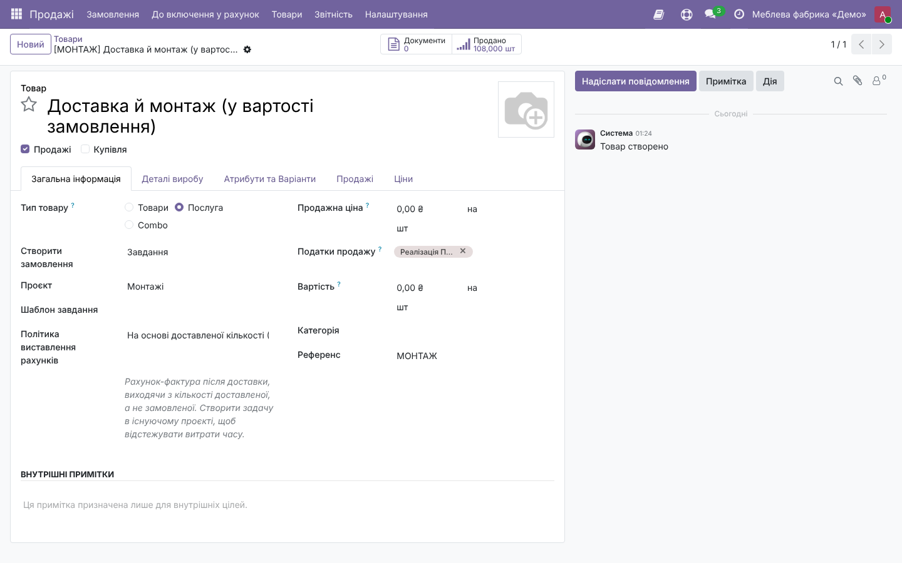

Наслідки: послуга, що створює завдання, — це виїзд монтажу: після підтвердження замовлення бригадир бачить завдання в «Календар монтажів», з нього — акт монтажу (`bryhadyr.md` SC-08). Якщо в «Налаштування» → «Меблі» увімкнено «Монтаж у вартості замовлення», рядок послуги має ціну 0.
Типова помилка: «Створити замовлення» = «Нічого» — завдання монтажу не з'являється, бригада виїзд не бачить.

## Робочі центри
Хто: технолог. Де: «Виробництво» → «Налаштування» → «Робочі центри». Модель — `mrp.workcenter`.

1. «Новий»: «Назва робочого центру», «Код» (напр. `CUT`, `EDG`, `DRL`, `ASM`), «Робочі години» (робочий графік дільниці).
2. Вкладка «Загальна інформація»: «Ефективність часу», «Вартість на годину».
3. «Зберегти».

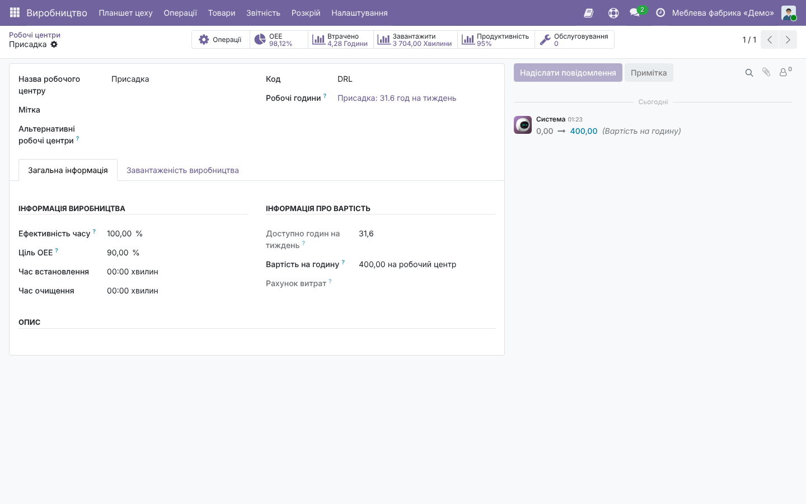

Поля пакета (лише для читання): «Доступно годин на тиждень» = години графіка × кількість одночасних виробів; «Відкриті заявки» (смарт-кнопка «Обслуговування») — відкриті запити на обслуговування дільниці; «Верстати» — обладнання дільниці. Наслідки: від «Доступно годин на тиждень» — «Завантаження, %» і зона перевантаження в «Завантаження дільниць» начальника виробництва (`nachalnyk-vyrobnytstva.md` SC-03).
Типова помилка: робочий графік не задано — доступних годин 0, завантаження не рахується.
Масово: `09_mrp.workcenter.csv`.

## Специфікація й операції
Хто: технолог. Де: «Виробництво» → «Товари» → «Специфікації»; операції — вкладка «Операції» або «Виробництво» → «Налаштування» → «Операції». Моделі — `mrp.bom` (рядки `mrp.bom.line`, деталі `td.mebli.part`) і «Використання робочого центру» `mrp.routing.workcenter`.

1. Специфікація-шаблон параметричного виробу: «Новий» → «Товар», «Позначення» (напр. «Шаблон»), «Тип специфікації» = «Виготовляти цей товар»; вкладка «Компоненти» — фурнітура й постійні матеріали (плита й кромка рахуються з правил деталей).
2. Вкладка «Операції» → «Додати рядок» (форма «Використання робочого центру»): «Операція», «Робочий центр».
3. «База часу»: «Фіксовано» / «На деталь» / «На метр кромки» / «На м² плити»; «Хвилин на одиницю бази» — хвилин на одну деталь, метр кромки, м² плити (для «Фіксовано» — стандартна «Тривалість за замовчуванням»).
4. «Розцінка за одиницю бази» — грн відрядної оплати за одиницю бази (для «Фіксовано» — за операцію).
5. «Крок якості» (функція «Контроль якості») — що перевіряє працівник після операції.
6. «Зберегти». Для непараметричних виробів деталі імпортують з файлу програми проєктування («Імпорт деталей» на специфікації, `tekhnolog.md` SC-02).

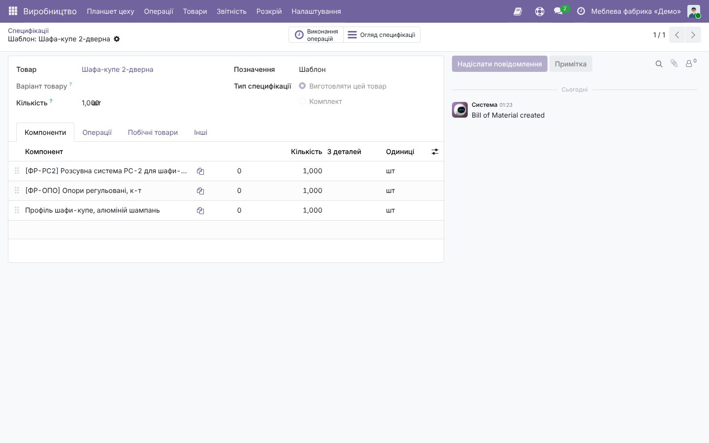
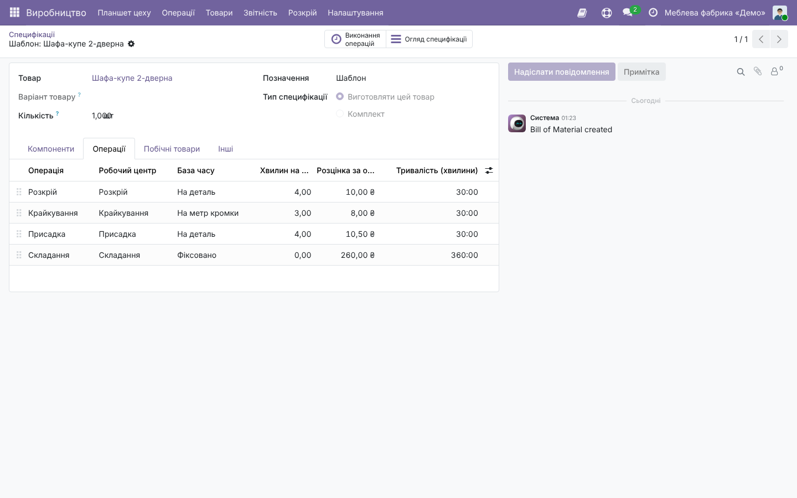
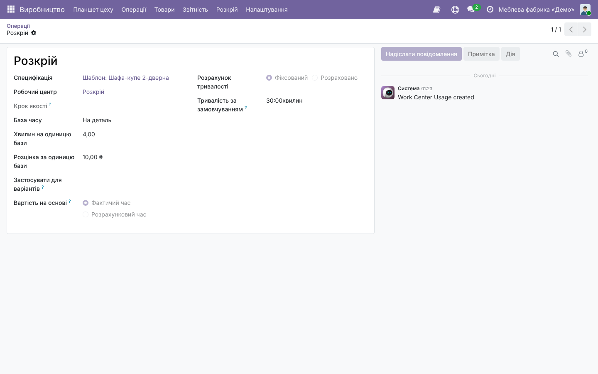

Обов'язкові поля й наслідки: «База часу» обов'язкова (за замовчуванням «Фіксовано»). У специфікації під замовлення тривалість операції = «Хвилин на одиницю бази» × кількість бази (деталей, метрів кромки, м² плити) — це планові години й завантаження дільниць начальника виробництва. «Розцінка за одиницю бази» × база × виготовлено = відрядне нарахування працівнику (фінансист, «Премії й штрафи»). «Крок якості» показується на планшеті цеху після операції (`nachalnyk-vyrobnytstva.md` SC-03). Службові поля специфікації («Специфікація під замовлення», «Шаблонна специфікація», «Рядок замовлення», «Замовлення на продаж», «Версія розкрою», «Ширина/Висота/Глибина, мм», «Деталі», «Кількість деталей», «Площа плит, м²», «Кромка, м», у рядках — «З деталей») заповнює система для специфікацій під замовлення; вручну їх не правлять.
Типова помилка: «Розцінка за одиницю бази» = 0 — відрядна за операцію не нараховується.
Масово: `10_mrp.bom.csv`, `11_mrp.bom.line.csv`, `12_mrp.routing.workcenter.csv`, поля пакета — `td/12b_mrp.routing.workcenter.csv`.

## Обладнання
Хто: адміністратор. Де: «Обслуговування» → «Обладнання». Модель — `maintenance.equipment`.

1. «Новий»: «Назва», «Категорія обладнання», «Команда технічного обслуговування», «Технік».
2. «Робочий центр» — дільниця, на якій стоїть верстат.
3. «Зберегти».

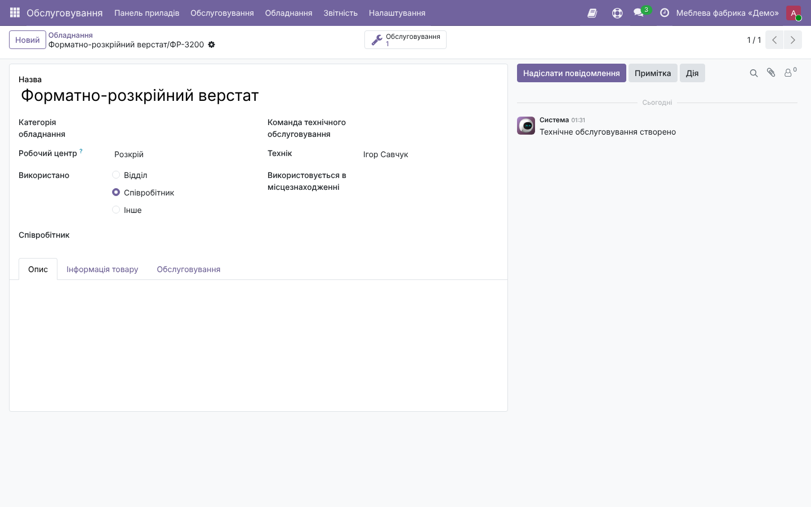

Наслідки: заявка на ремонт верстата з робочим центром позначає дільницю як таку, що стоїть («Дільниця стоїть», «Простій, год» у заявці — `maintenance.request`), а в робочому центрі з'являються «Відкриті заявки»; простій видно начальнику виробництва (`nachalnyk-vyrobnytstva.md` SC-03).
Типова помилка: «Робочий центр» не задано — простій дільниці не фіксується.
Масово: `14_maintenance.equipment.csv`, `td/14b_maintenance.equipment.csv`.

## Шаблони імпорту деталей
Хто: технолог. Де: «Виробництво» → «Налаштування» → «Шаблони імпорту». Модель — довідник `td.mebli.import.template`.

1. Шаблон створюється під час першого імпорту деталей: на специфікації «Імпорт деталей» → оберіть файл → «Розпізнати колонки» → задайте відповідність колонок → введіть назву шаблону → «Імпортувати».
2. У списку «Шаблони імпорту» можна перейменувати шаблон або архівувати його. Поля: «Назва», «Підпис заголовків» (нормалізовані назви колонок файлу), «Компанія».

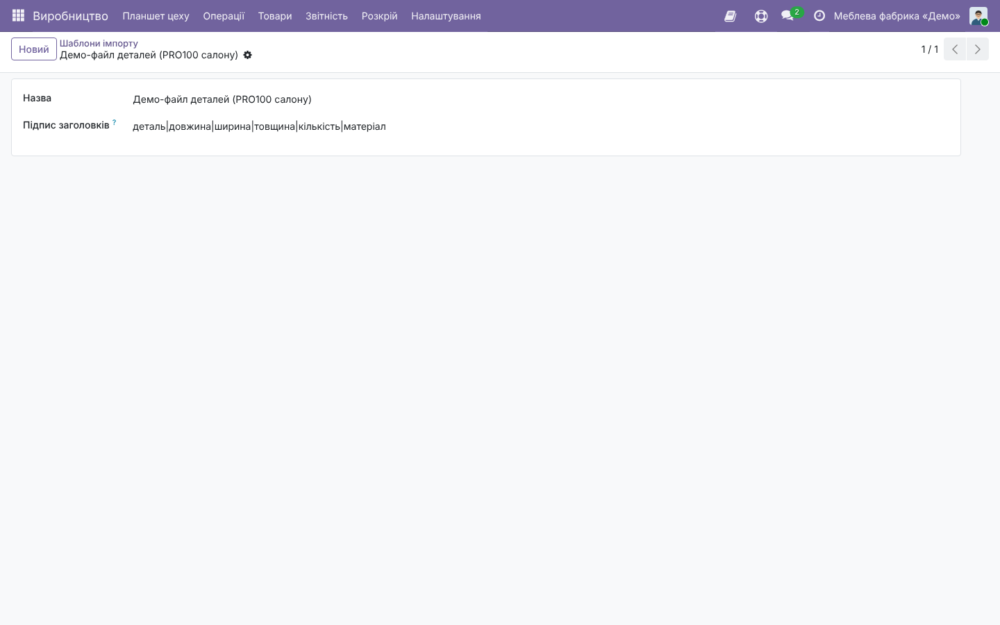

Наслідки: файл з тими самими заголовками колонок наступного разу розпізнається автоматично (технолог, `tekhnolog.md` SC-02).
Типова помилка: у файлі змінився порядок чи назви колонок — підпис не збігається, колонки треба зіставити знову й зберегти новий шаблон.
Масово: `td/18_td.mebli.import.template.csv`.

## Терміни оплати з етапами
Хто: адміністратор. Де: «Виставлення рахунків» → «Налаштування» → «Термін оплати». Модель — `account.payment.term` (рядки `account.payment.term.line`).

1. «Новий»: назва (напр. «50 % передоплата, 40 % перед монтажем, 10 % після акта»).
2. «Додати рядок»: «Борг» (відсоток), «Після» (днів), колонка «Етап оплати» — «Передоплата» / «Перед монтажем» / «Після акта».
3. «Зберегти». Призначте термін покупцеві (вкладка «Продажі та купівля» контрагента) або в замовленні.

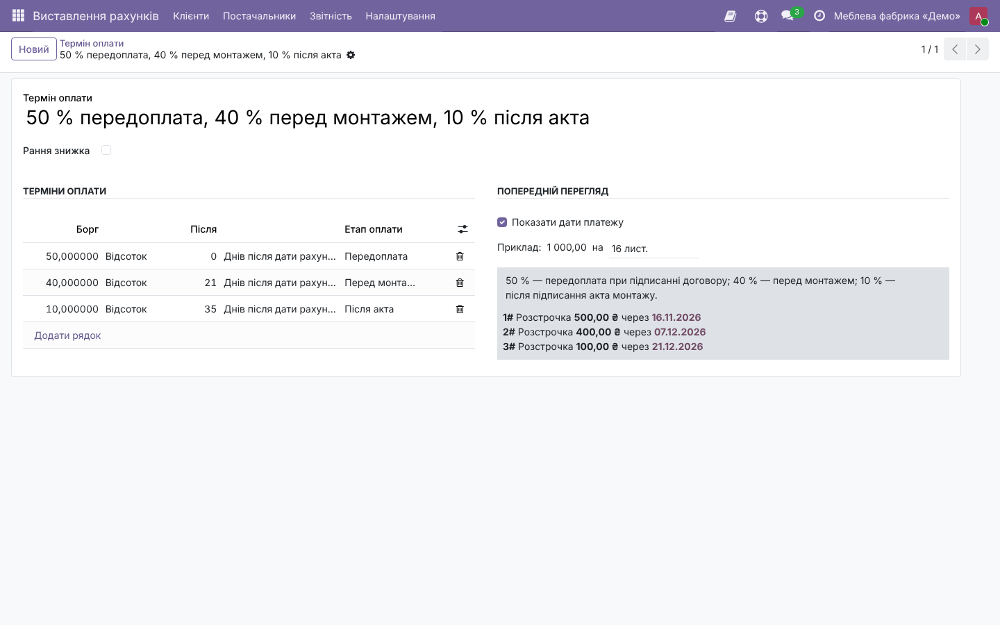

Наслідки: рядки «Передоплата» і «Перед монтажем» мають бути сплачені до виїзду бригади; «Після акта» — після підписаного акта. Менеджер бачить «Графік оплат» і «Оплата етапами» в замовленні, бригадир і менеджер — «Бракує до монтажу» на виїзді; друкований договір показує графік. Умова без етапів — уся сума до монтажу.
Типова помилка: етап не задано в жодному рядку — контроль доплати вважає всю суму обов'язковою до монтажу.

## Працівники: код BAS і PIN цеху
Хто: адміністратор (кадровик). Де: «Співробітники» → «Співробітники». Модель — `hr.employee`.

1. Відкрийте або створіть працівника: ім'я, «Відділ», «Посада».
2. Вкладка «Налаштування», блок «Відвідування/точка продажу»: «PIN-код» (для планшета цеху) і «Номер `RFID`/бейджа»; поруч — «Код BAS» (табельний код працівника в BAS; видно кадровику).
3. Блок «Налаштування модуля»: «Вартість години».
4. «Зберегти».

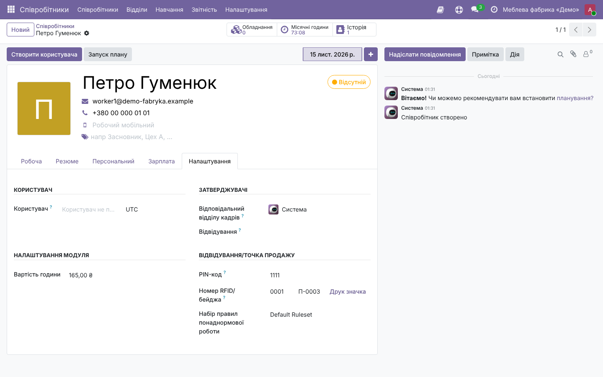

Обов'язкові поля й наслідки: без PIN працівник не відмітиться на планшеті цеху («Планшет цеху» → кіоск, `nachalnyk-vyrobnytstva.md` SC-03), час і відрядна йому не підуть. «Код BAS» — у вивантаженні табеля й нарахувань у BAS (`finansyst.md` SC-05). Службові поля «Невірних PIN поспіль» і «Планшет заблоковано до» ставить кіоск: після 5 невірних PIN поспіль — «Працівника заблоковано до %s» на 15 хвилин.
Типова помилка: однаковий PIN у двох працівників — кіоск не розрізнить; PIN має бути унікальним.
Масово: `13_hr.employee.csv`, коди BAS — `td/21b_hr.employee.csv`.

## Причини премій і штрафів
Хто: адміністратор (начальник виробництва). Де: «Виробництво» → «Налаштування» → «Причини премій і штрафів». Модель — довідник `td.mebli.accrual.reason`.

1. «Новий»: «Причина», «Вид» («Премія» / «Штраф»), «Типова сума».
2. «Зберегти». Непотрібну причину архівуйте (не видаляйте — на неї посилаються нарахування).

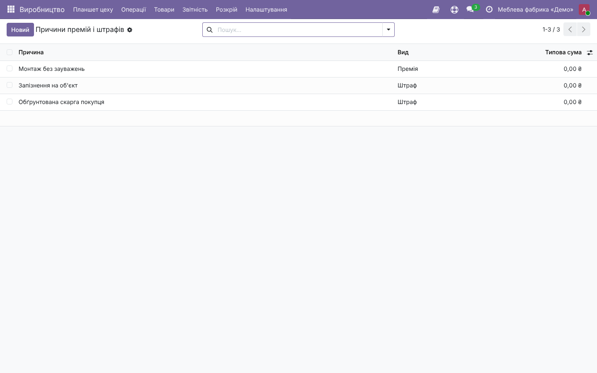

Наслідки: начальник виробництва й фінансист обирають причину в нарахуванні премії чи штрафу; список обмежено видом нарахування. Без причини — «Вкажіть причину премії або штрафу».
Масово: `td/17_td.mebli.accrual.reason.csv`.

## Причини втрат дільниць
Хто: адміністратор. Модель — стандартна `mrp.workcenter.productivity.loss`.

Пакет використовує стандартні причини втрат Odoo: кіоск цеху пропонує при «Пауза» причини з типом «Доступність», «Якість», «Продуктивність» («Доступність матеріалу», «Несправність обладнання», «Налаштування» тощо); заявка на ремонт верстата фіксує простій стандартною причиною «Несправність обладнання». В Odoo 19 CE окремого пункту меню для цього довідника немає (перевірено на стенді); список стандартний, власні причини в CE через інтерфейс не додаються — відкрите питання (`tests/open-questions.md`). Кадр вибору причини паузи — `nachalnyk-vyrobnytstva.md` SC-03.
Типова помилка: «Пауза» без причини -> «Оберіть причину паузи.».

## Заміри: графік і нагадування
Хто: адміністратор. Окремого типу зустрічі «Замір» пакет не створює: запис на замір — стандартна зустріч календаря, прив'язана до нагоди.

1. Користувачу замірника дайте групу «Замірник» («Налаштування» → «Користувачі», `admin.md` § Користувачі й ролі).
2. Робочий графік замірника — «Співробітники» → «Налаштування» → «Робочий графік» (вільні вікна запису = години графіка мінус його зустрічі; без графіка працівника — графік компанії).
3. Нагадування покупцю за день — стандартне сповіщення календаря «Лист — за 1 день», яке створює модуль `td_mebli_measure`; список — «Налаштування» → «Технічні налаштування» → «Календар» → «Сповіщення календаря» (режим розробника). Не видаляйте його.

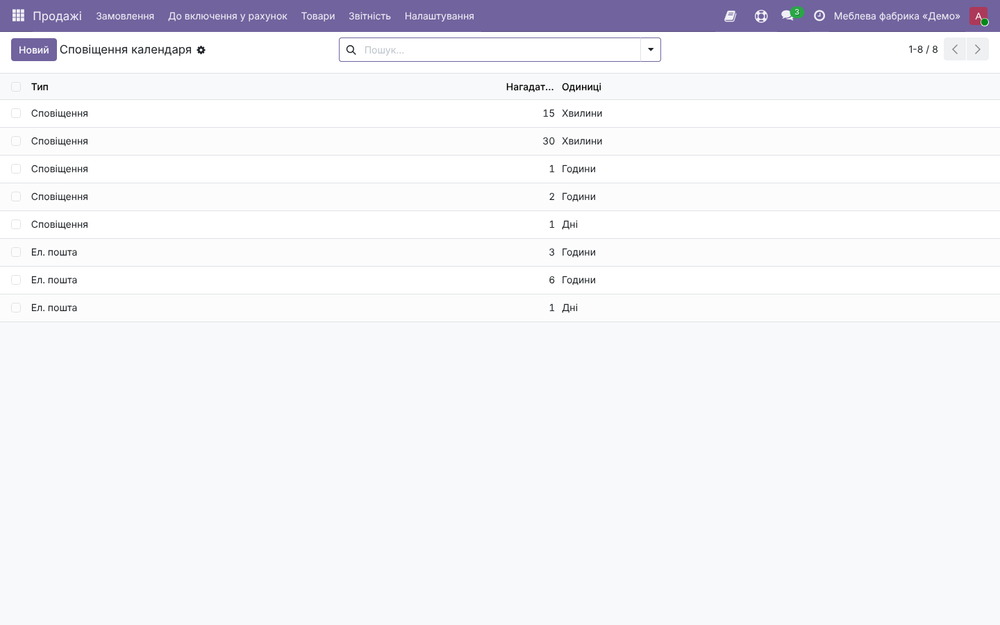

Наслідки: менеджер у нагоді бачить кнопку «Заміри» (поле `crm.lead` «Заміри») і вікна запису; замірник — свої заміри (`zamirnyk.md` SC-07). Відправлення листа потребує налаштованої пошти (`admin.md` § Пошта).
Типова помилка: у замірника немає групи — його немає у виборі замірника.

## Ділові обрізки (партії)
Хто: комірник або адміністратор. Де: «Склад» → «Товари» → «Ділові обрізки». Модель — `stock.lot` (партія товару-плити).

1. Обрізки створює система під час підтвердження завдання розкрою (залишки, не менші за «Мінімальний обрізок»).
2. Вручну (напр. первинний облік): «Склад» → «Товари» → «Партії / Серійні номери» → «Новий»: товар-плита, назва партії, «Діловий обрізок», «Довжина, мм», «Ширина, мм»; кількість — інвентаризацією.

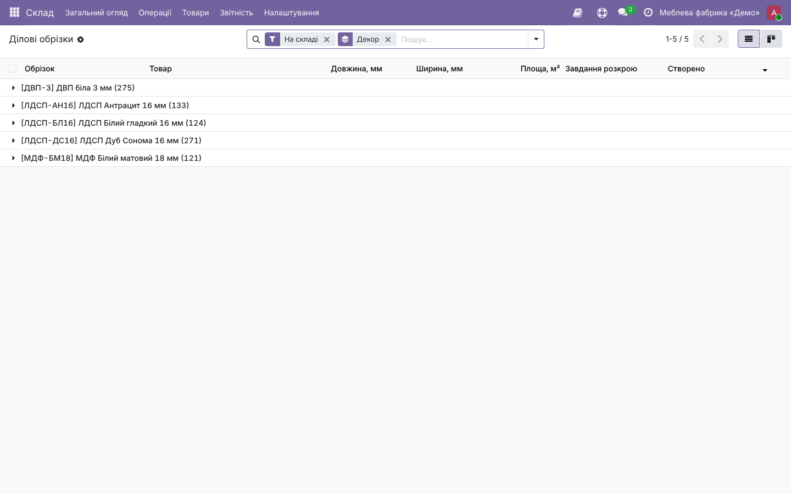

Наслідки: технолог підбирає обрізок під деталь («Підібрати обрізок», `tekhnolog.md` SC-02); службові поля «Площа, м²», «Завдання розкрою», «Зарезервовано для», «Зарезервовано, м²» рахує система.
Типова помилка: розміри не заповнено — обрізок не пропонується жодній деталі.

## Обмін з BAS: канал
Хто: адміністратор. Де: «Виставлення рахунків» → «Обмін з BAS» → «Канали». Модель — довідник `td.mebli.bas.channel`.

1. «Новий»: «Назва», «Відповідальний», «Транспорт» («Файл у теці / вкладення»; «`HTTP`-сервіс BAS» — після контракту обміну), «Дата початку обміну» (документи до цієї дати не передаються).
2. Для транспорту `HTTP` — адреса і ключ (`admin.md` § Обмін з обліковою системою).
3. «Зберегти»; «Передати в BAS» — ручний запуск.

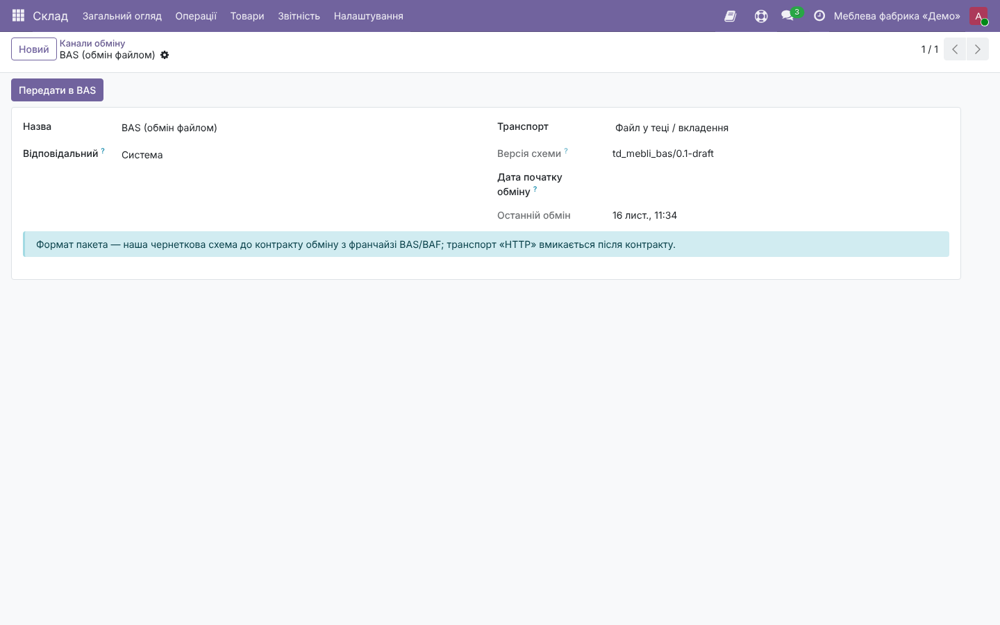

Наслідки: пакети й журнал обміну, позначки «Обмін з BAS» і «Пакет BAS» на рахунках (`account.move`), «Посилання BAS» на оплатах — у фінансиста (`finansyst.md` SC-05).
Типова помилка: «Дата початку обміну» порожня — у перший пакет підуть усі проведені документи, у т. ч. вже внесені в BAS.

## Міграція: порядок імпорту шаблонів і звірка
Хто: адміністратор. Де: «Продажі» → «Налаштування» → «Міграція» → «Порядок імпорту шаблонів» / «Звірка». Моделі — довідник `td.mebli.migration.step` (28 кроків постачаються з модулем) і документи звірки `td.mebli.migration.check`.

1. Відкрийте «Порядок імпорту шаблонів»: кроки за номером, шаблон CSV, модель, «Після кроків», коробка, модуль.
2. У рядку кроку натисніть «Імпортувати» — стандартний імпорт Odoo для моделі кроку: завантажте CSV, перевірте колонки, «Тест», потім «Імпорт». Сірі рядки — модуль не встановлено.
3. Після імпорту — «Звірка» (фінансист, `finansyst.md`).

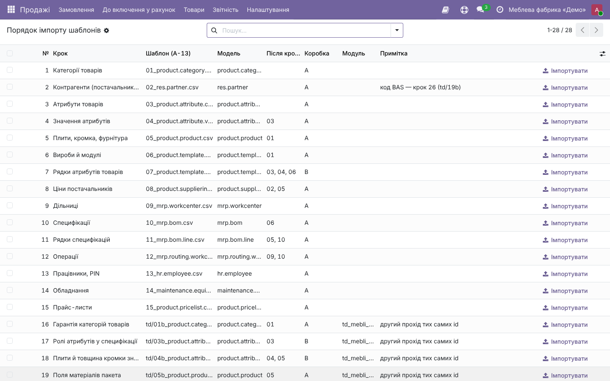

Типова помилка: невідомий зовнішній ідентифікатор батьківського запису — порушено порядок кроків; імпортуйте попередній крок. Детальніше — `package/master-data/README.md` і `admin.md` § Майстер-дані й імпорт.

## Курси валют
Хто: фінансист / адміністратор. Де: «Виставлення рахунків» → «Налаштування» → «Валюти». Поле пакета «Джерело» (`res.currency.rate`) — службове: курс НБУ (або імітація на стенді) ставить розклад «Курси НБУ», ручний курс — без позначки. Вмикання — функція «Курс НБУ» і параметр `td_mebli_ua.nbu_online` (`admin.md` § Локалізація UA). Кадрів немає: поле видно лише в списку курсів.

## База знань і звернення в підтримку
Довідник статей `td.knowledge.article` і звернення `td.support.request` — `admin.md` § База знань (td_knowledge) і § Звернення в підтримку (td_support). Налаштування адреси підтримки — `res.config.settings`, «Налаштування» → блок «Підтримка ToDo».

## Поля пакета на робочих документах
Ці поля `td_*` стоять на стандартних формах документів і заповнюються в роботі (або рахуються системою) — у налаштуванні їх не вводять. Де їх видно і як працювати — посібник ролі:

| Модель (форма) | Де описано |
|---|---|
| `sale.order`, `sale.order.line`, `sale.report` (замовлення на продаж) | `menedzher.md` SC-01; собівартість і маржа — `finansyst.md` SC-05, `kerivnyk.md` SC-06 |
| `crm.lead` (нагода: «Заміри») | `menedzher.md` SC-01, `zamirnyk.md` SC-07 |
| `mrp.production`, `mrp.workorder`, `mrp.workcenter.productivity`, `stock.move` (виробництво, операції, рядки часу, компоненти й аналоги) | `tekhnolog.md` SC-02, `nachalnyk-vyrobnytstva.md` SC-03 |
| `purchase.order` / `purchase.order.line` (історія ціни, затримки), `stock.picking` (комплектувальний лист) | `komirnyk.md` SC-04 |
| `account.move`, `account.payment` (обмін з BAS) | `finansyst.md` SC-05 |
| `project.task` (виїзд монтажу, контроль оплати, акти), `repair.order` (рекламація) | `bryhadyr.md` SC-08 |
| `maintenance.request` (простій дільниці) | `nachalnyk-vyrobnytstva.md` SC-03 |
| `helpdesk.ticket`, `planning.slot` (мости EE) | `admin.md` § Редакції (EE не перевірено) |

## Документи пакета (не налаштовуються)
Власні моделі `td_*`, які є документами чи рядками документів, а не довідниками: завдання й листи розкрою, розміщення деталей, обрізки розкрою, заміри з нішами й технікою, акти монтажу з бригадою й дефектами, позначки оплати, нарахування, зміни замовлення, рядки комплекту, перевірки якості, пакети й журнал BAS. Їх створюють ролі в роботі (посібники ролей, `INDEX.md` «Покриття: розроблене»); перелік з технічними назвами — таблиця (г) `INDEX.md`.
