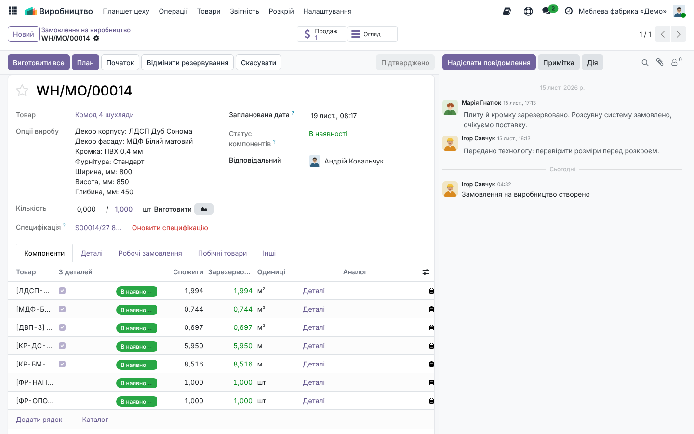
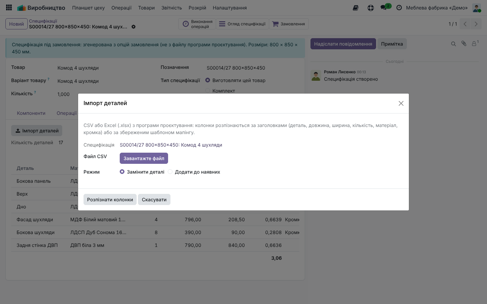
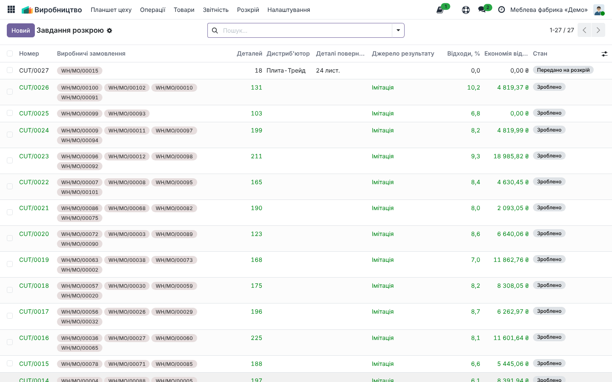
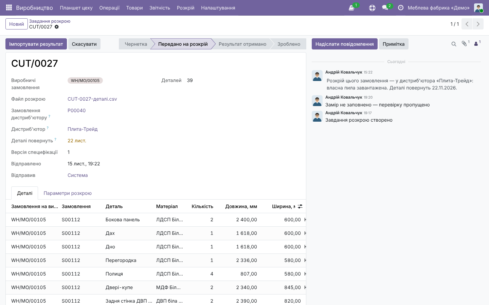
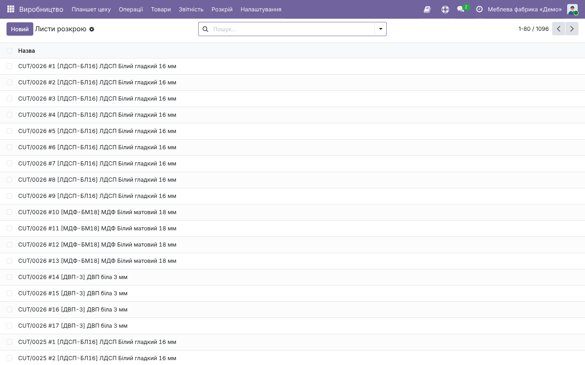
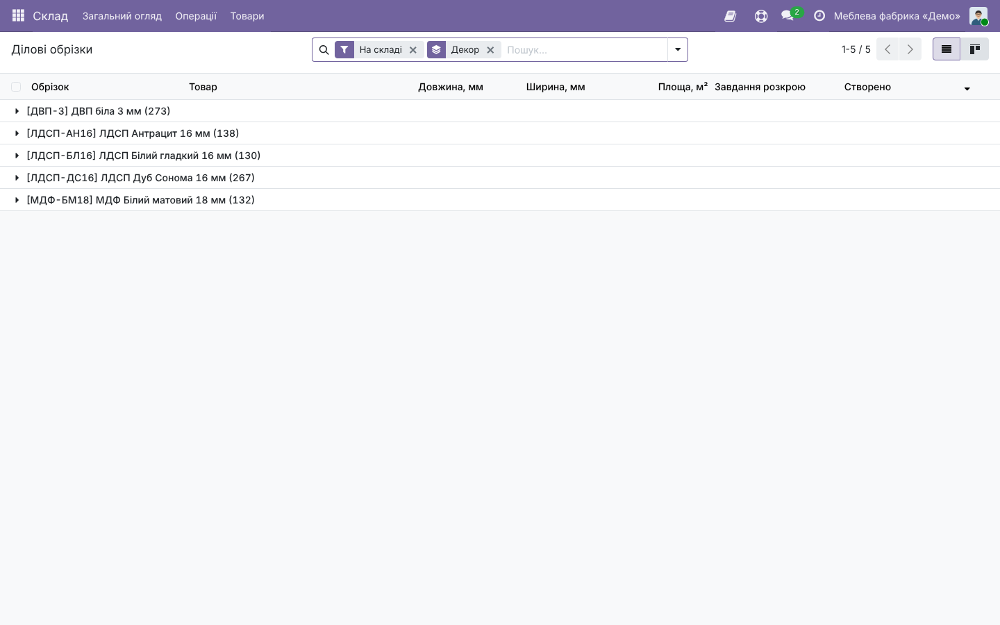
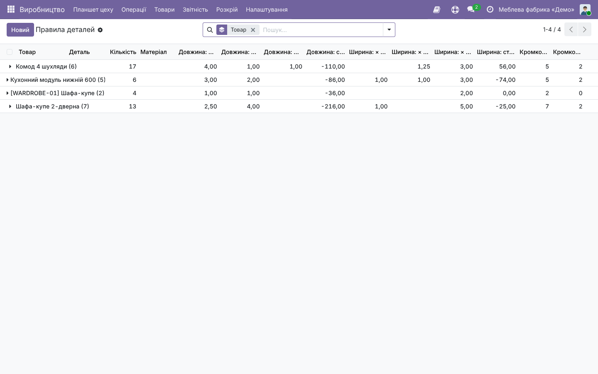

# Посібник: Конструктор-технолог

Для кого: конструктор-технолог (ROLE-01), який готує специфікацію замовлення і передає деталі на розкрій або порізку. Стенд/SHA: див. INDEX.md. Вхід у систему: демо-користувач `tech@demo-fabryka.example` (README стенда).

## SC-02 Від файлу програми проєктування до розкрою й порізки
Коли: на кожне підтверджене замовлення, перед запуском у виробництво.  Результат: специфікація замовлення з деталями, завдання розкрою передане на свій розкрій або в дистриб'ютора, етикетки деталей з QR.
Статус: готово

| № | Дія | Що видно |
|---|---|---|
| 1 | Відкрийте «Виробництво» → «Операції» → виробниче замовлення. Вкладка «Деталі» — деталі тієї самої специфікації, що в рядку замовлення клієнта й у розкрої. | Виробниче замовлення: «Специфікація», «Опції виробу», вкладки «Компоненти», «Деталі», «Робочі замовлення»  |
| 2 | Відкрийте специфікацію замовлення (смарт-кнопка на виробничому замовленні), вкладка «Деталі» → «Імпорт деталей». У вікні «Завантажте файл» (CSV або Excel з програми проєктування), «Режим»: «Замінити деталі» або «Додати до наявних»; натисніть «Розпізнати колонки», перевірте відповідність колонок (шаблон — «Шаблони імпорту») і натисніть «Імпортувати». Кнопки немає, якщо специфікацію вже відправлено на розкрій. Значок «Сформувати специфікацію» в рядку замовлення клієнта перебудовує специфікацію з опцій. Карта присадок з програми проєктування (частина F-01) у пакеті не розроблена: імпортуються лише деталі (AI-22). | Вікно «Імпорт деталей» над специфікацією під замовлення  |
| 3 | Відкрийте «Виробництво» → «Розкрій» → «Завдання розкрою». Нове завдання створюється з виробничого замовлення: у списку виробничих замовлень «Дія» → «Створити завдання розкрою» (кілька замовлень одного декору — одне завдання, коробка B). | Список завдань розкрою з номерами `CUT/…` і станами  |
| 4 | Завдання в стані «Чернетка»: натисніть «Передати на розкрій» (свій розкрій; кнопки немає, якщо «Розкрій плит» = лише дистриб'ютор) — система звіряє проєкт із заміром; якщо є розбіжність, з'явиться попередження («Все одно відправити» — свідоме рішення). Файл деталей для програми розкрою («Файл розкрою») додається до завдання, стан — «Передано на розкрій». Порізка в дистриб'ютора — «Передати дистриб'ютору» (теж із чернетки; замовлення послуги, «Деталі повернуть» іде в прогнозну дату). Якщо в замовлення завдання немає замір-листа, у чаті завдання з'являється «Замір не заповнено — перевірку пропущено», передача не блокується (AC-056). На виробничому замовленні смарт-кнопка «Розкрій» відкриває його завдання розкрою. | Завдання розкрою: стани «Чернетка» → «Передано на розкрій» → «Результат отримано» → «Зроблено»; вкладки «Деталі», «Параметри розкрою»; «Версія специфікації», «Відправлено»  |
| 5 | Коли програма розкрою дала результат, натисніть «Імпортувати результат», оберіть файл і «Імпортувати» — стан «Результат отримано» (повторно — «Імпортувати результат ще раз»). Перевірте листи й натисніть «Підтвердити» — стан «Зроблено». «Скасувати» — з чернетки, переданого або з результатом; скасоване — «Повернути в чернетку». «Отримати результат (імітація)» видно лише в режимі розробника (для стенда без програми розкрою). | Листи розкрою з картою деталей і обрізками: «Виробництво» → «Розкрій» → «Листи розкрою»  |
| 6 | (коробка B) Підберіть діловий обрізок: «Підібрати обрізок» на завданні → оберіть обрізок декору з розмірами не менше деталі → «Зарезервувати під завдання». Вільні обрізки — «Склад» → «Товари» → «Ділові обрізки». | Список ділових обрізків з розмірами  |
| 7 | Надрукуйте етикетки: на виробничому замовленні або замовленні клієнта «Друк» → «Етикетки деталей (QR)». Правила деталей виробів (формули розмірів) — «Виробництво» → «Налаштування» → «Правила деталей». | Правила деталей  |

Типові помилки:
- У файлі немає обов'язкових колонок -> імпорт зупиняється з переліком колонок; виправте заголовки або шаблон імпорту (AC-046).
- Кілька виробничих замовлень з різними плитами в одному завданні (коробка B) -> «В одному завданні розкрою — лише один матеріал плити»: розділіть на завдання за декором (AC-058).
- Невідомий матеріал у файлі -> рядок позначено, деталь не імпортується, доки матеріал не додано в довідник (AC-047).
- «Передати на розкрій» відмовляє: у виробничого замовлення немає деталей -> спершу імпортуйте деталі (AC-054).
- «Передати дистриб'ютору» відмовляє: немає дистриб'ютора порізки -> заповніть «Дистриб'ютор» у «Параметри розкрою» або постачальника порізки в товарі (AC-027). У технолога без прав закупівель кнопка повідомить про брак прав — передайте закупівельнику.

Питання й відповіді (FAQ):
- Чи можна змінити специфікацію після передачі на розкрій? — Відправлена версія зафіксована («Версія специфікації»); зміни — лише дозамовленням (AC-028).
- Скільки деталей можна імпортувати за раз? — Перевірено 300 деталей за один імпорт (AC-048).
- Що робить «AI-підказка колонок»? — У коробці B система пропонує відповідність незнайомих колонок; вмикає адміністратор (AC-050).

Пов'язані AC: AC-027, AC-028, AC-045, AC-046, AC-047, AC-048, AC-049, AC-050, AC-051, AC-052, AC-053, AC-054, AC-055, AC-056, AC-057, AC-058, AC-060, AC-061, AC-131.
Пов'язані функції концепції: F-01, F-02, F-05, F-11, F-27, F-28, F-29, F-30, F-62.

## Довідка й підтримка
Значок «Довідка» (книжка) у верхній панелі — статті до поточного екрана; «Підтримка ToDo» — звернення в підтримку (див. menedzher.md «Довідка й підтримка»).

## Довідник ролі: меню, кнопки, друк
| Що | Де | Для чого |
|---|---|---|
| «Розкрій»: «Завдання розкрою», «Листи розкрою» | Виробництво | завдання на свій розкрій або порізку; результат розкрою по листах |
| «Створити завдання розкрою» | список виробничих замовлень → «Дія» | одне завдання на одне або кілька виробничих замовлень |
| «Передати на розкрій», «Передати дистриб'ютору» (чернетка), «Імпортувати результат» (передано), «Імпортувати результат ще раз», «Підтвердити» (результат отримано → зроблено), «Скасувати», «Повернути в чернетку» (скасоване), «Отримати результат (імітація)» (режим розробника), «Підібрати обрізок» | завдання розкрою | життєвий цикл завдання розкрою |
| «Все одно відправити» | попередження звірки з заміром | передати на розкрій попри розбіжність (рішення технолога) |
| «Зарезервувати під завдання» | вікно підбору обрізка | резерв ділового обрізка під деталь |
| «Імпортувати» | вікно імпорту результату розкрою | завантажити файл результату програми розкрою |
| «Імпорт деталей» (вікно: «Розпізнати колонки», «Імпортувати») | специфікація | деталі з CSV/Excel програми проєктування |
| «Шаблони імпорту», «Правила деталей» | Виробництво → Налаштування | відповідність колонок файлу; формули деталей і межі розмірів виробу |
| «Ділові обрізки» | Склад → Товари | облік обрізків з розмірами (коробка B) |
| «Етикетки деталей (QR)» | виробниче замовлення / замовлення → «Друк» | етикетки деталей з QR для збирання й комплектування |
