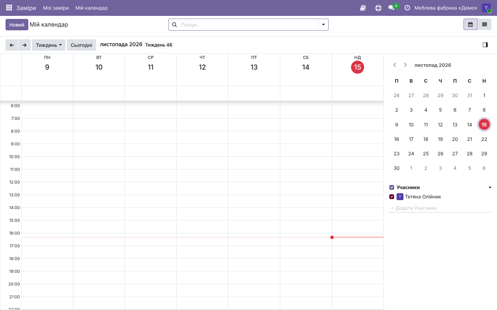

# Посібник: Замірник

Для кого: замірник (ROLE-09), який виїжджає на об'єкт і вносить заміри з телефона. Стенд/SHA: див. INDEX.md. Вхід у систему: демо-користувач `measure@demo-fabryka.example` (README стенда).

## SC-07 Замір без помилки на монтажі
Коли: на кожен виїзд на замір.  Результат: замір-лист з номером `ЗМ/РРРР/NNNN` у картці замовлення; розбіжності проєкту з заміром підсвічені до розкрою.
Статус: готово

| № | Дія | Що видно |
|---|---|---|
| 1 | Відкрийте застосунок «Заміри» → «Мій календар»: лише ваші зустрічі-заміри (з телефона — та сама сторінка, плитки без прокрутки). | Мій календар замірів  |
| 2 | Відкрийте «Заміри» → «Мої заміри»: замір-листи з клієнтом, адресою, станом. | Список «Мої заміри»  |
| 3 | Відкрийте замір-лист і заповніть вкладки «Ніші й розміри», «Техніка клієнта», «Комунікації й фото»; «Приміщення», «Перепад підлоги, мм», «Кут стін, °». Телефон клієнта — з картки. | Замір-лист: стани «Заміряно» → «Звірено з проєктом»  |
| 4 | Після проєкту натисніть «Звірити з проєктом»: техніка, яка не вміщається в нішу, підсвічується з різницею в мм; на замовленні з'являється лічильник «Не вміщається за заміром». | Стан «Звірено з проєктом»; розбіжності видно менеджеру й технологу (див. знімок кроку 3) |

Типові помилки:
- Розміри ніші не внесено -> хибної тривоги немає, рядок не перевіряється (AC-010).
- Відкрити чужий замір або ціну замовлення не можна -> замірник бачить лише свої заміри, без цін (AC-006).

Питання й відповіді (FAQ):
- Чи працює замір-лист з телефона? — Так, форма мобільна (AC-007).
- Хто бачить мої заміри? — Менеджер у картці замовлення («Заміри») і технолог перед розкроєм (AC-055).

Пов'язані AC: AC-005, AC-006, AC-007, AC-008, AC-009, AC-010.
Пов'язані функції концепції: F-19, F-20.

## Довідка й підтримка
Значок «Довідка» (книжка) у верхній панелі — статті до поточного екрана; «Підтримка ToDo» — звернення в підтримку (див. menedzher.md «Довідка й підтримка»).

## Довідник ролі: меню, кнопки, друк
| Що | Де | Для чого |
|---|---|---|
| «Заміри»: «Мій календар», «Мої заміри» | головний екран (застосунок) | свої зустрічі й замір-листи |
| «Звірити з проєктом» | замір-лист | звірка ніш і техніки з проєктом |
