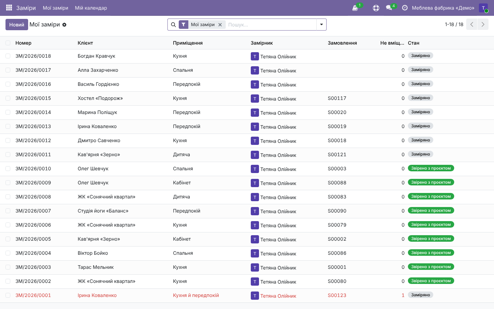
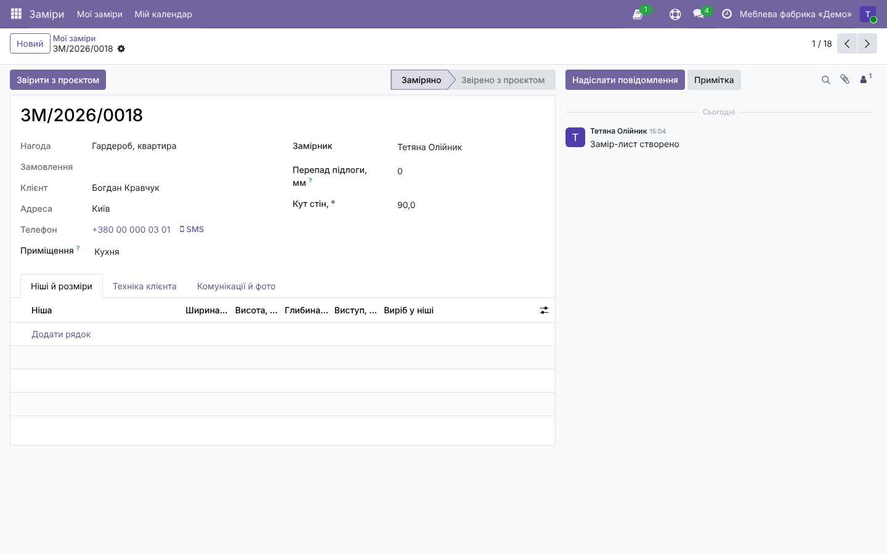

# Посібник: Замірник

Для кого: замірник (ROLE-09), який виїжджає на об'єкт і вносить заміри з телефона. Стенд/SHA: див. INDEX.md. Вхід у систему: демо-користувач `measure@demo-fabryka.example` (README стенда).

## SC-07 Замір без помилки на монтажі
Коли: на кожен виїзд на замір.  Результат: замір-лист з номером `ЗМ/РРРР/NNNN` у картці замовлення; розбіжності проєкту з заміром підсвічені до розкрою.
Статус: готово

| № | Дія | Що видно |
|---|---|---|
| 1 | Відкрийте застосунок «Заміри» → «Мій календар» (подання «Тиждень»; стрілка «→» — наступний тиждень, «Сьогодні» — повернутись): лише ваші зустрічі-заміри (з телефона — та сама сторінка, плитки без прокрутки). | Мій календар замірів  |
| 2 | Відкрийте «Заміри» → «Мої заміри»: замір-листи з клієнтом, адресою, станом. | Список «Мої заміри»  |
| 3 | Відкрийте замір-лист і заповніть вкладки «Ніші й розміри», «Техніка клієнта», «Комунікації й фото»; «Приміщення», «Перепад підлоги, мм», «Кут стін, °». Телефон клієнта — з картки. | Замір-лист: стани «Заміряно» → «Звірено з проєктом»  |
| 4 | Після проєкту натисніть «Звірити з проєктом». Система звіряє три числа за правилами, без AI (AC-008, AC-009): (1) техніка клієнта проти своєї ніші — ширина, висота, глибина, де глибина ніші зменшується на «Виступ, мм» (труба, короб); (2) виріб, поставлений у нішу («Виріб у ніші» — рядок замовлення), — його ширина, висота, глибина з рядка замовлення проти корисного розміру ніші; (3) найдовша деталь специфікації цього виробу проти більшого з розмірів ніші. Кожна невідповідна пара (техніка > модуль, модуль > ніша) підсвічується з різницею в мм («Не вміщається: глибше на 30 мм»), на замовленні — лічильник «Не вміщається» і перелік «Проєкт проти заміру» для технолога перед розкроєм. Звіряються лише внесені числа: порожній розмір не перевіряється (AC-010). | Стан «Звірено з проєктом»; якщо все вміщається — запис у чаті «Уся техніка вміщається в ніші» (див. знімок кроку 3) |

Типові помилки (усі повідомлення системи дослівно — `reference/messages.md`):
- Розміри ніші не внесено -> хибної тривоги немає, рядок не перевіряється (AC-010).
- Немає вільних вікон запису -> робочий графік замірника й нагадування налаштовує адміністратор (`setup.md` § Заміри: графік і нагадування).
- Відкрити чужий замір або ціну замовлення не можна -> замірник бачить лише свої заміри, без цін (AC-006).

Питання й відповіді (FAQ):
- Чи працює замір-лист з телефона? — Так, форма мобільна (AC-007).
- Хто бачить мої заміри? — Менеджер у картці замовлення («Заміри») і технолог перед розкроєм (AC-055).

Пов'язані AC: AC-005, AC-006, AC-007, AC-008, AC-009, AC-010.
Пов'язані функції концепції: F-19, F-20.

## Довідка й підтримка
Значок «Довідка» (книжка) у верхній панелі — статті до поточного екрана; «Підтримка ToDo» — звернення в підтримку (див. menedzher.md «Довідка й підтримка»).

## Довідник ролі: меню, кнопки, друк
| Що | Де | Для чого |
|---|---|---|
| «Заміри»: «Мій календар», «Мої заміри» | головний екран (застосунок) | свої зустрічі й замір-листи |
| «Звірити з проєктом» | замір-лист | звірка ніш і техніки з проєктом |
